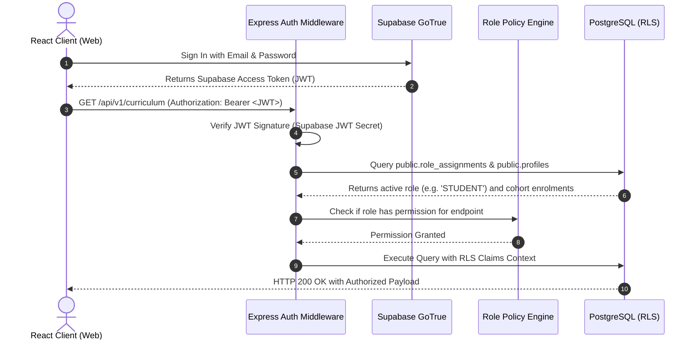
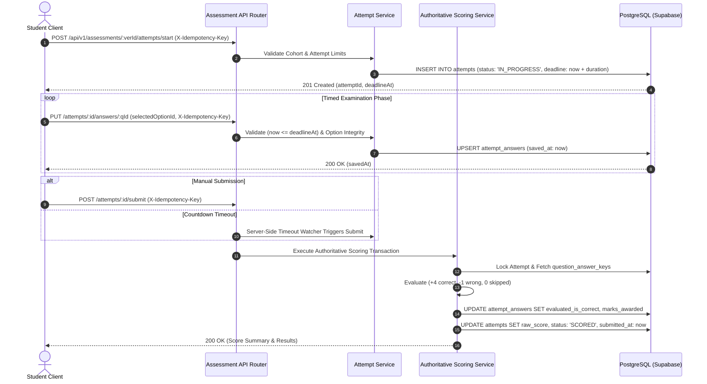
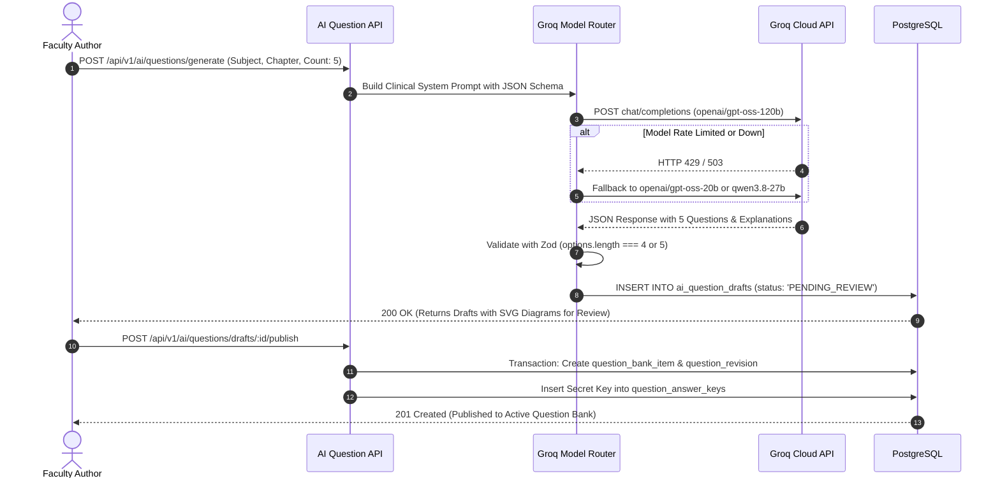

# NEET Prep LMS — Production REST API Specification & Architecture Design

**Document Version:** 1.0.0  
**Specification Standard:** RESTful JSON API / OpenAPI 3.0.3 Compatible  
**Target Architecture:** Node.js, Express.js, TypeScript, PostgreSQL 15+ (Supabase)  
**Primary Sources of Truth:** `project_overview.md` (v2.0) and `folder_structure.md`  

---

## Table of Contents

1. [Architectural Overview & Engineering Principles](#1-architectural-overview--engineering-principles)
2. [Global API Protocols & Conventions](#2-global-api-protocols--conventions)
   - 2.1 [Base URI & Versioning Strategy](#21-base-uri--versioning-strategy)
   - 2.2 [Standard Request Headers](#22-standard-request-headers)
   - 2.3 [Standard Response Envelopes](#23-standard-response-envelopes)
   - 2.4 [Error Handling & Error Code Dictionary](#24-error-handling--error-code-dictionary)
   - 2.5 [Pagination, Sorting & Filtering Standards](#25-pagination-sorting--filtering-standards)
3. [Authentication, Authorization & Database RLS Integration](#3-authentication-authorization--database-rls-integration)
   - 3.1 [Supabase JWT Bearer Authentication Flow](#31-supabase-jwt-bearer-authentication-flow)
   - 3.2 [Role-Based Access Control (RBAC) & Permission Policy Matrix](#32-role-based-access-control-rbac--permission-policy-matrix)
   - 3.3 [Database Row-Level Security (RLS) Context Injection](#33-database-row-level-security-rls-context-injection)
   - 3.4 [Audited Administrative Impersonation ("View As")](#34-audited-administrative-impersonation-view-as)
4. [Security Architecture, Protection & Rate Limiting](#4-security-architecture-protection--rate-limiting)
   - 4.1 [Tiered Rate Limiting Policies](#41-tiered-rate-limiting-policies)
   - 4.2 [Zero-Leakage Answer Key Protection Architecture](#42-zero-leakage-answer-key-protection-architecture)
   - 4.3 [Idempotency & Assessment Integrity](#43-idempotency--assessment-integrity)
   - 4.4 [Storage Security & Signed URLs](#44-storage-security--signed-urls)
5. [Complete API Module & Endpoint Catalog](#5-complete-api-module--endpoint-catalog)
   - Module 01: [System Health & Diagnostics (`/health`)](#module-01-system-health--diagnostics-health)
   - Module 02: [Authentication & Session (`/auth`)](#module-02-authentication--session-auth)
   - Module 03: [User Management & Roles (`/users`)](#module-03-user-management--roles-users)
   - Module 04: [Student Domain & Profiles (`/students`)](#module-04-student-domain--profiles-students)
   - Module 05: [Faculty Domain & Staffing (`/faculty`)](#module-05-faculty-domain--staffing-faculty)
   - Module 06: [Exam Definitions & Blueprints (`/exams`, `/blueprints`)](#module-06-exam-definitions--blueprints-exams-blueprints)
   - Module 07: [3-Tier Academic Curriculum (`/curriculum`)](#module-07-3-tier-academic-curriculum-curriculum)
   - Module 08: [Academic Years, Programs & Cohort Batches (`/academic-years`, `/programs`, `/cohorts`)](#module-08-academic-years-programs--cohort-batches-academic-years-programs-cohorts)
   - Module 09: [Student Enrollments & Transfers (`/enrollments`)](#module-09-student-enrollments--transfers-enrollments)
   - Module 10: [Learning Resources & Protected Media (`/resources`)](#module-10-learning-resources--protected-media-resources)
   - Module 11: [Question Bank & Revision Lifecycle (`/questions`)](#module-11-question-bank--revision-lifecycle-questions)
   - Module 12: [Protected Answer Keys Administration (`/questions/:id/answer-keys`)](#module-12-protected-answer-keys-administration-questionsidanswer-keys)
   - Module 13: [Assessment Definitions & Versions (`/assessments`)](#module-13-assessment-definitions--versions-assessments)
   - Module 14: [Assessment Attempts & Autosave Engine (`/attempts`)](#module-14-assessment-attempts--autosave-engine-attempts)
   - Module 15: [Server-Authoritative Scoring & Adjudication (`/attempts/:id/submit`, `/score-adjustments`)](#module-15-server-authoritative-scoring--adjudication-attemptsidsubmit-score-adjustments)
   - Module 16: [Student Performance Analytics & Diagnostic Reports (`/analytics`)](#module-16-student-performance-analytics--diagnostic-reports-analytics)
   - Module 17: [AI Question Generator with Multi-Model Fallback (`/ai/questions`)](#module-17-ai-question-generator-with-multi-model-fallback-aiquestions)
   - Module 18: [Student AI Academic Assistant (`/ai/assistant`)](#module-18-student-ai-academic-assistant-aiassistant)
   - Module 19: [Student Academic Documents & Verification (`/documents`)](#module-19-student-academic-documents--verification-documents)
   - Module 20: [Announcements & Emergency Broadcasting (`/announcements`)](#module-20-announcements--emergency-broadcasting-announcements)
   - Module 21: [Academic Calendar & Exam Deadlines (`/calendar`)](#module-21-academic-calendar--exam-deadlines-calendar)
   - Module 22: [Community Forums & Content Moderation (`/community`)](#module-22-community-forums--content-moderation-community)
   - Module 23: [Immutable Audit Logging (`/audit`)](#module-23-immutable-audit-logging-audit)
   - Module 24: [Operational Administration & Telemetry (`/admin`)](#module-24-operational-administration--telemetry-admin)
6. [Specialized Real-World Workflows](#6-specialized-real-world-workflows)
   - 6.1 [Authoritative Assessment Lifecycle & Scoring Pipeline](#61-authoritative-assessment-lifecycle--scoring-pipeline)
   - 6.2 [AI Question Generation, Review & 1-Click Publishing Pipeline](#62-ai-question-generation-review--1-click-publishing-pipeline)
   - 6.3 [Student Cohort Transfer & Access Invalidation Workflow](#63-student-cohort-transfer--access-invalidation-workflow)
7. [Database Alignment & Gap Analysis](#7-database-alignment--gap-analysis)
8. [Backend Modular Monolith Codebase Mapping](#8-backend-modular-monolith-codebase-mapping)

---

# 1. Architectural Overview & Engineering Principles

The NEET Prep LMS REST API is engineered as a high-security, domain-driven **modular monolith** written in TypeScript on Node.js and Express.js, connecting to a PostgreSQL 15+ database managed via Supabase.

### Core Architectural Principles

1. **Stateless Business Layer:** The Express API instances store zero session state in local memory. All authentication relies on cryptographically verified Supabase JWTs, and shared state is persisted in PostgreSQL.
2. **Server-Authoritative Business Truth:** Sensitive operations (such as assessment evaluation, score calculation, deadline expiration, role assignment, and cohort access verification) are executed and enforced strictly on the backend. Client devices are never trusted for scores or permissions.
3. **Defense-in-Depth Authorization:** Security is enforced at three distinct layers:
   - **Network & Gateway:** Reverse proxy TLS termination, rate limiting, and CORS allowlisting.
   - **Application Layer (Express):** Middleware-level JWT verification, RBAC permission checking (`authorize(['ADMIN', 'FACULTY'])`), and cohort-tenancy validation.
   - **Database Layer (PostgreSQL):** Row-Level Security (RLS) enforcing tenant isolation, role constraints, and view boundaries directly on PostgreSQL tables.
4. **Zero Client Leakage of Evaluative Data:** Active student examination payloads strictly omit correct answer indexes, explanations, scoring keys, and evaluation logic.
5. **Idempotent Operational Mutation:** Critical mutations (submitting an assessment attempt, saving an answer under poor network conditions, processing an AI generation job) accept an `X-Idempotency-Key` to eliminate race conditions and double submissions.

---

# 2. Global API Protocols & Conventions

## 2.1 Base URI & Versioning Strategy

All production API routes are strictly versioned via the URI path:

$$\text{Base URI: } \texttt{https://api.neetpreplms.institute.com/api/v1}$$

- Non-breaking changes (e.g. adding new optional fields) are rolled out within the same major version.
- Breaking schema modifications mandate a version increment (`/api/v2`).

## 2.2 Standard Request Headers

| Header | Type | Required | Description |
|---|---|---|---|
| `Authorization` | `string` | Yes (for protected endpoints) | Standard Bearer token: `Bearer <supabase_jwt_access_token>`. |
| `Content-Type` | `string` | Conditional | Must be `application/json` for requests with a payload body. |
| `X-Request-ID` | `string (UUIDv4)` | Optional (Auto-generated if absent) | Unique client trace ID attached to server access logs and error responses. |
| `X-Idempotency-Key` | `string` | Optional (Required on `/submit` & `/answers`) | Unique token (UUID or hash) ensuring identical retry requests are executed exactly once. |
| `X-Support-Session` | `string (UUIDv4)` | Conditional | Required when an administrator executes an audited "View As" impersonation request. |

## 2.3 Standard Response Envelopes

Every JSON response follows a predictable envelope structure.

### Successful Response Envelope (`HTTP 200 / 201`)
```json
{
  "success": true,
  "data": { ... },
  "metadata": {
    "requestId": "a0f8b1c4-7d23-4b9a-8e2f-5d1b7a9c3e4f",
    "timestamp": "2026-11-05T12:00:00.000Z"
  }
}
```

### Paginated Collection Response Envelope
```json
{
  "success": true,
  "data": [ ... ],
  "pagination": {
    "page": 1,
    "limit": 20,
    "total": 142,
    "totalPages": 8,
    "hasNext": true,
    "hasPrev": false
  },
  "metadata": {
    "requestId": "a0f8b1c4-7d23-4b9a-8e2f-5d1b7a9c3e4f",
    "timestamp": "2026-11-05T12:00:00.000Z"
  }
}
```

### Error Response Envelope (`HTTP 4xx / 5xx`)
```json
{
  "success": false,
  "error": {
    "code": "VALIDATION_FAILED",
    "message": "The request body failed schema validation.",
    "details": [
      {
        "field": "duration_seconds",
        "message": "Duration must be an integer between 300 and 14400."
      }
    ]
  },
  "metadata": {
    "requestId": "a0f8b1c4-7d23-4b9a-8e2f-5d1b7a9c3e4f",
    "timestamp": "2026-11-05T12:00:00.000Z"
  }
}
```

## 2.4 Error Handling & Error Code Dictionary

The API returns standard HTTP status codes mapped to domain-specific error codes:

| HTTP Status | Domain Error Code | Description |
|---|---|---|
| `400 Bad Request` | `INVALID_INPUT` / `VALIDATION_FAILED` | Malformed JSON or input validation failure (Zod error). |
| `401 Unauthorized` | `AUTH_TOKEN_MISSING` / `AUTH_TOKEN_EXPIRED` / `AUTH_TOKEN_INVALID` | Missing or invalid Supabase JWT bearer token. |
| `403 Forbidden` | `FORBIDDEN_ROLE` / `COHORT_ACCESS_DENIED` / `ACCOUNT_SUSPENDED` | Authenticated user lacks permission or cohort entitlement. |
| `404 Not Found` | `RESOURCE_NOT_FOUND` / `ASSESSMENT_NOT_FOUND` | Referenced entity UUID does not exist. |
| `409 Conflict` | `ACTIVE_ATTEMPT_EXISTS` / `RESOURCE_CONFLICT` | Precondition conflict (e.g. attempting to start a test while another is in progress). |
| `410 Gone` | `ASSESSMENT_WINDOW_CLOSED` | Attempt action rejected because assessment deadline or window has expired. |
| `422 Unprocessable` | `INVALID_QUESTION_FORMAT` / `UNPROCESSABLE_ENTITY` | Semantic validation failure on syntactically valid data. |
| `429 Too Many Requests`| `RATE_LIMIT_EXCEEDED` | Client surpassed allowed request threshold. |
| `500 Server Error` | `INTERNAL_SERVER_ERROR` | Unhandled runtime exception (stack trace suppressed). |
| `502 Bad Gateway` | `AI_PROVIDER_ERROR` | Upstream Groq LLM API failure after exhausted fallbacks. |
| `503 Service Unavailable`| `SERVICE_DEGRADED` | Database connection saturation or scheduled maintenance. |

## 2.5 Pagination, Sorting & Filtering Standards

All collection endpoints support standardized query parameters:
- `page`: 1-based index (default: `1`).
- `limit`: items per page (default: `20`, maximum: `100`).
- `sortBy`: target database column (e.g., `createdAt`, `displayOrder`, `title`).
- `sortOrder`: sort direction, either `asc` or `desc` (default: `desc`).
- `filter[<field>]`: exact match filter (e.g., `filter[subjectId]=...`, `filter[status]=PUBLISHED`).
- `search`: case-insensitive text search string (URL-encoded).

---

# 3. Authentication, Authorization & Database RLS Integration

## 3.1 Supabase JWT Bearer Authentication Flow



1. The client signs in via Supabase Auth and acquires an RS256/HS256 signed JWT.
2. The Express `authenticate.ts` middleware verifies token expiration and cryptographic validity.
3. The user ID (`sub`) is resolved against `public.profiles` and `public.role_assignments`.
4. If the account status is `SUSPENDED` or `INACTIVE`, the request is immediately rejected with HTTP `403 ACCOUNT_SUSPENDED`.
5. The verified user identity is attached to the Express request object as `req.user`:
   ```typescript
   interface AuthenticatedUser {
     id: string;              // auth.users UUID
     profileId: string;       // public.profiles UUID
     email: string;
     role: 'STUDENT' | 'FACULTY' | 'ADMIN';
     studentId?: string;      // public.students UUID (if student)
     facultyId?: string;      // public.faculty UUID (if faculty)
     activeCohortId?: string; // Currently active cohort from student_enrollments
     isImpersonated?: boolean;
     auditActorId?: string;
   }
   ```

## 3.2 Role-Based Access Control (RBAC) & Permission Policy Matrix

| Functional Module / Action | STUDENT | FACULTY | ADMIN | Special Constraints |
|---|---|---|---|---|
| Read Curriculum (Subjects, Chapters, Topics) | Yes | Yes | Yes | Authenticated scope |
| Read Learning Resources (Notes, Books, Videos) | Cohort Only | Assigned Scope | All | Published status only for students |
| Upload Learning Resources | No | Yes | Yes | Files stored in private S3 bucket |
| Delete Learning Resources | No | No | Yes | Administrative governance rule |
| Create Question Drafts | No | Yes | Yes | Single-select MCQ standard |
| AI Question Generation | No | Yes | Yes | Rate-limited per faculty |
| Approve AI Question Drafts | No | Yes | Yes | Requires faculty peer review |
| Read Question Answer Keys | **NO** | Assigned Scope | Yes | **Never exposed to student clients** |
| Create & Publish Assessment Versions | No | Yes | Yes | Freezes scoring profile & questions |
| Start Assessment Attempt | Yes | Test Account Only | Test Account Only | Must have active cohort enrollment |
| Save Answers & Auto-Timeout | Yes | No | No | Owner-only, within active window |
| Evaluate & Score Attempt | System Only | System Only | System Only | Authoritative backend scoring |
| View Test Results & Analytics | After Release | Assigned Cohort | Institute-wide | Subject to `result_release_policy` |
| Verify Admission Documents | No | No | Yes | Admin & Agent verification desk |
| Enroll / Transfer Students | No | No | Yes | Creates immutable audit record |
| Read Security Audit Logs | No | No | Yes | JSON/CSV export capabilities |

## 3.3 Database Row-Level Security (RLS) Context Injection

When the Express repository layer queries Supabase, it configures the PostgreSQL session settings so database-level RLS policies execute in the exact context of the authenticated caller:

```typescript
// Repository execution pattern within a transaction
await db.tx(async (t) => {
  await t.none(`SET LOCAL "request.jwt.claim.sub" = $1;`, [req.user.id]);
  await t.none(`SET LOCAL "request.jwt.claim.role" = $1;`, [req.user.role]);
  return await t.any(query, params);
});
```
This guarantees that even if application-level logic has an unexpected flaw, PostgreSQL's RLS engine drops unauthorized rows at the storage engine boundary.

## 3.4 Audited Administrative Impersonation ("View As")

To diagnose student issues without credential compromise:
1. Administrator requests a short-lived support token via `POST /api/v1/admin/support-sessions`.
2. The session creates an immutable audit entry in `public.audit_logs` specifying `SUPPORT_SESSION_STARTED`.
3. Requests carrying `X-Support-Session` header execute with the student's read boundaries, but write mutations are strictly blocked (`403 IMPERSONATION_READ_ONLY`).
4. Terminating the session records `SUPPORT_SESSION_ENDED`.

---

# 4. Security Architecture, Protection & Rate Limiting

## 4.1 Tiered Rate Limiting Policies

Implemented via Redis-backed token bucket algorithm (`rate-limit.ts`):

| Limiter Scope | Target Endpoints | Threshold (Per Window) | Action on Breach |
|---|---|---|---|
| **Tier 1: Authentication** | `POST /auth/login`, `POST /auth/refresh` | 5 requests / 1 minute / IP | HTTP 429 + 15 min lock on 5 failures |
| **Tier 2: Assessment Autosave** | `PUT /attempts/:id/answers/:qId` | 120 requests / 1 minute / User | HTTP 429 with `Retry-After: 1` |
| **Tier 3: AI Generation** | `POST /ai/questions/generate` | 10 requests / 1 hour / Faculty | HTTP 429 (`AI_GENERATION_QUOTA_EXCEEDED`) |
| **Tier 4: File Download URL** | `POST /resources/:id/signed-url` | 30 requests / 1 minute / User | HTTP 429 (`DOWNLOAD_BURST_EXCEEDED`) |
| **Tier 5: General API** | All other `GET`, `POST`, `PATCH` routes | 300 requests / 1 minute / User | HTTP 429 standard throttle |

## 4.2 Zero-Leakage Answer Key Protection Architecture

```mermaid
flowchart TD
    subgraph ClientZone["Client Zone (Browser)"]
        StudentClient["Student Active Quiz Runner"]
    end

    subgraph APILayer["Express API Layer"]
        AttemptCtrl["Attempt Controller"]
        AttemptSvc["Attempt Service"]
        ScoringEngine["Authoritative Scoring Engine"]
    end

    subgraph DBZone["PostgreSQL Database"]
        QRevisions["public.question_revisions<br/>(question_text, diagram, options A-D)"]
        AnswerKeys["public.question_answer_keys<br/>(accepted_option_ids, resolution_type)"]
        AttemptAnswers["public.attempt_answers<br/>(selected_option_id, evaluated_is_correct)"]
    end

    StudentClient -->|GET /attempts/:id/questions| AttemptCtrl
    AttemptCtrl --> AttemptSvc
    AttemptSvc -->|SELECT sanitized options ONLY| QRevisions
    QRevisions -->> StudentClient: Returns text, options, diagrams (NO KEYS)

    StudentClient -->|POST /attempts/:id/submit| AttemptCtrl
    AttemptCtrl --> ScoringEngine
    ScoringEngine -->|Internal Query| AnswerKeys
    ScoringEngine -->|Evaluate & Score| AttemptAnswers
    AttemptAnswers -->> ScoringEngine: Computed Results
    ScoringEngine -->> StudentClient: HTTP 200 (Score Summary post-release)

    style AnswerKeys fill:#ff4d4f,stroke:#333,stroke-width:2px,color:#fff
```

- When `GET /api/v1/attempts/:id/questions` is invoked, the repository projects **only**: `id`, `question_text`, `diagram_storage_path`, and `question_revision_options` (`id`, `option_label`, `option_text`).
- The database table `question_answer_keys` is **never joined or queried** by student-accessible endpoints.
- Scoring is triggered exclusively on `POST /attempts/:id/submit` or auto-timeout, running in an isolated backend transaction.

## 4.3 Idempotency & Assessment Integrity

- All answer-save and submission requests require the `X-Idempotency-Key` header.
- The server stores the hash of the request payload and resulting response in Redis/PostgreSQL for 24 hours.
- Repeated submissions with the same key immediately return the original cached response without re-triggering scoring mutations.

## 4.4 Storage Security & Signed URLs

- Direct public access to the Supabase Storage bucket (`resources`, `documents`) is strictly disabled (`public = false`).
- Binary assets are accessed via HMAC-signed expiring URLs generated via `POST /api/v1/resources/:id/signed-url`:
  - Token validity is restricted to **15 minutes**.
  - Generated URLs include `Content-Disposition: inline` to prevent involuntary downloads while supporting the protected in-app PDF/video canvas reader.
  - Per-user dynamic watermarks (name, email, timestamp) are applied on document reading sections.

---

# 5. Complete API Module & Endpoint Catalog

---

### Module 01: System Health & Diagnostics (`/health`)
*Maps to: `apps/api/src/modules/health/`*

#### `GET /api/v1/health`
- **Description:** Verifies service availability, memory utilization, and PostgreSQL connectivity ping.
- **RBAC:** Public (unauthenticated).
- **Responses:**
  - `200 OK`:
    ```json
    {
      "success": true,
      "data": {
        "status": "HEALTHY",
        "version": "1.0.0",
        "uptimeSeconds": 84210,
        "database": {
          "status": "CONNECTED",
          "latencyMs": 12
        },
        "storage": {
          "status": "CONNECTED"
        }
      }
    }
    ```
  - `503 Service Unavailable`: Database ping timeout or failure.

---

### Module 02: Authentication & Session (`/auth`)
*Maps to: `apps/api/src/modules/auth/`*

#### `POST /api/v1/auth/login`
- **Description:** Authenticates credentials against Supabase GoTrue, verifies account status, and returns session tokens with role claims.
- **RBAC:** Public.
- **Rate Limit:** Tier 1 (5 req/min).
- **Request Body:**
  ```json
  {
    "email": "student@institute.com",
    "password": "SecurePassword123!"
  }
  ```
- **Responses:**
  - `200 OK`:
    ```json
    {
      "success": true,
      "data": {
        "accessToken": "eyJhbGciOiJSUzI1NiIs...",
        "refreshToken": "v1.MRj8...",
        "expiresIn": 3600,
        "tokenType": "Bearer",
        "user": {
          "id": "e4b2d5a1-7c98-4b11-9a2f-1e8b7c6d5e4f",
          "fullName": "Aarav Patel",
          "email": "student@institute.com",
          "role": "STUDENT",
          "cohortId": "c8b4d2e1-5f6a-4b9a-8e2f-5d1b7a9c3e4f",
          "cohortName": "Batch 1 (Dec)"
        }
      }
    }
    ```
  - `401 Unauthorized`: `AUTH_TOKEN_INVALID` (incorrect credentials).
  - `403 Forbidden`: `ACCOUNT_SUSPENDED` (account locked by administrator).

#### `POST /api/v1/auth/refresh`
- **Description:** Exchanges a valid refresh token for a new access token.
- **Request Body:** `{ "refreshToken": "v1.MRj8..." }`
- **Response:** `200 OK` with renewed access token.

#### `POST /api/v1/auth/logout`
- **Description:** Revokes the authenticated user's current session token.
- **RBAC:** Authenticated (`STUDENT`, `FACULTY`, `ADMIN`).
- **Response:** `200 OK` `{ "success": true, "message": "Session terminated." }`.

---

### Module 03: User Management & Roles (`/users`)
*Maps to: `apps/api/src/modules/users/`*

#### `GET /api/v1/users/me`
- **Description:** Retrieves the authenticated user's profile, role assignments, and active cohort details.
- **RBAC:** Authenticated.
- **Response:** `200 OK` returning `profiles`, `role_assignments`, and student/faculty metadata.

#### `PATCH /api/v1/users/me`
- **Description:** Updates allowed profile attributes (e.g. `phone`, `avatar_path`, `locale`).
- **RBAC:** Authenticated.
- **Request Body:**
  ```json
  {
    "phone": "+919876543210",
    "locale": "en"
  }
  ```
- **Response:** `200 OK` with updated profile.

#### `GET /api/v1/admin/users`
- **Description:** Lists all users across the institute with filtering and search.
- **RBAC:** `ADMIN`.
- **Query Params:** `page`, `limit`, `filter[role]`, `filter[status]`, `search`.
- **Response:** `200 OK` with paginated user collection.

#### `POST /api/v1/admin/users/invite`
- **Description:** Creates an authorized faculty or student account invitation without self-registration escalation risks.
- **RBAC:** `ADMIN`.
- **Request Body:**
  ```json
  {
    "email": "dr.rao@institute.com",
    "fullName": "Dr. Sunita Rao",
    "role": "FACULTY",
    "designation": "Senior Faculty of Biology",
    "department": "Biological Sciences"
  }
  ```
- **Response:** `201 Created`.

#### `PATCH /api/v1/admin/users/:id/status`
- **Description:** Updates account state (`ACTIVE`, `SUSPENDED`, `INACTIVE`).
- **RBAC:** `ADMIN`.
- **Request Body:** `{ "status": "SUSPENDED", "reason": "Academic integrity review pending" }`
- **Response:** `200 OK`.

#### `POST /api/v1/admin/users/:id/roles`
- **Description:** Assigns or revokes a user role through verified server-side logic.
- **RBAC:** `ADMIN`.
- **Request Body:** `{ "role": "FACULTY", "action": "GRANT", "reason": "Department promotion" }`
- **Response:** `200 OK`.

---

### Module 04: Student Domain & Profiles (`/students`)
*Maps to: `apps/api/src/modules/students/`*

#### `GET /api/v1/students/me/dashboard`
- **Description:** Aggregated student home dashboard: active batch, attendance summary, upcoming assessments, study progress, and recent announcements.
- **RBAC:** `STUDENT`.
- **Response:** `200 OK` with consolidated dashboard payload.

#### `GET /api/v1/students/me/progress`
- **Description:** Returns syllabus completion metrics across the 7 core subjects.
- **RBAC:** `STUDENT`.
- **Response:** `200 OK` with topic completion arrays and percentage by subject.

#### `POST /api/v1/students/me/progress/topics/:topicId`
- **Description:** Toggles student self-study completion state on a specific curriculum topic.
- **RBAC:** `STUDENT`.
- **Request Body:** `{ "status": "COMPLETED" }`
- **Response:** `200 OK` (updates `student_topic_progress` table).

---

### Module 05: Faculty Domain & Staffing (`/faculty`)
*Maps to: `apps/api/src/modules/faculty/`*

#### `GET /api/v1/faculty/me/dashboard`
- **Description:** Executive faculty summary: assigned cohorts, authored questions, published resources, and pending review tasks.
- **RBAC:** `FACULTY`.
- **Response:** `200 OK`.

#### `GET /api/v1/faculty/me/cohorts`
- **Description:** Retrieves cohorts assigned to the faculty member via `faculty_assignments`.
- **RBAC:** `FACULTY`.
- **Response:** `200 OK` listing assigned batches.

#### `GET /api/v1/faculty/cohorts/:cohortId/progress`
- **Description:** Inspects curriculum progress and topic completion rates of students in the assigned cohort.
- **RBAC:** `FACULTY`, `ADMIN`.
- **Response:** `200 OK` with student-by-student progress breakdown.

---

### Module 06: Exam Definitions & Blueprints (`/exams`, `/blueprints`)
*Maps to: `apps/api/src/modules/exam-catalog/`*

#### `GET /api/v1/exams`
- **Description:** Lists supported competitive entrance examinations (NEET-UG, etc.).
- **RBAC:** Authenticated.
- **Response:** `200 OK` returning active exam catalog.

#### `GET /api/v1/exams/:examId/blueprints`
- **Description:** Lists versioned syllabus blueprints for an exam.
- **RBAC:** Authenticated.
- **Response:** `200 OK` listing blueprints (e.g. NEET-UG 2026 Blueprint v1).

#### `POST /api/v1/admin/blueprints`
- **Description:** Authors a new exam blueprint specifying sections, question counts, and duration.
- **RBAC:** `ADMIN`.
- **Request Body:**
  ```json
  {
    "examId": "a1b2c3d4-...",
    "examYear": 2026,
    "version": 1,
    "sourceUrl": "https://nta.ac.in/neet-ug-2026-information-bulletin",
    "sections": [
      { "name": "Physics", "displayOrder": 1, "questionCount": 45, "maxMarks": 180 },
      { "name": "Chemistry", "displayOrder": 2, "questionCount": 45, "maxMarks": 180 },
      { "name": "Biology", "displayOrder": 3, "questionCount": 90, "maxMarks": 360 }
    ]
  }
  ```
- **Response:** `201 Created`.

#### `POST /api/v1/admin/blueprints/:id/scoring-profiles`
- **Description:** Defines standard marking scheme (+4 correct, -1 incorrect, 0 unanswered).
- **RBAC:** `ADMIN`.
- **Response:** `201 Created` in `scoring_profiles`.

---

### Module 07: 3-Tier Academic Curriculum (`/curriculum`)
*Maps to: `apps/api/src/modules/curriculum/`*

#### `GET /api/v1/curriculum`
- **Description:** Returns full 3-tier academic hierarchy: Subjects $\to$ Chapters $\to$ Topics for the active exam blueprint.
- **RBAC:** Authenticated.
- **Response:** `200 OK` with nested JSON structure covering all 7 core disciplines (Biology, Chemistry, Physics, Mathematics, Logical Reasoning, English, General Knowledge).

#### `GET /api/v1/curriculum/chapters/:chapterId/study-hub`
- **Description:** Returns the interactive Study Hub guide for a chapter (exam pearls, high-yield topics, linked resources, and practice drills).
- **RBAC:** Authenticated.
- **Response:** `200 OK`.

#### `POST /api/v1/admin/curriculum/chapters`
- **Description:** Adds a chapter to a subject.
- **RBAC:** `FACULTY`, `ADMIN`.
- **Response:** `201 Created`.

#### `POST /api/v1/admin/curriculum/topics`
- **Description:** Adds a topic under a chapter.
- **RBAC:** `FACULTY`, `ADMIN`.
- **Response:** `201 Created`.

---

### Module 08: Academic Years, Programs & Cohort Batches (`/academic-years`, `/programs`, `/cohorts`)
*Maps to: `apps/api/src/modules/batches/`*

#### `GET /api/v1/cohorts`
- **Description:** Lists institutional cohorts (e.g., `Batch 1 (Dec)`, `Batch 2 (May/June)`).
- **RBAC:** Authenticated.
- **Response:** `200 OK`.

#### `POST /api/v1/admin/cohorts`
- **Description:** Creates a new academic batch with program linkage and capacity limits.
- **RBAC:** `ADMIN`.
- **Request Body:**
  ```json
  {
    "programId": "b1a2c3d4-...",
    "academicYearId": "e1f2a3b4-...",
    "name": "Batch 2 (May/June)",
    "startsOn": "2026-05-01",
    "endsOn": "2027-04-30",
    "capacity": 150
  }
  ```
- **Response:** `201 Created`.

---

### Module 09: Student Enrollments & Transfers (`/enrollments`)
*Maps to: `apps/api/src/modules/enrollments/`*

#### `GET /api/v1/admin/enrollments`
- **Description:** Lists all active and historical student enrollments.
- **RBAC:** `ADMIN`.
- **Query Params:** `cohortId`, `status`, `page`, `limit`.
- **Response:** `200 OK`.

#### `POST /api/v1/admin/enrollments`
- **Description:** Enrolls a student into a designated cohort batch.
- **RBAC:** `ADMIN`.
- **Request Body:**
  ```json
  {
    "studentId": "s1a2b3c4-...",
    "cohortId": "c8b4d2e1-..."
  }
  ```
- **Response:** `201 Created`.

#### `POST /api/v1/admin/enrollments/:id/transfer`
- **Description:** Transfers a student from one batch to another (e.g., Batch 1 to Batch 2), archiving the prior enrollment row and creating an audit record.
- **RBAC:** `ADMIN`.
- **Request Body:**
  ```json
  {
    "targetCohortId": "c9a8b7c6-...",
    "effectiveDate": "2026-11-06T00:00:00.000Z",
    "reason": "Student requested transition to fast-track cohort"
  }
  ```
- **Response:** `200 OK`.

---

### Module 10: Learning Resources & Protected Media (`/resources`)
*Maps to: `apps/api/src/modules/resources/`*

#### `GET /api/v1/resources`
- **Description:** Returns published resources accessible to the user's cohort (Notes, Books, DPPs, PYQs, Videos).
- **RBAC:** Authenticated (`STUDENT` receives strictly batch-filtered items; `FACULTY`/`ADMIN` receive full scope).
- **Query Params:** `subjectId`, `chapterId`, `type`, `page`, `limit`.
- **Response:** `200 OK`.

#### `POST /api/v1/resources`
- **Description:** Creates a learning resource record with optional document reading text.
- **RBAC:** `FACULTY`, `ADMIN`.
- **Request Body:**
  ```json
  {
    "title": "Human Physiology: Cardiovascular System Complete Notes",
    "description": "High-yield NCERT diagrams and cardiac cycle formulas",
    "resourceType": "NOTE",
    "subjectId": "subj-bio-uuid",
    "chapterId": "chap-physio-uuid",
    "targetCohortIds": ["cohort-batch1-uuid"],
    "readingContent": "### Core Revision Notes\n- S1 (LUB) valve dynamics\n- Cardiac output formulas..."
  }
  ```
- **Response:** `201 Created`.

#### `POST /api/v1/resources/:id/files`
- **Description:** Requests an authorized file upload to the private storage bucket. Returns upload credentials/signed storage URL.
- **RBAC:** `FACULTY`, `ADMIN`.
- **Request Body:**
  ```json
  {
    "fileName": "cardiovascular_notes.pdf",
    "mimeType": "application/pdf",
    "fileSizeBytes": 4582100
  }
  ```
- **Response:** `200 OK` with storage upload path and authorization token.

#### `POST /api/v1/resources/:id/signed-url`
- **Description:** Generates an HMAC-signed, 15-minute expiring view URL for the protected resource file.
- **RBAC:** Authenticated & Cohort-Authorized.
- **Response:**
  ```json
  {
    "success": true,
    "data": {
      "signedUrl": "https://storage.supabase.co/object/sign/resources/bio/cardio.pdf?token=...",
      "expiresAt": "2026-11-05T12:15:00.000Z",
      "watermark": {
        "text": "Aarav Patel | aarav@institute.com | Batch 1 (Dec)",
        "timestamp": "2026-11-05T12:00:00.000Z"
      }
    }
  }
  ```

#### `DELETE /api/v1/resources/:id`
- **Description:** Deletes a learning resource and purges underlying storage objects.
- **RBAC:** `ADMIN` strictly (Faculty deletion permissions removed by governance rules).
- **Response:** `200 OK`.

---

### Module 11: Question Bank & Revision Lifecycle (`/questions`)
*Maps to: `apps/api/src/modules/question-bank/`*

#### `GET /api/v1/questions`
- **Description:** Searches question items and approved revisions within faculty authorization scope.
- **RBAC:** `FACULTY`, `ADMIN`.
- **Query Params:** `subjectId`, `chapterId`, `difficulty`, `status`, `page`, `limit`.
- **Response:** `200 OK`.

#### `POST /api/v1/questions`
- **Description:** Creates a question item and its initial revision (Revision 1) with exactly 4 or 5 options.
- **RBAC:** `FACULTY`, `ADMIN`.
- **Request Body:**
  ```json
  {
    "subjectId": "subj-bio-uuid",
    "chapterId": "chap-physio-uuid",
    "questionText": "During ventricular systole, which valve closure produces the first heart sound (S1)?",
    "questionType": "SINGLE_SELECT_MCQ",
    "explanation": "Closure of the tricuspid and bicuspid (mitral) AV valves produces the S1 sound.",
    "difficultyLabel": "MEDIUM",
    "options": [
      { "label": "A", "text": "Atrioventricular (Tricuspid and Bicuspid) valves", "displayOrder": 1 },
      { "label": "B", "text": "Semilunar valves (Aortic and Pulmonary)", "displayOrder": 2 },
      { "label": "C", "text": "Eustachian valve only", "displayOrder": 3 },
      { "label": "D", "text": "Thebesian valve only", "displayOrder": 4 }
    ],
    "answerKey": {
      "correctOptionLabel": "A",
      "resolutionType": "STANDARD"
    }
  }
  ```
- **Response:** `201 Created`.

#### `POST /api/v1/questions/:id/revisions`
- **Description:** Publishes a new immutable revision for an existing question item (e.g. correcting a distractor typo), incrementing `revision_number`.
- **RBAC:** `FACULTY`, `ADMIN`.
- **Response:** `201 Created`.

---

### Module 12: Protected Answer Keys Administration (`/questions/:id/answer-keys`)
*Maps to: `apps/api/src/modules/question-bank/`*

#### `GET /api/v1/questions/:id/revisions/:revId/answer-key`
- **Description:** Reads the official answer key for academic review or dispute adjudication.
- **RBAC:** `ADMIN` or Assigned Authoring `FACULTY` only.
- **Security Check:** Student access attempts are rejected with `403 FORBIDDEN` and logged as a security alert.
- **Response:**
  ```json
  {
    "success": true,
    "data": {
      "questionRevisionId": "rev-uuid",
      "acceptedOptionIds": ["opt-a-uuid"],
      "resolutionType": "STANDARD",
      "reviewedBy": "Dr. Sunita Rao",
      "updatedAt": "2026-11-04T10:00:00.000Z"
    }
  }
  ```

#### `PUT /api/v1/admin/questions/:id/revisions/:revId/answer-key`
- **Description:** Updates the answer key resolution following official challenge adjudication (e.g. marking both A and B accepted, or dropping the item).
- **RBAC:** `ADMIN`.
- **Request Body:**
  ```json
  {
    "acceptedOptionIds": ["opt-a-uuid", "opt-b-uuid"],
    "resolutionType": "MULTIPLE_KEYS",
    "adjudicationReason": "NTA official challenge provisional key revision"
  }
  ```
- **Response:** `200 OK`.

---

### Module 13: Assessment Definitions & Versions (`/assessments`)
*Maps to: `apps/api/src/modules/assessments/`*

#### `GET /api/v1/assessments`
- **Description:** Lists assessments available to the student's cohort, or all assessments for faculty/admin.
- **RBAC:** Authenticated.
- **Query Params:** `type` (DPP, MOCK_TEST, etc.), `status`, `page`, `limit`.
- **Response:** `200 OK`.

#### `POST /api/v1/assessments`
- **Description:** Creates an assessment definition and draft version with questions, duration, and scoring profile.
- **RBAC:** `FACULTY`, `ADMIN`.
- **Request Body:**
  ```json
  {
    "title": "NEET Full Mock Test 01 - Physics, Chemistry, Biology",
    "description": "Full syllabus 180-question practice simulation",
    "assessmentType": "MOCK_TEST",
    "blueprintId": "blueprint-2026-uuid",
    "durationSeconds": 12000,
    "scoringProfileId": "scoring-profile-standard-uuid",
    "targetCohortIds": ["cohort-batch1-uuid"],
    "questionRevisionIds": ["rev-uuid-1", "rev-uuid-2", "..."],
    "availableFrom": "2026-11-10T09:00:00.000Z",
    "availableUntil": "2026-11-10T21:00:00.000Z",
    "attemptLimit": 1
  }
  ```
- **Response:** `201 Created`.

#### `POST /api/v1/assessments/:id/publish`
- **Description:** Transitions an assessment version from `DRAFT` to `PUBLISHED`, freezing question revisions and scoring configurations permanently.
- **RBAC:** `ADMIN` or Authoring `FACULTY`.
- **Response:** `200 OK`.

---

### Module 14: Assessment Attempts & Autosave Engine (`/attempts`)
*Maps to: `apps/api/src/modules/attempts/`*

#### `POST /api/v1/assessments/:versionId/attempts/start`
- **Description:** Validates student cohort eligibility, checks attempt limits, checks testing window, and starts a server-timed attempt.
- **RBAC:** `STUDENT`.
- **Header:** `X-Idempotency-Key` (required).
- **Responses:**
  - `201 Created`:
    ```json
    {
      "success": true,
      "data": {
        "attemptId": "att-7a8b9c-...",
        "assessmentVersionId": "asmt-ver-uuid",
        "attemptNumber": 1,
        "startedAt": "2026-11-05T12:00:00.000Z",
        "deadlineAt": "2026-11-05T15:20:00.000Z",
        "durationSeconds": 12000,
        "totalQuestions": 180
      }
    }
    ```
  - `409 Conflict`: `ACTIVE_ATTEMPT_EXISTS` (returns existing active `attemptId` to resume).
  - `403 Forbidden`: `COHORT_ACCESS_DENIED` or `ATTEMPT_LIMIT_REACHED`.

#### `GET /api/v1/attempts/:attemptId/questions`
- **Description:** Retrieves sanitized examination questions and options. **Contains zero answer keys or evaluation logic.**
- **RBAC:** `STUDENT` (must own attempt) or `ADMIN`.
- **Response:** `200 OK` returning ordered question list with text, diagrams, and options.

#### `PUT /api/v1/attempts/:attemptId/answers/:assessmentQuestionId`
- **Description:** Idempotent autosave of a student's selected answer or review flag.
- **RBAC:** `STUDENT` (must own attempt).
- **Header:** `X-Idempotency-Key` (required).
- **Rate Limit:** Tier 2 (120 req/min).
- **Request Body:**
  ```json
  {
    "selectedOptionId": "opt-a-uuid",
    "answerStatus": "ANSWERED"
  }
  ```
- **Responses:**
  - `200 OK`: `{ "success": true, "savedAt": "2026-11-05T12:04:12.120Z" }`.
  - `410 Gone`: `ATTEMPT_DEADLINE_EXPIRED` (server rejects writes after `deadlineAt`).

---

### Module 15: Server-Authoritative Scoring & Adjudication (`/attempts/:id/submit`, `/score-adjustments`)
*Maps to: `apps/api/src/modules/attempts/`*

#### `POST /api/v1/attempts/:attemptId/submit`
- **Description:** Submits the attempt, finalizes answer records, locks further edits, executes server-side grading against `question_answer_keys`, and calculates final marks and accuracy.
- **RBAC:** `STUDENT` (must own attempt) or Server System Worker (on auto-timeout).
- **Header:** `X-Idempotency-Key` (required).
- **Responses:**
  - `200 OK`:
    ```json
    {
      "success": true,
      "data": {
        "attemptId": "att-7a8b9c-...",
        "status": "SCORED",
        "submittedAt": "2026-11-05T15:18:22.000Z",
        "summary": {
          "totalQuestions": 180,
          "answeredCount": 172,
          "unansweredCount": 8,
          "rawScore": 620.00,
          "maximumScore": 720.00,
          "accuracyPercentage": 89.5
        },
        "resultsReleased": true
      }
    }
    ```

#### `GET /api/v1/attempts/:attemptId/results`
- **Description:** Retrieves full post-test review with questions, chosen options, correct answers, and faculty rationales.
- **RBAC:** `STUDENT` (must own attempt) or `FACULTY`/`ADMIN`.
- **Precondition:** Blocked (`403 RESULTS_NOT_RELEASED`) if `result_release_policy` is set to manual or future date.
- **Response:** `200 OK` with comprehensive review tree.

#### `POST /api/v1/admin/attempts/:attemptId/score-adjustments`
- **Description:** Records an audited score adjustment following question challenge resolutions.
- **RBAC:** `ADMIN`.
- **Request Body:**
  ```json
  {
    "newScore": 625.00,
    "reason": "Credit awarded for Question 42 following dropped item policy",
    "adjudicationReference": "ADJ-2026-004"
  }
  ```
- **Response:** `201 Created` in `score_adjustments`.

---

### Module 16: Student Performance Analytics & Diagnostic Reports (`/analytics`)
*Maps to: `apps/api/src/modules/analytics/`*

#### `GET /api/v1/analytics/students/me`
- **Description:** Aggregates overall performance trends: chronological score curves, subject accuracy distributions, and weak chapter diagnostics.
- **RBAC:** `STUDENT`.
- **Response:** `200 OK` with Recharts-optimized data arrays.

#### `GET /api/v1/analytics/cohorts/:cohortId/summary`
- **Description:** Cohort-level performance distribution: median score, score percentiles, and top missed questions.
- **RBAC:** `FACULTY`, `ADMIN`.
- **Response:** `200 OK`.

---

### Module 17: AI Question Generator with Multi-Model Fallback (`/ai/questions`)
*Maps to: `apps/api/src/modules/ai-question-generator/`*

#### `POST /api/v1/ai/questions/generate`
- **Description:** Dispatches a structured question generation request to the backend Groq LLM orchestration service.
- **RBAC:** `FACULTY`, `ADMIN`.
- **Rate Limit:** Tier 3 (10 req/hour).
- **Request Body:**
  ```json
  {
    "subject": "Biology",
    "chapter": "Human Physiology",
    "topic": "Cardiovascular Dynamics",
    "targetCohort": "Batch 1 (Dec)",
    "questionCount": 5,
    "difficulty": "HARD",
    "includeDiagramStem": true
  }
  ```
- **Execution Logic:**
  - Checks cache and rate quota.
  - Tries `openai/gpt-oss-120b` $\to$ fallback to `openai/gpt-oss-20b` $\to$ fallback to `qwen/qwen3.8-27b`.
  - Enforces JSON output with exactly 4 or 5 options, distributed answers, and explanations.
  - Generates SVG diagram stems when requested.
  - Stages draft in `ai_question_drafts` with validation status.
- **Responses:**
  - `200 OK` (synchronous completion under 3s) or `202 Accepted` with `jobId`.

#### `POST /api/v1/ai/questions/drafts/:draftId/publish`
- **Description:** 1-Click approval converting a verified AI draft into an official `question_revision` and inserting the validated answer key into `question_answer_keys`.
- **RBAC:** `FACULTY`, `ADMIN`.
- **Response:** `201 Created`.

---

### Module 18: Student AI Academic Assistant (`/ai/assistant`)
*Maps to: `apps/api/src/modules/ai-assistant/`*

#### `POST /api/v1/ai/assistant/chat`
- **Description:** Context-aware academic assistant answering questions on admission documents, fee installments, batch syllabi, and testing rules.
- **RBAC:** `STUDENT`.
- **Request Body:**
  ```json
  {
    "message": "What is the penalty marking for wrong answers in my upcoming DPP drill?"
  }
  ```
- **Response:**
  ```json
  {
    "success": true,
    "data": {
      "reply": "In your enrolled batch (Batch 1 Dec), NEET DPP assessments award +4 marks for correct answers and deduct -1 mark for incorrect responses. Unanswered questions receive 0 marks.",
      "topic": "QUIZ_RULES"
    }
  }
  ```

---

### Module 19: Student Academic Documents & Verification (`/documents`)
*Maps to: `apps/api/src/modules/student-documents/`*

#### `GET /api/v1/documents/me`
- **Description:** Returns the authenticated student's admission document checklist and verification statuses (`Identity`, `Academic`, `Medical`, `Financial`).
- **RBAC:** `STUDENT` (Read-Only).
- **Response:** `200 OK`.

#### `POST /api/v1/documents/me/upload`
- **Description:** Uploads a required document file to private storage (`documents` bucket).
- **RBAC:** `STUDENT`.
- **Request Body:** `{ "category": "IDENTITY", "title": "Aadhaar Card Copy", "file": ... }`.
- **Response:** `201 Created` with status `PENDING`.

#### `POST /api/v1/admin/documents/:id/verify`
- **Description:** Verifies or rejects an uploaded student document with auditor remarks.
- **RBAC:** `ADMIN` strictly.
- **Request Body:**
  ```json
  {
    "status": "VERIFIED",
    "remarks": "Document matches official board marksheet roll number."
  }
  ```
- **Response:** `200 OK` (updates `student_documents` and creates `document_reviews` entry).

---

### Module 20: Announcements & Emergency Broadcasting (`/announcements`)
*Maps to: `apps/api/src/modules/announcements/`*

#### `GET /api/v1/announcements`
- **Description:** Retrieves active announcements targeted at the user's cohort or the institute.
- **RBAC:** Authenticated.
- **Response:** `200 OK`.

#### `POST /api/v1/admin/announcements`
- **Description:** Publishes an announcement with priority, pin status, and cohort targeting.
- **RBAC:** `FACULTY`, `ADMIN`.
- **Request Body:**
  ```json
  {
    "title": "NEET Mock Test 04 Rescheduled",
    "body": "Due to technical maintenance, Test 04 will commence at 14:00 IST.",
    "priority": "URGENT",
    "targetCohortIds": ["cohort-batch1-uuid", "cohort-batch2-uuid"],
    "isPinned": true
  }
  ```
- **Response:** `201 Created`.

---

### Module 21: Academic Calendar & Exam Deadlines (`/calendar`)
*Maps to: `apps/api/src/modules/academic-calendar/`*

#### `GET /api/v1/calendar/events`
- **Description:** Returns scheduled events (Exams, Lectures, Deadlines, Doubt Clearing) for a given date range.
- **RBAC:** Authenticated.
- **Query Params:** `startDate`, `endDate`, `type`.
- **Response:** `200 OK`.

#### `POST /api/v1/admin/calendar/events`
- **Description:** Schedules an academic event linked to specific batches.
- **RBAC:** `FACULTY`, `ADMIN`.
- **Response:** `201 Created`.

---

### Module 22: Community Forums & Content Moderation (`/community`)
*Maps to: `apps/api/src/modules/community/`*

#### `GET /api/v1/community/threads`
- **Description:** Lists discussion threads with nested reply counts and pin status.
- **RBAC:** Authenticated.
- **Query Params:** `cohortId`, `subjectId`, `page`, `limit`.
- **Response:** `200 OK`.

#### `POST /api/v1/community/threads`
- **Description:** Starts a new academic discussion thread.
- **RBAC:** Authenticated.
- **Response:** `201 Created`.

#### `POST /api/v1/community/threads/:threadId/replies`
- **Description:** Posts an inline or nested reply to a discussion thread.
- **RBAC:** Authenticated.
- **Request Body:** `{ "body": "The second heart sound S2 is caused by semilunar valve closure.", "parentReplyId": "..." }`
- **Response:** `201 Created`.

#### `DELETE /api/v1/admin/community/threads/:id`
- **Description:** Moderates and removes inappropriate content.
- **RBAC:** `ADMIN`.
- **Response:** `200 OK` (records `moderation_actions` entry).

---

### Module 23: Immutable Audit Logging (`/audit`)
*Maps to: `apps/api/src/modules/audit/`*

#### `GET /api/v1/admin/audit-logs`
- **Description:** Queries security audit logs with filtering by actor, action type, and date range.
- **RBAC:** `ADMIN` strictly.
- **Query Params:** `actorId`, `action`, `startDate`, `endDate`, `page`, `limit`.
- **Response:** `200 OK`.

#### `GET /api/v1/admin/audit-logs/export`
- **Description:** Generates a signed, tamper-evident JSON or CSV export of audit events for regulatory compliance.
- **RBAC:** `ADMIN` strictly.
- **Query Params:** `format` (`json` or `csv`), `startDate`, `endDate`.
- **Response:** `200 OK` (Streaming file attachment).

---

### Module 24: Operational Administration & Telemetry (`/admin`)
*Maps to: `apps/api/src/modules/administration/`*

#### `GET /api/v1/admin/telemetry`
- **Description:** Operational dashboard telemetry: active database connection count, database ping latency, active student sessions, and storage quota.
- **RBAC:** `ADMIN` strictly.
- **Response:**
  ```json
  {
    "success": true,
    "data": {
      "dbStatus": "CONNECTED",
      "dbPingLatencyMs": 14,
      "activeStudentSessions": 84,
      "activeAssessmentsRunning": 2,
      "totalStudentsEnrolled": 412,
      "totalFacultyStaff": 18,
      "storageUsedBytes": 1482019482
    }
  }
  ```

#### `POST /api/v1/admin/support-sessions`
- **Description:** Initializes an audited "View As" session allowing an administrator to view the portal under a student's permission scope.
- **RBAC:** `ADMIN`.
- **Request Body:** `{ "targetUserId": "std-uuid-123", "durationMinutes": 30, "reason": "Investigate cohort access issue" }`
- **Response:** `201 Created` with `supportSessionToken`.

---

# 6. Specialized Real-World Workflows

## 6.1 Authoritative Assessment Lifecycle & Scoring Pipeline



## 6.2 AI Question Generation, Review & 1-Click Publishing Pipeline



## 6.3 Student Cohort Transfer & Access Invalidation Workflow

1. **Initiation:** Administrator invokes `POST /api/v1/admin/enrollments/:id/transfer` with `targetCohortId` (`Batch 2 May/June`).
2. **Transaction Execution:**
   - Previous enrollment record in `student_enrollments` is updated to `status: 'TRANSFERRED'`, `ends_at: now()`.
   - New row in `student_enrollments` is created with `status: 'ACTIVE'`, `cohort_id: targetCohortId`, `starts_at: now()`.
   - Security event logged in `public.audit_logs`.
3. **Cache Eviction & Access Boundary Shift:**
   - Redis user entitlement cache is evicted.
   - Subsequent calls to `GET /resources` and `GET /assessments` immediately filter content using the new cohort ID via PostgreSQL RLS.
   - Any active attempt under the previous cohort is marked `ABANDONED`.

---

# 7. Database Alignment & Gap Analysis

Reviewing the API requirements against the PostgreSQL DDL in [database/db.sql](file:///c:/Users/ASUS/Downloads/Medical_LMS/database/db.sql):

| API Requirement | Database Table / Column | Alignment Status | Notes |
|---|---|---|---|
| User Identity & Avatars | `profiles.avatar_path`, `phone`, `locale` | **Aligned** | Standardized in `profiles`. |
| Role Governance | `role_assignments(profile_id, role, status)` | **Aligned** | Prevents client metadata self-escalation. |
| Cohort Isolation | `resource_cohort_access`, `assessment_cohort_access` | **Aligned** | Explicit join tables enforce cohort boundaries. |
| 7 Core Disciplines | `subjects(code, name)` | **Aligned** | PHY, CHEM, BIO, MATH, LR, ENG, GK seeded. |
| Revision Immutability | `question_revisions(question_item_id, revision_number)` | **Aligned** | History preserved across question edits. |
| Answer Key Isolation | `question_answer_keys` | **Aligned** | Zero student SELECT grant; RLS restricted to Staff. |
| Assessment Scoring Profile | `scoring_profiles`, `exam_sections` | **Aligned** | Validates +4 / -1 / 0 marking matrix. |
| Single Active Attempt | `attempts` partial index | **Aligned** | `idx_single_active_attempt_per_student` prevents duplicate runs. |
| Autosave & Evaluation | `attempt_answers.evaluated_is_correct`, `marks_awarded` | **Aligned** | Server scoring writes directly to evaluation fields. |
| AI Generation Jobs | `ai_generation_jobs`, `ai_question_drafts` | **Aligned** | Staging tables isolate drafts before publishing. |
| Audit Compliance Trail | `audit_logs(actor_id, action, metadata)` | **Aligned** | Append-only security log table. |

---

# 8. Backend Modular Monolith Codebase Mapping

The API endpoints map directly to the backend directory structure defined in `folder_structure.md`:

```text
apps/api/src/
├── app.ts                          # Express application entry, CORS, security headers, global error middleware
├── server.ts                       # HTTP server listener, graceful shutdown handlers
│
├── config/
│   ├── env.ts                      # Zod-validated environment variables
│   ├── security.ts                 # Helmet, CORS allowlists, rate-limit configs
│   ├── database.ts                 # Supabase client & pg connection pool
│   └── ai-config.ts                # Groq API model fallback hierarchy & tokens
│
├── common/
│   ├── errors/                     # AppError, ErrorCodes, standard error responses
│   ├── middleware/                 # authenticate.ts, authorize.ts, validate-request.ts, rate-limit.ts
│   └── policies/                   # permissions.ts (RBAC matrix definitions)
│
├── modules/
│   ├── auth/                       # Module 02: auth.routes.ts, auth.controller.ts, auth.service.ts
│   ├── users/                      # Module 03: user.routes.ts, user.controller.ts, user.repository.ts
│   ├── students/                   # Module 04: student.routes.ts, student.controller.ts
│   ├── faculty/                    # Module 05: faculty.routes.ts, faculty.controller.ts
│   ├── exam-catalog/               # Module 06: exam.routes.ts, blueprint.service.ts
│   ├── curriculum/                 # Module 07: curriculum.routes.ts, curriculum.service.ts
│   ├── batches/                    # Module 08: cohort.routes.ts, cohort.controller.ts
│   ├── enrollments/                # Module 09: enrollment.routes.ts, enrollment.service.ts
│   ├── resources/                  # Module 10: resource.routes.ts, storage.service.ts
│   ├── question-bank/              # Modules 11 & 12: question.routes.ts, answer-key.service.ts
│   ├── assessments/                # Module 13: assessment.routes.ts, assessment.service.ts
│   ├── attempts/                   # Modules 14 & 15: attempt.routes.ts, scoring.service.ts
│   ├── analytics/                  # Module 16: analytics.routes.ts, analytics.service.ts
│   ├── ai-question-generator/      # Module 17: ai-question.routes.ts, groq.provider.ts
│   ├── ai-assistant/               # Module 18: ai-assistant.routes.ts, assistant.service.ts
│   ├── student-documents/          # Module 19: document.routes.ts, document.service.ts
│   ├── announcements/              # Module 20: announcement.routes.ts, announcement.service.ts
│   ├── academic-calendar/          # Module 21: calendar.routes.ts, calendar.service.ts
│   ├── community/                  # Module 22: community.routes.ts, community.service.ts
│   ├── audit/                      # Module 23: audit.routes.ts, audit.service.ts
│   ├── administration/             # Module 24: admin.routes.ts, telemetry.service.ts
│   └── health/                     # Module 01: health.routes.ts, health.controller.ts
│
└── routes/
    └── v1/
        └── index.ts                # Master router mounting all 24 feature modules under /api/v1
```

---

*This document serves as the architectural foundation and binding contract for all backend engineering, database transactions, and frontend API client implementations across the NEET Prep LMS platform.*

