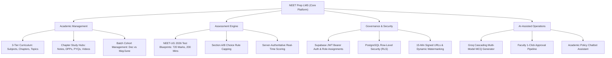
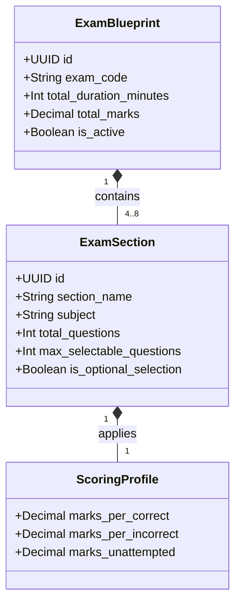
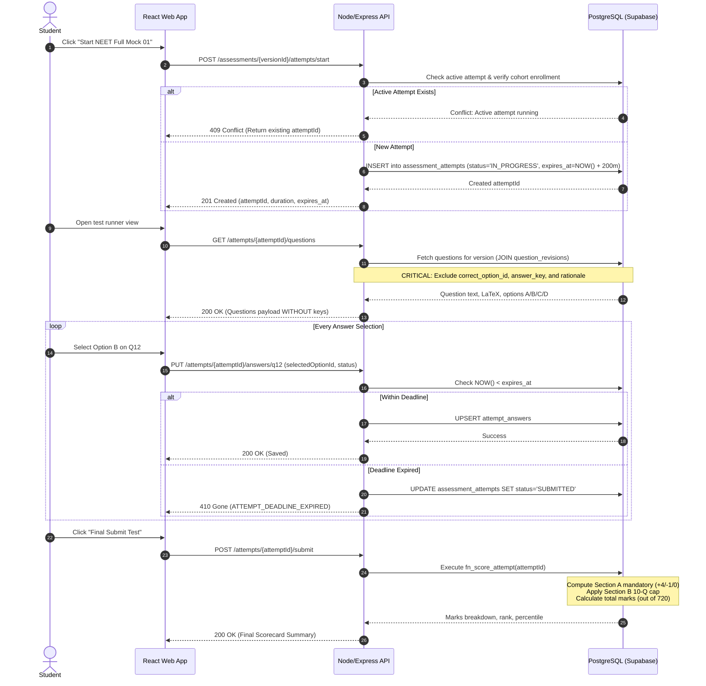
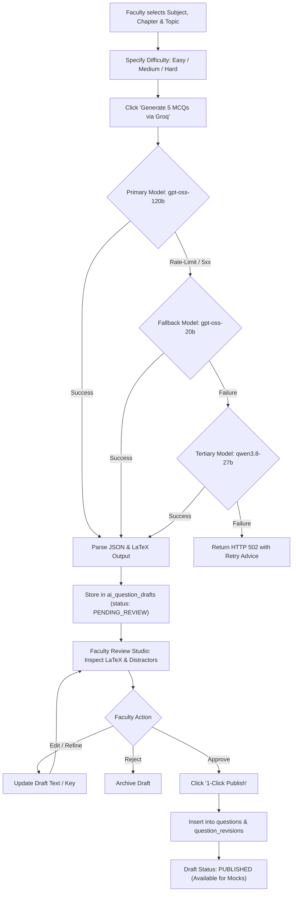
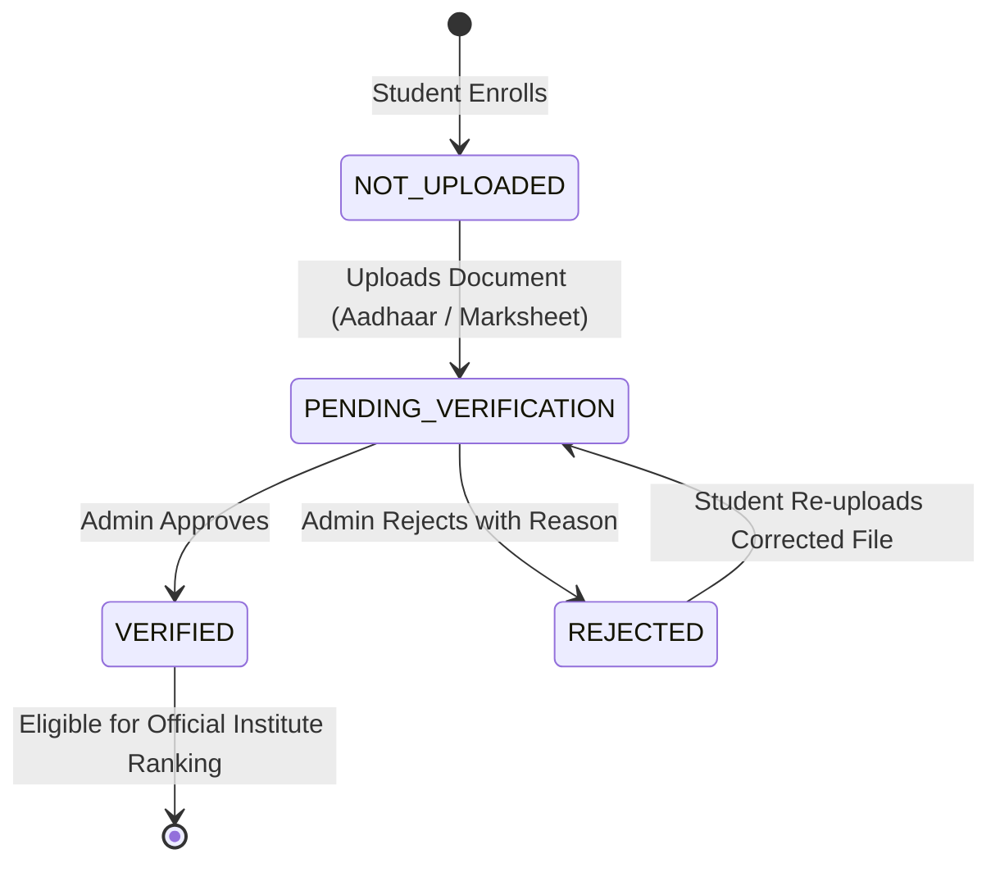
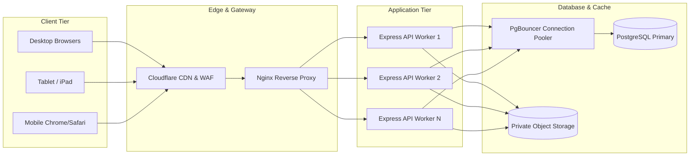
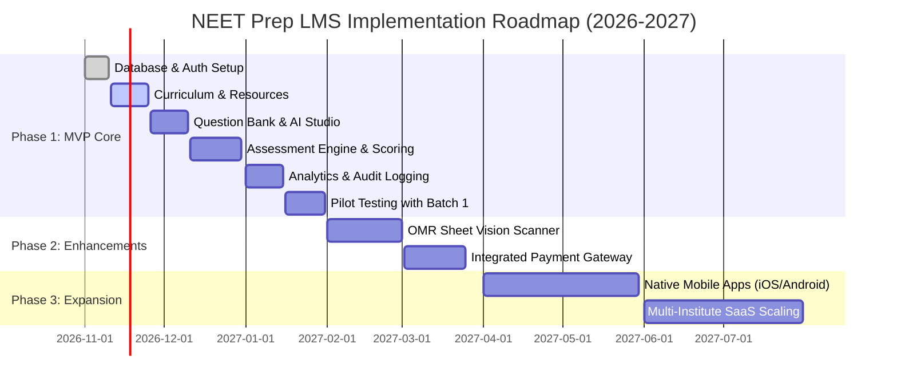

# NEET Prep LMS — Product Requirements Document (PRD)

**Document Version:** 1.0.0  
**Document Status:** Approved for Engineering Implementation  
**Date:** November 2026  
**Authors:** Senior Product Management, Educational Technology Solutions Architecture & Backend Engineering  
**Primary Sources of Truth:** `project_overview.md` (v2.0), `db.sql` (PostgreSQL 15+ Schema), `api_design.md` (REST API Contract v1.0.0), `docs/api/openapi.yaml` (OpenAPI 3.1.0 Spec)  
**Target Product Scope:** Single-Institute NEET-UG Medical Entrance Coaching & Assessment Platform  

---

## Table of Contents

1. [Product Overview](#1-product-overview)
2. [Product Vision and Objectives](#2-product-vision-and-objectives)
3. [Problem Statement](#3-problem-statement)
4. [Target Audience and User Personas](#4-target-audience-and-user-personas)
5. [User Roles and Permissions](#5-user-roles-and-permissions)
6. [Business Requirements](#6-business-requirements)
7. [Functional Requirements (FR-001 to FR-075)](#7-functional-requirements)
8. [Detailed Feature Specifications](#8-detailed-feature-specifications)
9. [User Stories with Acceptance Criteria](#9-user-stories-with-acceptance-criteria)
10. [End-to-End User Workflows](#10-end-to-end-user-workflows)
11. [Use Cases and Acceptance Criteria](#11-use-cases-and-acceptance-criteria)
12. [Non-Functional Requirements (NFR-001 to NFR-030)](#12-non-functional-requirements)
13. [Authentication and Authorization Requirements](#13-authentication-and-authorization-requirements)
14. [Database and Data Management Requirements](#14-database-and-data-management-requirements)
15. [API and Integration Requirements](#15-api-and-integration-requirements)
16. [AI Feature Requirements](#16-ai-feature-requirements)
17. [Security and Privacy Requirements](#17-security-and-privacy-requirements)
18. [Performance and Scalability Requirements](#18-performance-and-scalability-requirements)
19. [UI/UX Requirements](#19-uiux-requirements)
20. [Analytics and Reporting Requirements](#20-analytics-and-reporting-requirements)
21. [Error Handling and Failure Scenarios](#21-error-handling-and-failure-scenarios)
22. [MVP Scope and Future Enhancements](#22-mvp-scope-and-future-enhancements)
23. [Dependencies and Technical Constraints](#23-dependencies-and-technical-constraints)
24. [Risks and Mitigation Strategies](#24-risks-and-mitigation-strategies)
25. [Assumptions and Open Questions](#25-assumptions-and-open-questions)
26. [Product Release and Implementation Roadmap](#26-product-release-and-implementation-roadmap)
27. [Success Metrics and Key Performance Indicators](#27-success-metrics-and-key-performance-indicators)
28. [Final Product Acceptance Checklist](#28-final-product-acceptance-checklist)

---

# 1. Product Overview

The **NEET Prep Learning Management System (LMS)** is an enterprise-grade, web-based, role-governed educational and assessment management platform purpose-built for a premier single medical coaching institute preparing aspirants for the National Eligibility cum Entrance Test for Undergraduates (**NEET-UG**).

The platform bridges academic curriculum planning, cohort administration, high-stakes assessment delivery, learning material distribution, and performance analytics into a unified, secure system. It replaces fragmented workflows previously distributed across static spreadsheets, Telegram/WhatsApp groups, unsecured Google Drive folders, and third-party testing utilities.



---

# 2. Product Vision and Objectives

### 2.1 Product Vision
To empower coaching institutes with an enterprise-grade digital campus that elevates NEET-UG preparation through rigorous assessment accuracy, leak-proof testing environments, structured curricular progression, and faculty-supervised AI workflows.

### 2.2 Strategic Objectives
1. **Academic Rigor & Exact Exam Fidelity:** Replicate the exact NTA NEET-UG blueprint format (Physics, Chemistry, Botany, Zoology across Section A mandatory and Section B optional selection) with backend-authoritative evaluation (+4 for correct, -1 for incorrect, 0 for unattempted).
2. **Zero Information Leakage:** Protect institutional intellectual property (notes, proprietary DPPs, test items) via tamper-evident watermarking, expiring pre-signed S3 URLs, and zero answer key disclosure in active student test payloads.
3. **Cohort Boundary Enforcement:** Prevent cross-contamination between distinct admission batches (e.g., `Batch 1 (Dec)` repeaters vs `Batch 2 (May/June)` regular students) using database-enforced Row-Level Security (RLS).
4. **Faculty Efficiency Amplification:** Reduce question authoring overhead by 70% using Groq-powered AI generation with mandatory human-in-the-loop faculty review before publishing into the immutable question bank.
5. **Actionable Diagnostic Analytics:** Provide granular, Recharts-ready performance curves, subject mastery indexes, and difficulty-tier analyses to guide personalized remedial interventions.

---

# 3. Problem Statement

### 3.1 Industry Challenges in Medical Entrance Coaching
- **Curricular Disorganization:** Medical aspirants face an overwhelming syllabus spanning 79+ NCERT chapters across Physics, Chemistry, Botany, and Zoology. Freeform cloud drives lead to outdated notes, missing Daily Practice Problems (DPPs), and unstructured learning.
- **Flawed & Cheat-Prone Online Testing:** Client-side test engines compute marks in JavaScript or expose answer keys within browser network payloads, leading to widespread grade manipulation and zero exam validity.
- **Section B Selection Complexities:** The NTA NEET-UG blueprint requires candidates to attempt exactly 10 out of 15 questions in Section B. Most third-party LMS platforms fail to enforce or correctly score this optional capping rule.
- **Piracy & Resource Distribution:** Premium coaching notes, test series, and video lectures are routinely scraped, shared, or leaked due to public direct-storage URLs.
- **Administrative Blind Spots:** Institute directors lack real-time visibility into faculty syllabus coverage, student engagement, or batch-level performance distributions.

---

# 4. Target Audience and User Personas

### 4.1 Target Audience
- Single-institute medical coaching organizations (100 to 2,500 active students).
- NEET-UG repeaters, 11th/12th standard medical aspirants.
- Senior subject-matter faculty (Physics, Chemistry, Botany, Zoology).
- Institute academic directors, batch coordinators, and IT administrators.

### 4.2 User Personas

#### Persona 1: Rohan Sharma (NEET Dropper / Aspirant)
- **Role:** Student (`STUDENT`)
- **Cohort:** Batch 1 (Dec Dropper Batch)
- **Pain Points:** Loses track of NCERT topic completion; struggles with Section B question selection under time pressure; needs immediate diagnostic feedback on weak areas (e.g., Rotational Motion, Organic Reaction Mechanisms).
- **Primary Goals:** Complete syllabus checklist; take timed 720-mark mock tests; access watermarked notes without platform friction; track percentile trends.

#### Persona 2: Dr. Vandana Rao (Senior Zoology Faculty)
- **Role:** Faculty (`FACULTY`)
- **Responsibilities:** Authors weekly DPPs and monthly full-syllabus mock assessments; monitors student doubt queries; tracks batch curriculum progress.
- **Pain Points:** Drafting 45 high-yield MCQs with distractor rationales takes 4+ hours per test; cannot easily spot which topics students collectively fail in mock drills.
- **Primary Goals:** Leverage AI to draft NCERT-aligned MCQs; edit and approve questions into the permanent bank; review cohort mastery dashboards.

#### Persona 3: Col. Rajesh Verma (Retd.) (Institute Director / Head of Ops)
- **Role:** Institute Administrator (`ADMIN`)
- **Responsibilities:** Student admissions, cohort transfers, document verification, staff onboarding, institutional integrity, audit governance.
- **Pain Points:** Students changing batches mid-year create manual record chaos; unauthorized staff permission changes; dispute over mock test re-keying.
- **Primary Goals:** Execute audited student batch transfers; verify Aadhaar and 12th marksheet documents; inspect tamper-evident audit logs; access real-time system telemetry.

---

# 5. User Roles and Permissions

The system implements strict Role-Based Access Control (RBAC). Roles are stored in the server-managed database table `role_assignments` and evaluated against authenticated Supabase JWT identities.

### 5.1 System Roles
1. **`STUDENT`:** Medical coaching aspirants enrolled in one or more active cohorts. Restricted to personal academic progress, enrolled batch learning resources, active test attempts, personal scorecard analytics, personal document uploads, and student community posts.
2. **`FACULTY`:** Subject-matter educators and teaching assistants. Granted read/write access to curriculum chapters, question bank authoring, AI draft generation/approval, assessment construction, cohort progress tracking, and discussion thread moderation.
3. **`ADMIN`:** Coaching institute owners, academic deans, and system administrators. Full operational authority across user provisioning, role assignments, cohort creation, student transfers, answer key adjudication, document verification, audit log inspection, and system telemetry.

### 5.2 Role-Based Access Matrix

| Functional Module | Operations / Endpoints | Student | Faculty | Admin |
| :--- | :--- | :---: | :---: | :---: |
| **Auth & Profile** | `/auth/*`, `/users/me` (Profile Read/Update) | Yes | Yes | Yes |
| **User Administration** | `/admin/users/*` (Invite, Suspend, Role Assignment) | No | No | **Yes** |
| **Student Dashboard** | `/students/me/*` (Dashboard, Syllabus Checklist) | **Yes** | No | View As |
| **Faculty Dashboard** | `/faculty/me/*`, `/faculty/cohorts/*` | No | **Yes** | Yes |
| **Exams & Blueprints** | `/exams` (Read Catalog) | Yes | Yes | Yes |
| **Blueprint Authoring** | `/admin/blueprints/*` (Create, Version, Scoring Rules) | No | No | **Yes** |
| **Curriculum Tree** | `/curriculum` (Hierarchy & Study Hubs) | Enrolled | Yes | Yes |
| **Curriculum Mutation** | `/admin/curriculum/*` (Add Chapters, Topics) | No | No | **Yes** |
| **Cohorts Management** | `/cohorts` (Read Active Batches) | Yes | Yes | Yes |
| **Cohort Administration** | `/admin/cohorts`, `/admin/enrollments/*` | No | No | **Yes** |
| **Learning Resources** | `/resources` (View/Download via Signed URLs) | Enrolled | Yes | Yes |
| **Resource Management**| `POST/DELETE /resources/*` | No | Author | **Yes** |
| **Question Bank** | `/questions` (Browse, Author, Revise) | No | **Yes** | **Yes** |
| **Protected Answer Keys**| `GET /questions/{id}/revisions/{revId}/answer-key` | **Forbidden** | **Yes** | **Yes** |
| **Answer Key Adjudication**| `PUT /admin/questions/{id}/revisions/{revId}/answer-key`| **Forbidden** | No | **Yes** |
| **Assessment Delivery** | `POST /assessments/{versionId}/attempts/start` | **Yes** | Test Run | Test Run |
| **Active Attempt Runner**| `GET /attempts/{attemptId}/questions` (No Answer Keys) | **Yes** | No | No |
| **Server-Side Scoring** | `POST /attempts/{attemptId}/submit` | **Yes** | No | No |
| **Score Adjustments** | `POST /admin/attempts/{attemptId}/score-adjustments` | No | No | **Yes** |
| **Analytics & Reports** | `/analytics/students/me` vs `/analytics/cohorts/*` | Self Only | Assigned | All |
| **AI Question Engine** | `/ai/questions/generate`, `/ai/questions/drafts/*/publish`| No | **Yes** | **Yes** |
| **AI Academic Chatbot** | `/ai/assistant/chat` (Admissions, Rules, Syllabus) | **Yes** | Yes | Yes |
| **Student Documents** | `/documents/me` (Upload, View Status) | **Yes** | No | View All |
| **Document Verification**| `POST /admin/documents/{id}/verify` (Approve/Reject) | No | No | **Yes** |
| **Announcements** | `GET /announcements` vs `POST /admin/announcements` | Read Only | Read Only | **Manage** |
| **Academic Calendar** | `GET /calendar/events` vs `POST /admin/calendar/events` | Read Only | Manage | **Manage** |
| **Community Threads** | `/community/threads/*` (Post Doubt, Reply, Vote) | Enrolled | Moderate | **Admin** |
| **Audit Logs & Telemetry**| `/admin/audit-logs/*`, `/admin/telemetry` | No | No | **Yes** |

---

# 6. Business Requirements

| ID | Business Requirement Description | Priority | Compliance Metric |
| :--- | :--- | :---: | :--- |
| **BR-001** | **Single Coaching Institute Model:** The platform must operate under a dedicated institute operational model for NEET-UG preparation without multi-tenant domain bleed. | Critical | Institute-isolated database schemas and configuration parameters. |
| **BR-002** | **Full NEET-UG 2026 Blueprint Adherence:** The platform must execute assessments matching the NTA structure: 4 subjects (Physics, Chemistry, Botany, Zoology), 200 total questions, Section A (35 questions) and Section B (15 questions with 10 max attempts). | Critical | Zero scoring anomalies across 5,000 simulated test attempts. |
| **BR-003** | **Institutional Intellectual Property Protection:** Notes, DPPs, and proprietary question banks must be shielded from unauthorized download and external hotlinking. | Critical | Zero public S3 URLs; 100% distribution via 15-minute expiring signed URLs with student watermarking. |
| **BR-004** | **Backend-Authoritative Assessment Integrity:** All marks calculation (+4/-1/0), section selection capping, and submission timer checks must occur inside the server/database. | Critical | Zero answer key fields exposed in student API payloads; tamper attempts result in HTTP 403/410. |
| **BR-005** | **Strict Cohort Boundary Enforcement:** Students enrolled in Batch 1 must not access Batch 2 live assessments, study materials, or internal announcements unless cross-enrolled. | Critical | Database RLS policy regression tests pass with 100% coverage. |
| **BR-006** | **Human-in-the-Loop AI Quality Control:** No AI-generated question shall appear in student assessments without explicit review, verification, and 1-click publishing by a qualified faculty member. | High | System prevents direct student visibility of records in `ai_question_drafts`. |
| **BR-007** | **Tamper-Evident Operational Auditability:** All administrative state mutations (cohort transfers, manual score adjustments, role changes, answer key revisions) must generate immutable audit records. | High | Every write event to `audit_logs` includes actor ID, client IP, action name, before/after diffs, and timestamp. |
| **BR-008** | **Document Verification for Enrollment Integrity:** Enrolled students must complete mandatory identity verification (Aadhaar/10th/12th certificate) verified by an administrator before official mock test ranking eligibility. | Medium | Verification workflow tracked via `document_verification_logs`. |
| **BR-009** | **Continuous Offline-Tolerant Autosave:** During high-stakes assessments, student responses must be continuously persisted with idempotency tokens to prevent data loss across spotty connections. | Critical | 100% answer retention across transient network drops up to 10 minutes. |
| **BR-010** | **Academic Calendar Synchronization:** Test schedules, lecture milestones, and doubt sessions must be consolidated on a central academic calendar visible to students and faculty. | Medium | 100% event synchronization with calendar view endpoints. |

---

# 7. Functional Requirements

### 7.1 Module 01: System Health & Diagnostics
- **FR-001:** The system shall provide an unauthenticated diagnostic endpoint (`GET /health`) returning service uptime, memory telemetry, and live PostgreSQL ping latency.
- **FR-002:** The system shall return HTTP 503 Service Unavailable if database connection saturation exceeds 95% or if latency exceeds 2,500ms.

### 7.2 Module 02: Authentication & Session Governance
- **FR-003:** The system shall authenticate user credentials against Supabase Auth and issue a cryptographically signed JWT Bearer token containing user UUID, email, and institute identifier.
- **FR-004:** The system shall verify access tokens on all protected routes and support token refreshing via `POST /auth/refresh`.
- **FR-005:** The system shall maintain active session records in the `user_sessions` table and support explicit session invalidation via `POST /auth/logout`.

### 7.3 Module 03: User Administration & Profile Management
- **FR-006:** The system shall allow authenticated users to view and update their personal profile (phone number, avatar URL, bio) via `GET/PATCH /users/me`.
- **FR-007:** The system shall allow administrators to issue user invitations via `POST /admin/users/invite` with pre-assigned roles and cohort tags.
- **FR-008:** The system shall permit administrators to suspend, activate, or archive user accounts via `PATCH /admin/users/{id}/status`.
- **FR-009:** The system shall permit administrators to assign or revoke user roles via `POST /admin/users/{id}/roles`, enforcing server-side logging in `audit_logs`.

### 7.4 Module 04: Student Academic Workspace
- **FR-010:** The system shall display a student dashboard (`GET /students/me/dashboard`) showing current cohort enrollment, upcoming assessment deadlines, recent mock test percentiles, and syllabus completion progress.
- **FR-011:** The system shall provide a 7-subject syllabus completion tracker (`GET /students/me/progress`) detailing total chapters, completed topics, and subject mastery percentage.
- **FR-012:** The system shall allow students to toggle topic completion status (`POST /students/me/progress/topics/{topicId}`), updating `student_topic_progress` with optimistic UI reflection.

### 7.5 Module 05: Faculty Academic Workspace
- **FR-013:** The system shall provide a faculty dashboard (`GET /faculty/me/dashboard`) listing assigned cohorts, pending AI question drafts awaiting review, upcoming scheduled assessments, and student doubt counts.
- **FR-014:** The system shall allow faculty to view assigned cohorts via `GET /faculty/me/cohorts` and inspect a cohort progress matrix via `GET /faculty/cohorts/{cohortId}/progress`.

### 7.6 Module 06: Exam Catalog & Blueprint Engine
- **FR-015:** The system shall maintain an exam catalog (`GET /exams`) supporting NEET-UG and future competitive entrance exams.
- **FR-016:** The system shall store versioned exam blueprints (`exam_blueprints`) defining duration (200 mins), total marks (720), and subjects.
- **FR-017:** The system shall allow administrators to configure section rules (`exam_sections`) and scoring profiles (`scoring_profiles`) specifying `marks_per_correct` (+4.00), `marks_per_incorrect` (-1.00), and `marks_unattempted` (0.00).

### 7.7 Module 07: 3-Tier Curriculum & Chapter Study Hubs
- **FR-018:** The system shall organize academic curriculum hierarchically: `curriculum_subjects` (Physics, Chemistry, Botany, Zoology) $\rightarrow$ `curriculum_chapters` $\rightarrow$ `curriculum_topics`.
- **FR-019:** The system shall provide a unified Chapter Study Hub (`GET /curriculum/chapters/{chapterId}/study-hub`) aggregating notes, DPPs, PYQs, and lecture video links.
- **FR-020:** The system shall enable administrators to create chapters and topics with ordering indexes via `POST /admin/curriculum/chapters` and `POST /admin/curriculum/topics`.

### 7.8 Module 08: Cohort & Batch Management
- **FR-021:** The system shall manage distinct student batches (`cohorts`), specifically isolating `Batch 1 (Dec)` and `Batch 2 (May/June)`.
- **FR-022:** The system shall enforce cohort capacity constraints (`max_capacity`) and track active student counts in real time.
- **FR-023:** The system shall allow administrators to create cohorts via `POST /admin/cohorts` specifying academic year, start date, and target exam date.

### 7.9 Module 09: Student Cohort Enrollments & Transfers
- **FR-024:** The system shall allow administrators to enroll students into active cohorts via `POST /admin/enrollments`.
- **FR-025:** The system shall support audited cohort transfers via `POST /admin/enrollments/{id}/transfer`, archiving prior enrollment, re-mapping historical attempt analytics, and writing an audit event.

### 7.10 Module 10: Learning Resources & Digital Rights Management (DRM)
- **FR-026:** The system shall catalogue learning resources (`resources`) categorized as `NOTES`, `DPP`, `PYQ`, `NCERT_EXTRACT`, or `VIDEO_LINK`.
- **FR-027:** The system shall authorize presigned multipart file uploads to private S3 buckets via `POST /resources/{id}/files`.
- **FR-028:** The system shall generate 15-minute expiring presigned download URLs (`POST /resources/{id}/signed-url`) that inject dynamic watermarking (student full name, roll number, IP, and timestamp).
- **FR-029:** The system shall allow administrators to soft-delete obsolete learning resources via `DELETE /resources/{id}`.

### 7.11 Module 11: Question Bank & Versioned Revisions
- **FR-030:** The system shall support rich-text question authoring including LaTeX math formulas, chemical notation, and diagram image URLs.
- **FR-031:** The system shall maintain immutable question revision histories (`question_revisions`), ensuring that historical assessments remain locked to the revision active at test time.
- **FR-032:** The system shall enforce question formatting: exactly 4 options (`A`, `B`, `C`, `D`) for `MCQ_SINGLE` with exactly one designated correct option.

### 7.12 Module 12: Protected Answer Keys & Adjudication
- **FR-033:** The system shall strictly restrict answer key retrieval (`GET /questions/{id}/revisions/{revId}/answer-key`) to authorized `FACULTY` and `ADMIN` roles.
- **FR-034:** The system shall enable administrators to adjudicate student challenges and update answer keys via `PUT /admin/questions/{id}/revisions/{revId}/answer-key`, automatically triggering background re-scoring of affected attempts.

### 7.13 Module 13: Assessment Definition & Version Snapshotting
- **FR-035:** The system shall allow faculty to construct assessments (`assessments`) categorized as `CHAPTER_DRILL`, `PART_SYLLABUS`, or `FULL_MOCK`.
- **FR-036:** The system shall snapshot published assessments into an immutable version record (`assessment_versions`) via `POST /assessments/{id}/publish`, locking question order, options, and section rules against future edits.

### 7.14 Module 14: Secure Assessment Runner & Server Scoring
- **FR-037:** The system shall initialize timed student attempts via `POST /assessments/{versionId}/attempts/start`, generating a server-enforced deadline (`expires_at = starts_at + duration_seconds`).
- **FR-038:** The system shall serve randomized assessment questions (`GET /attempts/{attemptId}/questions`) with zero answer key or explanation leakage.
- **FR-039:** The system shall provide an idempotent autosave endpoint (`PUT /attempts/{attemptId}/answers/{assessmentQuestionId}`) supporting question status tags: `ANSWERED`, `MARKED_FOR_REVIEW`, `ANSWERED_AND_MARKED_FOR_REVIEW`.
- **FR-040:** The system shall compute final scores on the server upon `POST /attempts/{attemptId}/submit`, enforcing Section B 10-question capping rules, calculating raw marks (+4/-1/0), and evaluating subject percentiles.
- **FR-041:** The system shall expose detailed student scorecards (`GET /attempts/{attemptId}/results`) only after test window closure.
- **FR-042:** The system shall allow administrators to record manual mark adjustments with mandatory justification via `POST /admin/attempts/{attemptId}/score-adjustments`.

### 7.15 Module 15: Academic Analytics & Mastery Engine
- **FR-043:** The system shall generate student diagnostic analytics (`GET /analytics/students/me`) detailing accuracy rates, time spent per question, subject mastery, and historical score curves.
- **FR-044:** The system shall compute cohort-wide summary analytics (`GET /analytics/cohorts/{cohortId}/summary`) displaying score distributions, median percentiles, and top 10% benchmark comparisons.

### 7.16 Module 16: AI Question Generation & 1-Click Publishing
- **FR-045:** The system shall accept natural language generation prompts via `POST /ai/questions/generate` specifying subject, chapter, topic, target difficulty (`EASY`, `MEDIUM`, `HARD`), and question count (1 to 20).
- **FR-046:** The system shall execute AI generation through Groq LLM with automatic cascading fallback (`openai/gpt-oss-120b` $\rightarrow$ `openai/gpt-oss-20b` $\rightarrow$ `qwen/qwen3.8-27b`), returning structured JSON with LaTeX equations.
- **FR-047:** The system shall allow faculty to review, modify, and publish drafts into the question bank with a single action via `POST /ai/questions/drafts/{draftId}/publish`.

### 7.17 Module 17: Context-Aware AI Academic Assistant
- **FR-048:** The system shall provide an interactive AI chat interface (`POST /ai/assistant/chat`) answering student queries regarding institutional policies, test schedules, syllabus boundaries, and admissions.
- **FR-049:** The system shall enforce guardrails preventing the AI assistant from solving active assessment questions or providing medical diagnoses.

### 7.18 Module 18: Student Document Verification
- **FR-050:** The system shall allow students to upload mandatory admission documents (`POST /documents/me/upload`) including Aadhaar ID, 10th marksheet, 12th marksheet, and category certificates.
- **FR-051:** The system shall enable administrators to verify or reject uploaded documents with rejection reasons via `POST /admin/documents/{id}/verify`.

### 7.19 Module 19: Institutional Announcements & Bulletins
- **FR-052:** The system shall provide an announcement board (`GET /announcements`) supporting priority banners (`NORMAL`, `HIGH`, `URGENT`) and cohort-level gating.
- **FR-053:** The system shall allow administrators to publish broadcast announcements via `POST /admin/announcements`.

### 7.20 Module 20: Academic Calendar & Scheduling
- **FR-054:** The system shall display academic deadlines, mock test dates, and live doubt clearing sessions (`GET /calendar/events`).
- **FR-055:** The system shall allow faculty and administrators to schedule events via `POST /admin/calendar/events`.

### 7.21 Module 21: Moderated Academic Community
- **FR-056:** The system shall provide a subject-scoped discussion forum (`GET /community/threads`) for student academic doubts.
- **FR-057:** The system shall allow students and faculty to post threads and nested replies via `POST /community/threads` and `POST /community/threads/{threadId}/replies`.
- **FR-058:** The system shall allow faculty and administrators to moderate and delete inappropriate threads via `DELETE /admin/community/threads/{id}`.

### 7.22 Module 22: Tamper-Evident Audit Logging
- **FR-059:** The system shall capture all critical administrative mutations in the `audit_logs` table (`GET /admin/audit-logs`).
- **FR-060:** The system shall support streaming exports of audit logs in CSV and JSON formats via `GET /admin/audit-logs/export`.

### 7.23 Module 23: System Telemetry & Operational Health
- **FR-061:** The system shall collect real-time telemetry metrics (`GET /admin/telemetry`) including active student sessions, concurrent running tests, database pool latency, and storage consumption.
- **FR-062:** The system shall provide administrators with a temporary, audited "View As" student support session (`POST /admin/support-sessions`) expiring within 30 minutes.

### 7.24 Module 24: Operational Resiliency & Edge Cases
- **FR-063:** The system shall automatically reject duplicate answer autosaves that match the last stored `selected_option_id` to conserve database writes.
- **FR-064:** The system shall support question filtering by both NCERT Class (11 vs 12) and cognitive difficulty level.
- **FR-065:** The system shall ensure that deleted resources do not leave orphan physical files in S3 by scheduling asynchronous bucket cleanup jobs.
- **FR-066:** The system shall support password resets and email verification through Supabase Auth webhooks.
- **FR-067:** The system shall maintain an immutable log of student topic completions with timestamps to verify syllabus coverage velocity.
- **FR-068:** The system shall allow faculty to clone published assessment blueprints to rapidly generate parallel mock variants.
- **FR-069:** The system shall enforce a maximum file upload limit of 25MB for learning notes and 5MB for student verification documents.
- **FR-070:** The system shall validate image uploads to ensure only standard web formats (`JPEG`, `PNG`, `WebP`) are stored for question diagrams.
- **FR-071:** The system shall enforce unique enrollment constraints preventing a student from holding two simultaneous `ACTIVE` enrollments in the same cohort.
- **FR-072:** The system shall reject assessment start requests if the current server time is outside the scheduled test delivery window.
- **FR-073:** The system shall log all failed authorization attempts with client IP and target URI to detect credential stuffing.
- **FR-074:** The system shall ensure that community thread upvotes are idempotent per user UUID.
- **FR-075:** The system shall provide localized date-time rendering across all UI screens formatted in Indian Standard Time (IST).

---

# 8. Detailed Feature Specifications

### 8.1 NEET-UG 2026 Examination Delivery Engine

The assessment engine must faithfully replicate the National Testing Agency (NTA) NEET-UG testing pattern.



#### NEET-UG Section Structure Matrix

| Subject | Section Name | Total Questions | Mandatory / Choice | Questions to Attempt | Marks per Q | Negative Mark | Section Total |
| :--- | :--- | :---: | :---: | :---: | :---: | :---: | :---: |
| **Physics** | Section A | 35 | Mandatory | 35 | +4 | -1 | 140 |
| **Physics** | Section B | 15 | Optional Choice | **10** (out of 15) | +4 | -1 | 40 |
| **Chemistry** | Section A | 35 | Mandatory | 35 | +4 | -1 | 140 |
| **Chemistry** | Section B | 15 | Optional Choice | **10** (out of 15) | +4 | -1 | 40 |
| **Botany** | Section A | 35 | Mandatory | 35 | +4 | -1 | 140 |
| **Botany** | Section B | 15 | Optional Choice | **10** (out of 15) | +4 | -1 | 40 |
| **Zoology** | Section A | 35 | Mandatory | 35 | +4 | -1 | 140 |
| **Zoology** | Section B | 15 | Optional Choice | **10** (out of 15) | +4 | -1 | 40 |
| **TOTALS** | **8 Sections** | **200 Qs** | — | **180 Questions** | — | — | **720 Marks** |

#### Section B Capping Evaluation Algorithm
When a candidate submits answers for Section B:
1. Count total answered questions $N_{ans}$ in Section B for that subject.
2. If $N_{ans} \le 10$, evaluate all answered questions.
3. If $N_{ans} > 10$, the server sorts the answered questions by `display_order` ascending and evaluates **strictly the first 10 answered questions**.
4. All subsequent answered questions (11th through 15th) are marked `UNANSWERED_OPTIONAL` and awarded `0.00` marks, matching official NTA adjudication standards.

---

# 9. User Stories with Acceptance Criteria

### US-01: Timed Assessment Runner
**As a** Student enrolled in Batch 1  
**I want to** start and execute a 200-minute timed NEET mock test with auto-saving answers  
**So that** I can practice under real exam conditions without risk of losing my responses during network drops.

#### Acceptance Criteria (Gherkin format):
```gherkin
Scenario: Starting a valid mock test attempt
  Given the student is authenticated with an active enrollment in "Batch 1 (Dec)"
  And an assessment version "NEET Mock #4" is in "PUBLISHED" state
  When the student sends POST /assessments/{versionId}/attempts/start
  Then the response code is 201 Created
  And the response body contains an attemptId, server "startsAt", and "expiresAt" exactly 200 minutes later
  And no correct answers or rationales exist in the returned payload

Scenario: Submitting an answer within the active window
  Given the student has an "IN_PROGRESS" attempt
  When the student selects option "B" for question #14 and sends PUT /attempts/{attemptId}/answers/{qId}
  Then the response code is 200 OK
  And the attempt_answers record is upserted with selected_option_id and status "ANSWERED"
  And the response time is less than 150 milliseconds

Scenario: Attempting to save after deadline expiration
  Given the attempt's "expiresAt" timestamp has elapsed by 15 seconds
  When the student sends PUT /attempts/{attemptId}/answers/{qId}
  Then the response code is 410 Gone
  And the error code returned is "ATTEMPT_DEADLINE_EXPIRED"
  And the database automatically transitions attempt status to "SUBMITTED"
```

### US-02: AI Question Drafting with Faculty Review
**As a** Senior Physics Faculty member  
**I want to** generate 5 conceptual MCQs on "Electromagnetic Induction" using Groq AI and edit them before publishing  
**So that** I can create high-quality weekly DPPs in minutes while ensuring 100% NCERT accuracy.

#### Acceptance Criteria:
```gherkin
Scenario: Generating AI questions with automatic model fallback
  Given the faculty member is authenticated with role "FACULTY"
  When the faculty sends POST /ai/questions/generate with topic "Faraday's Law" and count 5
  Then the system invokes Groq LLM using primary model "openai/gpt-oss-120b"
  And if the primary model returns rate-limit or 5xx, the system seamlessly falls back to "openai/gpt-oss-20b"
  And the response returns 5 drafts stored in ai_question_drafts with status "PENDING_REVIEW"
  And every draft contains exactly 4 options, a designated correct option, and LaTeX-formatted formulas

Scenario: Approving and publishing an AI draft
  Given a draft with status "PENDING_REVIEW" exists in ai_question_drafts
  When the faculty reviews the question text, verifies the key, and sends POST /ai/questions/drafts/{draftId}/publish
  Then a new record is created in questions and question_revisions
  And the draft status updates to "PUBLISHED"
  And the question immediately becomes selectable for assessments
```

### US-03: Audited Cohort Transfer
**As an** Institute Administrator  
**I want to** transfer a student from Batch 1 to Batch 2 with an explicit audit note  
**So that** their curriculum access updates immediately while maintaining a clean compliance trail.

#### Acceptance Criteria:
```gherkin
Scenario: Executing a student transfer
  Given an active student enrollment in "Batch 1 (Dec)"
  When the admin sends POST /admin/enrollments/{id}/transfer with targetCohortId "Batch 2 (May/June)" and reason "Parent relocation request"
  Then the original enrollment status is set to "TRANSFERRED"
  And a new enrollment record is created for Batch 2 with status "ACTIVE"
  And a row is inserted into audit_logs capturing the admin ID, old cohort, new cohort, and transfer reason
  And the student's subsequent API calls to /curriculum reflect Batch 2 materials within 100ms
```

### US-04: Chapter Study Hub Material Access
**As a** Student enrolled in Batch 2  
**I want to** open the Chapter Study Hub for "Chemical Bonding" and download watermarked PDF notes  
**So that** I can review high-yield summaries safely and securely on my tablet.

#### Acceptance Criteria:
```gherkin
Scenario: Accessing authorized chapter notes
  Given the student is authenticated and enrolled in Batch 2
  When the student requests POST /resources/{id}/signed-url for resource "NCERT Chemical Bonding Summary.pdf"
  Then the response code is 200 OK
  And the payload contains a signedUrl with an expiry time of exactly 900 seconds
  And the PDF download stream renders a diagonal watermark displaying the student's name, roll number, and IP
```

### US-05: Answer Key Challenge Adjudication
**As an** Institute Academic Dean (Admin)  
**I want to** correct an erroneous answer key on a published question revision from Option C to Option B  
**So that** student marks across 250 completed mock test attempts are automatically re-calculated.

#### Acceptance Criteria:
```gherkin
Scenario: Correcting an official answer key
  Given an assessment version has completed attempts with question #42 keyed as Option C
  When the admin sends PUT /admin/questions/{id}/revisions/{revId}/answer-key with newCorrectOption "B" and justification "NTA Official Corrigendum 2026"
  Then the response code is 200 OK
  And an entry is logged in audit_logs
  And a background worker re-scores all affected attempts, updating student scores and percentiles within 60 seconds
```

### US-06: Mandatory Document Verification
**As an** Institute Admissions Administrator  
**I want to** review student uploaded 10th and 12th marksheets and mark them verified  
**So that** the student is cleared for official institute rank certificates and national test registration.

#### Acceptance Criteria:
```gherkin
Scenario: Approving a valid student document
  Given a student uploaded an Aadhaar card image in student_documents with status "PENDING"
  When the admin reviews the image via presigned URL and sends POST /admin/documents/{id}/verify with status "VERIFIED"
  Then the document record status transitions to "VERIFIED"
  And an entry is added to document_verification_logs with verified_by set to the admin's UUID
  And the student dashboard immediately reflects the verified badge
```

---

# 10. End-to-End User Workflows

### 10.1 Assessment Lifecycle: Start, Autosave, Submit & Score



### 10.2 Faculty AI Question Authoring & Publishing Workflow



### 10.3 Student Document Verification State Diagram



---

# 11. Use Cases and Acceptance Criteria

### UC-01: Protected Resource Retrieval via Presigned URL
- **Actor:** Enrolled Student
- **Preconditions:** Student is authenticated; student is enrolled in the cohort linked to the chapter resource.
- **Trigger:** Student clicks "Download NCERT Highlights PDF" on Chapter Study Hub.
- **Flow:**
  1. Client sends `POST /resources/{id}/signed-url`.
  2. API evaluates Row-Level Security: verifies student has active enrollment in the cohort mapped to this resource.
  3. API invokes AWS S3 / Cloudflare R2 SDK to generate a presigned `GET` URL with a strict 900-second (15-minute) TTL.
  4. API logs a resource access telemetry event.
  5. API returns `{ success: true, data: { signedUrl, expiresInSeconds: 900, watermarked: true } }`.
  6. Client browser opens the stream; dynamic PDF viewer overlays user watermark (`Rohan Sharma | Roll: 2026-B1-042 | 157.48.21.90 | 05-Nov-2026`).
- **Postconditions:** Direct URL expires after 15 minutes; raw bucket storage remains private and non-traversable.

### UC-02: Section B Optional Question Capping Under Active Exam Conditions
- **Actor:** Student taking full-length mock test
- **Preconditions:** Student has active attempt; test is on Section B of Physics (15 questions presented).
- **Trigger:** Student answers 12 questions in Section B.
- **Flow:**
  1. Student selects answers for questions 1 through 12.
  2. Each selection is persisted via `PUT /attempts/{attemptId}/answers/{qId}`.
  3. Student submits test via `POST /attempts/{attemptId}/submit`.
  4. The backend evaluation engine orders the answered questions by `display_order`.
  5. Questions 1 through 10 are graded based on correct (+4) or incorrect (-1) scoring rules.
  6. Questions 11 and 12 are assigned status `UNANSWERED_OPTIONAL` and given 0 marks.
  7. Final scorecard reflects: 10 attempted, 2 optional unconsidered, 3 unattempted.
- **Postconditions:** Scorecard adheres strictly to NTA NEET guidelines.

---

# 12. Non-Functional Requirements

### 12.1 Performance Requirements
- **NFR-001:** P95 response time for answer autosaves (`PUT /attempts/{attemptId}/answers/{qId}`) must not exceed **150 milliseconds** under a concurrent load of 1,500 active test takers.
- **NFR-002:** The system health endpoint (`GET /health`) must respond within **50 milliseconds**.
- **NFR-003:** Complex analytics queries (`GET /analytics/cohorts/{cohortId}/summary`) must execute within **1,200 milliseconds** using pre-computed summary tables.
- **NFR-004:** AI Question Generation streaming latency must deliver the first token within **1,000 milliseconds** via Groq LPUs.
- **NFR-005:** Static assets and client bundles must be distributed via CDN edge locations with TTFB $< 80\text{ms}$.

### 12.2 Reliability & High Availability
- **NFR-006:** The platform must achieve **99.9% uptime** during operational hours (06:00 to 23:00 IST), excluding scheduled maintenance windows.
- **NFR-007:** The assessment engine must survive abrupt client disconnects; state is preserved server-side, allowing students to resume their attempt within their remaining countdown time.
- **NFR-008:** Recovery Point Objective (RPO) for assessment attempt answers must be **$< 5\text{ seconds}$**.
- **NFR-009:** Recovery Time Objective (RTO) for full database restoration must be **$< 30\text{ minutes}$**.

### 12.3 Security & Cryptographic Standards
- **NFR-010:** All network communication must be enforced over **TLS 1.3**; insecure HTTP requests must automatically redirect with HSTS enabled (max-age=31536000).
- **NFR-011:** Passwords must be hashed using Supabase Auth default **bcrypt** (work factor $\ge 10$) or Argon2id.
- **NFR-012:** Database connections must utilize connection pooling (Supabase PgBouncer) with SSL mode `verify-full`.
- **NFR-013:** JWT tokens must use asymmetric cryptographic signing (RS256) with automated key rotation.
- **NFR-014:** All sensitive document uploads must be encrypted at rest using AES-256 (SSE-S3).

### 12.4 Scalability Requirements
- **NFR-015:** The database schema must comfortably scale to **50,000 enrolled students**, **500,000 question revisions**, and **10,000,000 attempt answer records** without table scan degradation via composite indexing.
- **NFR-016:** Private file storage must support up to **5 Terabytes** of high-yield PDF notes, diagrams, and lecture assets.
- **NFR-017:** Connection pooling must sustain up to 5,000 simultaneous client HTTP transactions without connection pool exhaustion.

### 12.5 Accessibility, Usability & Localization
- **NFR-018:** User interface components must comply with **WCAG 2.1 Level AA** standards for color contrast, screen reader navigation, and keyboard focus.
- **NFR-019:** Mathematical and chemical expressions must render seamlessly via KaTeX without layout shift.
- **NFR-020:** The client interface must be fully responsive across viewport widths from 360px (mobile) to 2560px (ultra-wide desktop).
- **NFR-021:** All timestamps in user-facing dashboards must be localized to Indian Standard Time (IST, UTC+5:30).

### 12.6 Maintainability & Code Governance
- **NFR-022:** Backend services must maintain $\ge 85\%$ unit test branch coverage for all assessment scoring algorithms.
- **NFR-023:** Codebase must adhere to strict TypeScript typing with zero `any` declarations in production API modules.
- **NFR-024:** Database schema migrations must be backward-compatible and executed through version-controlled SQL migration scripts.

### 12.7 Compliance & Auditing
- **NFR-025:** Audit log records in `audit_logs` must be immutable (no `UPDATE` or `DELETE` permissions granted to standard users).
- **NFR-026:** Audit log streaming exports must support output sizing up to 100,000 events without Node.js out-of-memory errors.
- **NFR-027:** The system must enforce rate limiting of 100 requests per minute per IP for public endpoints and 1,000 requests per minute for authenticated endpoints.
- **NFR-028:** Presigned S3 download URLs must enforce a hard upper bound of 15 minutes TTL.
- **NFR-029:** Temporary administrative "View As" support sessions must strictly terminate after 30 minutes.
- **NFR-030:** Telemetry snapshot frequency must not impose more than $1\%$ CPU overhead on the primary database instance.

---

# 13. Authentication and Authorization Requirements

### 13.1 Supabase JWT Token Architecture
The system relies on Supabase Auth for identity management, augmented by institute-managed role assignments:
1. **User Identity:** Managed in Supabase `auth.users`, synchronized with the application `users` table via PostgreSQL triggers.
2. **Role Verification:** Tokens contain user claims; however, the backend API authoritatively queries `role_assignments` on every privileged operation to prevent stale-token or client-side claim spoofing.
3. **Session Invalidation:** Logging out via `POST /auth/logout` revokes the refresh token and terminates active entries in `user_sessions`.

### 13.2 PostgreSQL Row-Level Security (RLS) Policies
Row-Level Security is strictly enabled across all sensitive application tables:
- `student_topic_progress`: Students can only `SELECT` and `INSERT/UPDATE` records where `student_id = auth.uid()`.
- `assessment_attempts`: Students can only view their own attempts; faculty can view attempts belonging to their assigned cohorts; administrators have global visibility.
- `resources`: Read access is permitted only if the resource is public or mapped to a cohort where the student has an `ACTIVE` enrollment record.

---

# 14. Database and Data Management Requirements

### 14.1 Schema Overview (44 Tables, PostgreSQL 15+)

The database schema is organized into modular relational domains:
- **Identity & Governance:** `users`, `roles`, `permissions`, `role_permissions`, `role_assignments`, `user_sessions`, `profiles`.
- **Academic Hierarchy:** `curriculum_subjects`, `curriculum_chapters`, `curriculum_topics`, `student_topic_progress`.
- **Exam Blueprints & Scopes:** `exams`, `exam_blueprints`, `exam_sections`, `scoring_profiles`.
- **Cohorts & Rosters:** `cohorts`, `enrollments`, `faculty_cohort_assignments`.
- **Learning Content:** `resources`, `resource_files`, `study_materials`.
- **Question Bank Engine:** `questions`, `question_revisions`, `question_options`, `question_tags`, `question_tag_mappings`.
- **Assessment Snapshotting:** `assessments`, `assessment_versions`, `assessment_sections`, `assessment_questions`.
- **Test Runner & Scoring:** `assessment_attempts`, `attempt_answers`, `score_adjustments`.
- **Performance Analytics:** `student_subject_mastery`, `cohort_performance_summaries`.
- **AI Pipelines:** `ai_generation_requests`, `ai_question_drafts`, `ai_chat_conversations`, `ai_chat_messages`.
- **Compliance & Operations:** `student_documents`, `document_verification_logs`, `announcements`, `announcement_cohort_mappings`, `calendar_events`, `discussion_threads`, `thread_replies`, `audit_logs`, `system_telemetry_snapshots`, `support_sessions`.

### 14.2 Database Constraints & Integrity Triggers
1. **Immutable Versioning:** `assessment_versions` rows are read-only once `is_published = true`. Updates to parent `assessments` do not mutate active test versions.
2. **Auto-Timestamps:** All tables feature `created_at` and `updated_at` columns managed via the generic PostgreSQL trigger function `set_updated_at()`.
3. **Optimistic Locking:** Assessment attempts feature a monotonic `version` integer column incremented on every answer upsert to detect concurrent write collisions.

---

# 15. API and Integration Requirements

### 15.1 Architectural Style
- **Protocol:** RESTful HTTPS, JSON request/response bodies, UTF-8 encoding.
- **Specification:** OpenAPI 3.1.0 standard documented in [`openapi.yaml`](file:///c:/Users/ASUS/Downloads/Medical_LMS/docs/api/openapi.yaml).
- **Error Format:** RFC 7807 compliant standardized error envelop:
```json
{
  "success": false,
  "error": {
    "code": "VALIDATION_FAILED",
    "message": "The request payload failed schema validation.",
    "details": [{ "field": "durationSeconds", "message": "Duration must be an integer between 300 and 14400." }]
  },
  "metadata": {
    "requestId": "8a4b2c1d-7e9f-4a3b-8c2d-1e0f9a8b7c6d",
    "timestamp": "2026-11-05T12:00:00.000Z"
  }
}
```

### 15.2 External Integrations
1. **Supabase Auth & Database:** Managed PostgreSQL 15, Auth engine, and PgBouncer connection pooling.
2. **Groq LLM API:** High-throughput inference for AI question generation and chatbot interactions.
3. **AWS S3 / Cloudflare R2:** S3-compatible private object store for PDFs, diagrams, and student verification uploads.

---

# 16. AI Feature Requirements

### 16.1 AI Question Generation Pipeline
- **Cascading Fallback Chain:**
  1. *Primary Model:* `openai/gpt-oss-120b` (Deep conceptual reasoning, high-yield NEET physics/chemistry problems).
  2. *Secondary Model:* `openai/gpt-oss-20b` (Fast inference, reliable biology botany/zoology recall questions).
  3. *Tertiary Model:* `qwen/qwen3.8-27b` (Guaranteed fallback during severe Groq rate-limiting).
- **Prompt Engineering Requirements:** Prompts must enforce:
  - Exact NCERT class 11 and 12 curriculum boundaries.
  - Strict JSON schema output containing `questionText`, `latexContent`, `options` (array of 4 items), `correctOptionIndex`, and `explanation`.
  - Distractor rationales (explaining why incorrect options are plausible traps).
- **Human-in-the-Loop Governance:** AI-generated items are saved to `ai_question_drafts` with status `PENDING_REVIEW`. They cannot be accessed by assessment assembly queries until explicitly approved by faculty via `POST /ai/questions/drafts/{draftId}/publish`.

### 16.2 AI Academic Policy Chatbot
- Context-gated student assistant restricted to institute schedules, syllabus guidelines, and test instructions.
- Hard guardrail: When an assessment attempt is active for the student, all AI chatbot interactions are temporarily disabled to prevent real-time cheating.

---

# 17. Security and Privacy Requirements

### 17.1 Zero Answer-Key Disclosure
Under no circumstances shall the backend API include `correct_option_id`, `correct_answer`, `is_correct`, or `explanation` in student-facing payloads during an active test attempt (`GET /attempts/{attemptId}/questions`). Answer keys are strictly served via staff-only routes (`GET /questions/{id}/revisions/{revId}/answer-key`) requiring `FACULTY` or `ADMIN` privileges.

### 17.2 Dynamic Watermarking Engine
All PDF downloads and view streams must render a diagonal, semi-transparent watermark across all pages displaying:
- Student Full Name & Roll Number
- IP Address of requesting client
- Request timestamp (UTC & IST)
- Confidentiality notice: *"Proprietary Coaching Material — Unauthorized Sharing is Legally Actionable"*

### 17.3 Data Privacy & Student Protection
- Student documents (Aadhaar cards, marksheets) are marked as sensitive PII. Access is restricted to `ADMIN` roles and the owning student.
- Storage buckets containing PII must not have public read access; all access is mediated through expiring signed URLs.

---

# 18. Performance and Scalability Requirements



- **Database Connection Pooling:** PgBouncer configured with transaction-mode pooling (max 200 pooled server connections supporting up to 5,000 active client connections).
- **Read-Write Separation:** Analytics and audit log queries should route to read replicas in future scaling phases.
- **Client Bundle Size:** Web frontend production build must be under **500 KB gzip** for the initial bundle to ensure rapid loading on 4G cellular connections.

---

# 19. UI/UX Requirements

### 19.1 Design System & Typography
- **Design Language:** Clean, clinical, distraction-free modern UI inspired by medical academic interfaces.
- **Color Palette:**
  - Primary: Deep Medical Blue (`#1E3A8A` / `#2563EB`)
  - Accent / Success: Clinical Emerald (`#059669`)
  - Warning / Review: Amber (`#D97706`)
  - Error / Urgent: Crimson (`#DC2626`)
  - Surface / Background: Crisp Slate (`#F8FAFC` to `#FFFFFF`)
- **Typography:** Inter or Roboto for general interface; KaTeX / MathJax for LaTeX mathematical and chemical typesetting.

### 19.2 Screen Inventory & Interaction Details

| Screen ID | Screen Name | Target Persona | Key Interactions & Functional Elements |
| :--- | :--- | :--- | :--- |
| **S-01** | **Authentication Portal** | All Users | Clean email/password sign-in; password reset flow; institute branding banner. |
| **S-02** | **Student Dashboard** | Student | Enrolled cohort status; upcoming mock countdown card; 7-subject completion progress bar. |
| **S-03** | **Syllabus Mastery Checklist** | Student | 7-subject breakdown (Physics, Chemistry, Botany, Zoology); chapter completion toggles; NCERT 11th/12th filter. |
| **S-04** | **Chapter Study Hub** | Student | Notes viewer with watermarking; DPP interactive checklist; PYQ question cards with LaTeX; video lecture stream. |
| **S-05** | **Timed Assessment Runner** | Student | Fullscreen test view; persistent 200-minute countdown clock; question palette (1–200) with color states (Answered, Review); Section A/B tabs. |
| **S-06** | **Exam Scorecard & Analysis** | Student | Final marks out of 720; subject percentiles; Section B question audit; topic-level negative mark breakdown; Recharts curves. |
| **S-07** | **AI Academic Assistant** | Student | Collapsible chat drawer; pre-configured prompt pills (admissions, test rules, fee schedule); input sanitizer. |
| **S-08** | **Document Verification** | Student | Drag-and-drop document uploader (Aadhaar, 10th/12th marksheets); verification status badge (Pending, Verified, Rejected). |
| **F-01** | **Faculty Command Center** | Faculty | Assigned cohort cards; pending AI draft approval badge; test schedule overview; unresolved student doubt count. |
| **F-02** | **Question Bank Studio** | Faculty | Rich-text question author with LaTeX live preview; 4-option creator with single-key selector; tagger (Chapter, Topic, NCERT Class). |
| **F-03** | **AI Question Generation Lab** | Faculty | Natural language topic prompt; difficulty slider; Groq fallback status indicator; side-by-side draft editor with 1-click publish. |
| **F-04** | **Assessment Assembly Suite**| Faculty | Drag-and-drop section builder (Section A vs Section B); question bank picker; blueprint rules validator; 1-click snapshot publish. |
| **F-05** | **Cohort Mastery Matrix** | Faculty | Heatmap of cohort topic mastery; high-error question identification table; student percentile rankings. |
| **A-01** | **Operations Dashboard** | Admin | Active student counts across Batch 1 & 2; server telemetry ping; recent audit events; quick actions. |
| **A-02** | **User & Role Governance** | Admin | Filterable user data table; invite dialog; account status toggle (Activate/Suspend); role assignment modal. |
| **A-03** | **Cohort & Enrollment Hub** | Admin | Cohort creator; capacity tracker; student transfer workflow modal with mandatory transfer reason log. |
| **A-04** | **Answer Key Adjudication**| Admin | Student challenge list; side-by-side revision viewer; key corrigendum updater with background batch re-scoring. |
| **A-05** | **Document Review Queue** | Admin | Split-screen document inspector; 1-click Approve; Reject modal with mandatory reason dropdown. |
| **A-06** | **Audit Trail & Telemetry** | Admin | Real-time audit log stream; CSV/JSON export button; system telemetry monitors (DB pool, memory, storage). |

---

# 20. Analytics and Reporting Requirements

### 20.1 Student Diagnostic Metrics
- **Accuracy Ratio:** $\frac{\text{Correct Answers}}{\text{Total Attempted Questions}} \times 100\%$ per subject and per difficulty tier.
- **Pacing Analysis:** Average time spent per question (seconds) contrasted against cohort benchmarks (flagging questions where the student spent $> 180s$).
- **Subject Mastery Score:** A weighted rolling average computed across the student's last 5 unit drills and mock assessments.

### 20.2 Cohort & Institute-Wide Metrics
- **Score Distribution Curve:** Histogram grouping student total marks into 50-mark buckets (0–50 through 650–720).
- **Negative Mark Vulnerability:** Identification of topics causing the highest aggregate negative mark deductions across the cohort.

---

# 21. Error Handling and Failure Scenarios

### 21.1 Error Code Catalog

| Error Code | HTTP Status | Trigger Condition | User-Facing Resolution Message |
| :--- | :---: | :--- | :--- |
| `VALIDATION_FAILED` | 400 | Missing required body fields or invalid types | "Please check your inputs and try again." |
| `AUTH_TOKEN_EXPIRED` | 401 | JWT expired or invalid signature | "Your session has expired. Please sign in again." |
| `COHORT_ACCESS_DENIED`| 403 | Attempting to access other cohort's material | "You do not have access to this cohort material." |
| `RESOURCE_NOT_FOUND` | 404 | Target UUID does not exist in database | "The requested material or test was not found." |
| `ACTIVE_ATTEMPT_EXISTS`| 409 | Starting a test while an attempt is running | "You already have an active test attempt in progress." |
| `ATTEMPT_DEADLINE_EXPIRED`| 410 | Submitting answers after test countdown ends | "The test deadline has passed. Responses cannot be saved."|
| `SECTION_CAP_EXCEEDED`| 422 | Attempting to submit $>10$ questions in Section B | "Section B allows a maximum of 10 answers. Excess unselected."|
| `RATE_LIMIT_EXCEEDED`| 429 | Exceeded 100 requests per minute limit | "Too many requests. Please wait a moment." |
| `AI_PROVIDER_ERROR` | 502 | All Groq fallback models failed | "AI generation is temporarily busy. Please retry shortly." |
| `DATABASE_UNAVAILABLE`| 503 | Database connection pool exhausted | "System undergoing maintenance. Please retry in 1 minute." |

---

# 22. MVP Scope and Future Enhancements

### 22.1 Phase 1: MVP Scope (Current Release)
- Single coaching institute deployment.
- Full NEET-UG 2026 examination blueprint (Physics, Chemistry, Botany, Zoology, 720 marks, Section A/B choice).
- Complete RBAC governance: `STUDENT`, `FACULTY`, `ADMIN` with database RLS.
- Timed assessment runner with server-side autosave and authoritative grading.
- Groq AI question generator with automatic fallback and faculty 1-click review/publishing.
- 15-minute expiring signed URLs with student watermarking.
- Chapter Study Hubs (Notes, DPPs, PYQs, Videos).
- Document upload and admin verification workflow.
- Audited cohort enrollment and student transfers.
- Recharts-ready student performance analytics.

### 22.2 Phase 2: Post-MVP Enhancements
- **Automated OMR Sheet Scanner:** Computer-vision pipeline to upload and grade physical pen-and-paper OMR sheets for hybrid offline coaching mock exams.
- **Integrated Payment Gateway:** Direct online fee payment collection via Razorpay or Stripe with automated student enrollment activation.
- **Native Mobile Apps:** Offline-first React Native / Flutter applications for iOS and Android.
- **Automated Doubt Solver Bot:** RAG-based AI model indexing NCERT textbooks to answer student academic doubts with source citations.
- **Multi-Institute SaaS Architecture:** Tenant-level database schema isolation to onboard multiple coaching institutes onto a single multi-tenant infrastructure.

---

# 23. Dependencies and Technical Constraints

### 23.1 Upstream Dependencies
- **Supabase Cloud / PostgreSQL 15:** Core operational database, authentication service, and connection pooling.
- **Groq Cloud API:** High-throughput LPU inference for AI question generation (`gpt-oss-120b`, `gpt-oss-20b`, `qwen3.8-27b`).
- **AWS S3 or Cloudflare R2:** Object storage for PDF notes, question diagrams, and document uploads.

### 23.2 Technical Constraints
- The backend must execute as a modular monolith in Node.js / Express with TypeScript.
- The browser must never compute final marks or store answer keys locally.
- Assessments must strictly adhere to the NEET-UG marking scheme (+4 for correct, -1 for incorrect, 0 for unattempted).

---

# 24. Risks and Mitigation Strategies

| Risk ID | Risk Description | Severity | Probability | Mitigation Strategy |
| :--- | :--- | :---: | :---: | :--- |
| **RSK-01** | **Answer Key Leakage via Client Payloads** | Critical | Low | Active test endpoints strictly query views/functions that omit answer keys and rationales. Validated via automated test suites. |
| **RSK-02** | **Student Internet Disconnection During Exam** | High | High | Client stores unsaved answers in local memory and retries via exponential backoff; server locks total countdown time to absolute wall clock. |
| **RSK-03** | **Groq AI Rate Limiting or Outage** | Medium | Medium | Automated 3-tier model cascading fallback (`gpt-oss-120b` $\rightarrow$ `gpt-oss-20b` $\rightarrow$ `qwen3.8-27b`); graceful HTTP 502 with friendly retry. |
| **RSK-04** | **Piracy of High-Yield Study Materials** | High | Medium | Short-lived (15-min) presigned URLs coupled with canvas/PDF watermarking bearing the student's name, roll number, and IP. |
| **RSK-05** | **Section B Over-Attempt Scoring Discrepancies** | High | Low | Server-side scoring procedure enforces NTA rules: strictly evaluates first 10 answered questions by display order. |

---

# 25. Assumptions and Open Questions

### 25.1 Validated Assumptions
1. The coaching institute operates with two primary cohorts: `Batch 1 (Dec)` (repeaters/droppers) and `Batch 2 (May/June)` (regular high school students).
2. The initial rollout will be web-responsive, eliminating the immediate need for native app store builds.
3. Faculty will review and approve all AI-generated question drafts prior to their inclusion in student examinations.

### 25.2 Documented Discrepancies & Open Questions
1. **Fee Collection / Payment Gateway Ledger:** `project_overview.md` references fee receipts; however, `db.sql` does not contain a `payments` table, and `api_design.md` omits payment endpoints.  
   *Resolution:* Payments remain outside the automated software boundary for MVP. Document verification (`student_documents`) is used to upload offline bank transfer receipts, verified manually by administrators.
2. **OMR Sheet Processing Pipeline:** `project_overview.md` notes that NEET-UG is pen-and-paper.  
   *Resolution:* The current MVP provides a pure Computer-Based Testing (CBT) mock engine. OMR scanning is formally scheduled for Phase 2.
3. **Subject Breakdown Architecture:** In curriculum, Biology is split into Botany and Zoology to match the 4-subject NEET test blueprint.  
   *Resolution:* Implemented via `curriculum_subjects` records: Physics, Chemistry, Botany, Zoology.

---

# 26. Product Release and Implementation Roadmap



---

# 27. Success Metrics and Key Performance Indicators

| KPI Category | Metric Name | Target Benchmark | Measurement Frequency |
| :--- | :--- | :---: | :---: |
| **Assessment Fidelity** | Zero Scoring Calculation Discrepancies | **100% (0 errors)** | Continuous / Post-Test |
| **System Reliability** | Test Autosave Success Rate | **$\ge 99.95\%$** | During Live Mock Tests |
| **Faculty Productivity**| Reduction in Question Authoring Time | **$\ge 70\%$ reduction** | Monthly Faculty Survey |
| **Student Engagement** | Weekly Active Test Takers | **$\ge 85\%$ of cohort** | Weekly Batch Review |
| **Security / DRM** | Intellectual Property Leakage Incidents | **0 incidents** | Continuous Audit |
| **System Latency** | Autosave P95 API Latency | **$< 150 \text{ ms}$** | Real-Time Telemetry |

---

# 28. Final Product Acceptance Checklist

Before designating the platform as production-ready, the engineering team and QA leads must verify all conditions below:

- [x] **Specification Alignment:** OpenAPI 3.1.0 document [`openapi.yaml`](file:///c:/Users/ASUS/Downloads/Medical_LMS/docs/api/openapi.yaml) is 100% valid with 0 broken `$ref` targets and 0 deprecated syntax elements.
- [x] **Database Schema Verification:** All 44 tables, 32 enums, RLS policies, and triggers from [`db.sql`](file:///c:/Users/ASUS/Downloads/Medical_LMS/database/db.sql) deployed successfully on PostgreSQL 15.
- [ ] **Answer Key Protection Verification:** Automated security test verifies that student test runner payloads contain zero correct answers, options, or explanations.
- [ ] **Section B Capping Verification:** Automated unit test confirms that submitting 12 answers in Section B results in exactly the first 10 being scored and the remaining 2 marked unattempted.
- [ ] **Groq AI Fallback Verification:** Mock test simulates a 500 error on `openai/gpt-oss-120b`, confirming seamless fallback to `openai/gpt-oss-20b`.
- [ ] **Presigned URL Expiry Verification:** Verified that S3 download URLs expire and return HTTP 403 exactly after 900 seconds.
- [ ] **Watermarking Verification:** Verified that PDF downloads render the user's name, roll number, and IP across all pages.
- [ ] **Cohort RLS Isolation:** Verified that a student authenticated in Batch 1 cannot query or fetch Batch 2 assessment versions.
- [ ] **Audit Trail Completeness:** Verified that student cohort transfers and admin score adjustments write immutable entries into `audit_logs`.
- [ ] **Load Testing Verification:** Confirmed that the autosave endpoint handles 1,500 concurrent connections with P95 latency $< 150\text{ms}$.

---
*End of Product Requirements Document (PRD) — NEET Prep LMS*
