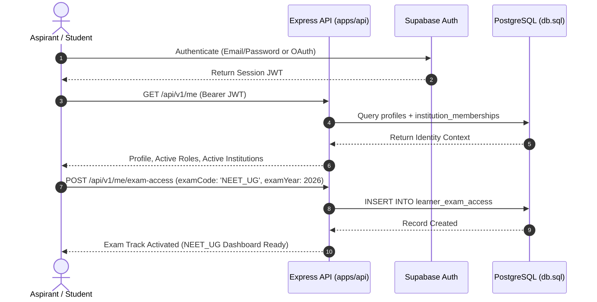
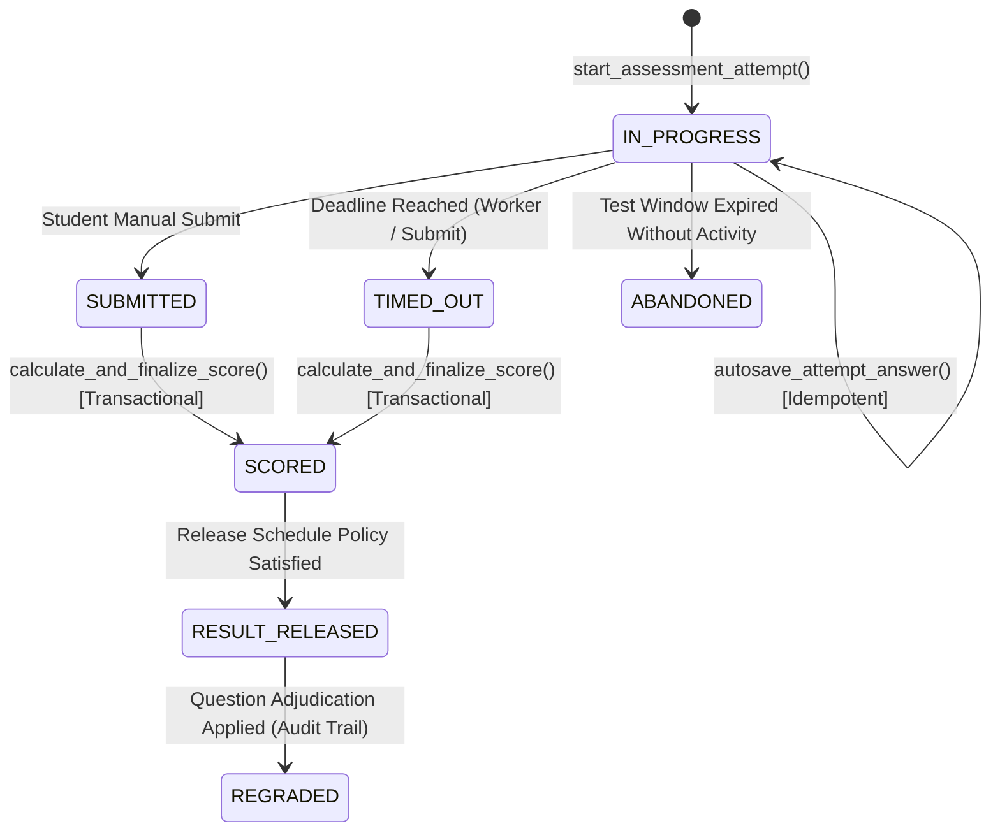

# Product Requirements Document (PRD) — MedPrep

## Specialized Dual-Track Learning, Practice & Authoritative Assessment Platform for NEET-UG and IMAT

| Document Attribute          | Specification Value                                                                               |
| --------------------------- | ------------------------------------------------------------------------------------------------- |
| **Document Version**        | 1.0 (Comprehensive Baseline)                                                                      |
| **Source Specifications**   | `project_overview.md` (v3.0), `db.sql` (PostgreSQL DDL), `api_design.md` (v1.0)                   |
| **Product Scope**           | NEET-UG and IMAT examinations exclusively (Strictly no UCAT/MCAT)                                 |
| **Verified Exam Baselines** | NEET-UG 2026 (NTA/NMC) & IMAT 2026/27 (MUR Ministerial Decree No. 1005)                           |
| **Target Architecture**     | TypeScript Monorepo, React + Vite, Node.js/Express Modular Monolith, Supabase/PostgreSQL with RLS |
| **Document Status**         | Approved Product & Architectural Blueprint                                                        |

---

# 1. Executive Summary, Product Vision & Objectives

## 1.1 Product Vision & Core Positioning

**MedPrep** is an exam-specific preparation, practice, and assessment platform engineered exclusively for **NEET-UG** and **IMAT** aspirants. It replaces fragmented study materials, unreliable online quizzes, and generic LMS architectures with a dual-track platform maintaining two distinct academic and assessment engines under one application shell.

The platform answers six practical questions for aspirants:

1. What should I study for my selected examination and examination year?
2. Which verified resources and practice questions belong to each syllabus topic?
3. Am I practising with the authoritative number of options, timing, and marking rules?
4. Which subjects, sections, and topics require targeted revision?
5. How has my performance evolved across comparable, versioned mock tests?
6. What specific topic or skill should I revise next, backed by objective performance data?

## 1.2 Problem Statement

Aspirants facing NEET-UG (India) and IMAT (Italy/International) encounter critical preparation failures:

- **Taxonomic & Rule Confusion:** Commercial platforms treat competitive exams as generic multiple-choice quizzes, applying a universal `+4/-1` scoring rule or mixing 4-option and 5-option questions.
- **Syllabus Drift:** Outdated or unversioned syllabi are presented without alignment to official regulatory bulletins (e.g. NTA Information Bulletin vs MUR Ministerial Decrees).
- **Untrusted Assessment Engines:** Client-side scoring, exposed answer keys in browser memory, unhandled network drops during tests, and lack of reproducible adjudication for dropped or disputed questions.
- **Unregulated AI Ingestion:** Direct exposure of raw LLM outputs to learners without academic verification, hallucinations in scientific stems, and position bias (such as defaulting Option A as correct).
- **Dual-Track Data Contamination:** Aspirants preparing for both NEET-UG and IMAT suffer from combined scores, misleading percentile comparisons, and unified analytics across fundamentally incompatible exam scales (720 raw marks vs 90 raw marks).

## 1.3 High-Level Business & Operational Objectives

1. **Academic Conformance:** 100% adherence to verified annual blueprints for NEET-UG and IMAT.
2. **Server-Authoritative Assessment Integrity:** Zero answer keys delivered to the client prior to release; 100% server-authoritative deadline calculation, autosave synchronization, and scoring.
3. **Dual-Track Isolation:** Absolute separation of curriculum hierarchies, question banks, scoring policies, attempts, and analytics for NEET-UG and IMAT.
4. **Governed AI Workflow:** 100% of AI-generated questions saved strictly as `DRAFT` requiring qualified faculty review before publication.
5. **Multi-Tenant Security:** Total isolation of institutional data, private resources, and student records reinforced by PostgreSQL Row Level Security (RLS).

## 1.4 Product Boundaries & Explicit Anti-Goals

| In Scope                                                  | Explicitly Out of Scope (Anti-Goals)                                    |
| --------------------------------------------------------- | ----------------------------------------------------------------------- |
| Dual-track NEET-UG and IMAT workflows                     | Generic LMS for UCAT, MCAT, USMLE, or JEE                               |
| Exam-year-versioned practice and mock assessments         | Official NTA or MUR examination administration                          |
| Server-authoritative scoring & adjudication               | Guaranteed official ranks, percentiles, or university admission         |
| Evidence-based revision recommendations                   | Opaque AI predictions of admission chances                              |
| AI-assisted draft question generation with faculty review | Automatic, unreviewed publishing of AI-generated content                |
| Signed URL access control & watermark deterrence          | "Bank-grade DRM", screenshot-proof, or OS-level screen capture blocking |
| Server-authoritative timed testing                        | Calculating final test scores in the React browser                      |

---

# 2. Target Users, Personas & Role Matrix

## 2.1 User Personas

### 1. The Aspirant (Primary Persona)

- **Independent Aspirant:** Self-directed student preparing for NEET-UG, IMAT, or both. Needs personalized track selection, verified syllabus tracking, topic practice drills, timed full-length mocks, and transparent error analytics.
- **Institute-Enrolled Aspirant:** Student enrolled in a coaching academy batch. Accesses batch-assigned resources, schedules institutional mock tests, participates in batch analytics, and receives tutor announcements.

### 2. Faculty / Academic Tutor (Supporting Persona)

- Subject matter experts (Biology, Chemistry, Physics, Mathematics, Logical Reasoning, Reading Skills).
- Needs tools to author questions, review AI-generated question drafts, create assessment blueprints, schedule tests for assigned batches, and analyze cohort weakness radars.

### 3. Coaching Institute Administrator (Tenant Persona)

- Manages institutional tenancy, faculty assignments, student batch enrollments, academic years, course mappings, resource governance, and cohort audit logs.

### 4. Platform Administrator & Academic Reviewer (Governance Persona)

- Global operations: verifies annual NTA bulletins and MUR decrees, publishes immutable exam versions, oversees platform-wide audit trails, and monitors infrastructure health.

## 2.2 Role-Based Access Control (RBAC) & Permission Matrix

System roles are strictly decoupled from user-editable metadata and enforced via database tables `platform_roles` and `institution_memberships`.

| Role Code           | Tenancy Scope      | Description               | Primary Permissions                                                          |
| ------------------- | ------------------ | ------------------------- | ---------------------------------------------------------------------------- |
| `PLATFORM_ADMIN`    | Global             | Platform Owner / Ops      | Manage all institutions, blueprints, global configs, system audit logs       |
| `ACADEMIC_REVIEWER` | Global / Institute | Chief Academic Reviewer   | Verify exam versions, publish syllabus trees, approve question adjudications |
| `INSTITUTE_ADMIN`   | Tenant             | Coaching Institute Head   | Manage batches, enroll students, assign faculty, view institute reports      |
| `FACULTY`           | Tenant / Batch     | Teacher / Question Setter | Upload resources, author/edit questions, review AI drafts, create tests      |
| `STUDENT`           | User / Batch       | Learner / Aspirant        | Browse entitled syllabus, access resources, attempt tests, view own results  |

---

# 3. Dual-Track Examination Specifications (Verified 2026 Baselines)

```
                                  MedPrep Core Engine
                                          │
                 ┌────────────────────────┴────────────────────────┐
                 ▼                                                 ▼
        NEET-UG 2026 Track                                 IMAT 2026/27 Track
   (NTA Bulletin / NMC Syllabus)                      (MUR Ministerial Decree No. 1005)
  ─────────────────────────────────                  ────────────────────────────────────
  • 180 Compulsory Questions                         • 60 Compulsory Questions
  • 4 Options (A, B, C, D)                           • 5 Options (A, B, C, D, E)
  • Duration: 180 Minutes                            • Duration: 100 Minutes
  • Marking: +4.0 Correct, -1.0 Wrong, 0 Blank       • Marking: +1.5 Correct, -0.4 Wrong, 0 Blank
  • Maximum Score: 720 Raw Marks                     • Maximum Score: 90 Raw Marks
  • Adjudication: Dropped Q (+4 all),                • Adjudication: Standard MUR Scoring,
    Multiple-Correct (+4 attempted)                    5 Strict Discrete Sections
```

## 3.1 Examination Versioning Principle

Examination blueprints, question distributions, option counts, and marking schemes are **versioned data entities**, never hardcoded application constants. Before activating a new testing cycle, an authorized Academic Reviewer must verify official decree documents and publish a new version.

## 3.2 NEET-UG 2026 Reference Baseline

- **Governing Authority:** National Testing Agency (NTA) & National Medical Commission (NMC).
- **Syllabus Standard:** NCERT Class 11 and Class 12 Core Sciences.
- **Delivery Mode Simulation:** Digital simulation of official pen-and-paper pattern.
- **Structure & Question Distribution:**
  - Physics: 45 compulsory questions (180 marks)
  - Chemistry: 45 compulsory questions (180 marks)
  - Biology (Botany & Zoology): 90 compulsory questions (360 marks)
  - **Total:** 180 questions | 180 minutes | 720 maximum raw marks.
- **Scoring Rules:**
  - Correct Answer: `+4.0`
  - Incorrect Answer: `-1.0`
  - Unanswered: `0.0`
- **Official 2026 NTA Adjudication Rules:**
  1. _Multiple Correct Options:_ `+4.0` awarded only to candidates who selected any of the authorized correct options.
  2. _All Options Correct:_ `+4.0` awarded to all candidates who attempted the question.
  3. _Dropped Question / Invalid Stem:_ `+4.0` awarded to all candidates who appeared for the test, regardless of attempt.

## 3.3 IMAT 2026/27 Reference Baseline

- **Governing Authority:** Italian Ministry of University and Research (MUR) — Decree No. 1005 (6 August 2026).
- **Structure & Section Distribution:**
  1. Reading Skills and Knowledge Acquired in Studies: 4 questions
  2. Logical Reasoning and Problem Solving: 5 questions
  3. Biology: 23 questions
  4. Chemistry: 15 questions
  5. Physics and Mathematics: 13 questions
  - **Total:** 60 questions | 100 minutes | 90 maximum raw marks.
- **Scoring Rules:**
  - Correct Answer: `+1.5`
  - Incorrect Answer: `-0.4`
  - Unanswered: `0.0`
- **Academic Safeguard:** Section 1 (_Reading Skills and Knowledge_) tests analytical reading, argument deconstruction, and cultural/historical literacy. It must **never** be generated or treated as an English grammar drill.
- **Published Exam Convention Safeguard:** The official 2026 MUR paper published with Option A as the key for all questions. The platform treats this as an artifact of that specific past paper release; **AI generation and mock question authoring must strictly prevent Option A bias.**

## 3.4 Deep Comparison Matrix

| Architectural Dimension  | NEET-UG Specification                             | IMAT Specification                                         |
| ------------------------ | ------------------------------------------------- | ---------------------------------------------------------- |
| **Question Count**       | 180 questions                                     | 60 questions                                               |
| **Options per Question** | Exactly 4 options (`A, B, C, D`)                  | Exactly 5 options (`A, B, C, D, E`)                        |
| **Test Duration**        | 180 minutes (3 hours)                             | 100 minutes (1 hour 40 mins)                               |
| **Correct Marking**      | `+4.0` marks                                      | `+1.5` marks                                               |
| **Negative Marking**     | `-1.0` marks                                      | `-0.4` marks                                               |
| **Maximum Score**        | 720.00 raw marks                                  | 90.00 raw marks                                            |
| **Section Hierarchy**    | Physics, Chemistry, Biology (Botany/Zoology)      | Reading Knowledge, Logic, Biology, Chemistry, Physics/Math |
| **Language Baseline**    | English (launch) + 12 regional languages (future) | English exclusively                                        |
| **Adjudication Logic**   | Dropped Q (+4 all), Multi-correct, All-correct    | Standard single key; MUR decree adjustments                |

---

# 4. Functional Requirements & Feature Workflows

## 4.1 Identity, Authentication & Track Selection

- **FR-AUTH-01:** Integration with Supabase Auth for identity management. The platform extracts the authenticated `sub` (profile ID) via Bearer JWT.
- **FR-AUTH-02:** User-editable metadata (`raw_user_meta_data`) must never be used for authorization. User roles are resolved strictly from `platform_roles` and `institution_memberships`.
- **FR-TRACK-01:** Aspirants select their preparation track: `NEET_UG`, `IMAT`, or `BOTH`.
- **FR-TRACK-02:** Selecting both tracks creates two distinct `learner_exam_access` records. The application shell provides a track toggle without merging data or progress.
- **FR-TRACK-03:** Independent learners can access platform-level content; institute-enrolled learners automatically inherit access to institute batches upon accepting an invitation.



## 4.2 Multi-Tenant Institutional Workspaces

- **FR-TEN-01:** Coaching institutes operate in isolated workspaces represented by `institutions`.
- **FR-TEN-02:** Institute Admins invite faculty and students via `invitations` with cryptographic tokens and defined expiration.
- **FR-TEN-03:** Cohort hierarchy: `institutions` -> `academic_years` -> `courses` -> `batches`.
- **FR-TEN-04:** Students enroll into batches via `student_batch_enrollments`; faculty assign to batches via `faculty_batch_assignments`.

## 4.3 Curriculum & Syllabus Navigation

- **FR-CURR-01:** Curriculums follow an explicit five-level hierarchy: `SUBJECT` -> `SECTION` -> `CHAPTER` -> `TOPIC` -> `SKILL` via `syllabus_nodes`.
- **FR-CURR-02:** Hierarchical queries are optimized using the `syllabus_node_closures` transitive closure table, maintained automatically via database trigger `trg_maintain_syllabus_closures`.
- **FR-CURR-03:** Topic progression (`student_topic_progress`) tracks status (`NOT_STARTED`, `IN_PROGRESS`, `COMPLETED`), revision cycles, and study timestamps.
- **FR-CURR-04:** Study planning: faculty and independent learners create `study_plans`, `study_plan_items`, and log `study_sessions`.

## 4.4 Learning Resources & Private Object Delivery

- **FR-RES-01:** Resources support notes, PDFs, book references, DPPs, PYQs, videos, diagrams, and external links via `resources`.
- **FR-RES-02:** Files are stored in private Supabase Storage buckets (`resources`). Public direct bucket access is denied.
- **FR-RES-03:** The API authorizes resource access based on batch enrollment or personal entitlement and generates short-lived signed URLs (maximum validity: 60 seconds).
- **FR-RES-04:** Content lifecycle governance follows strict state transitions: `DRAFT` -> `PENDING_REVIEW` -> `PUBLISHED` -> `ARCHIVED`/`REJECTED`.

## 4.5 Question Bank Governance & Immutable Revisions

- **FR-QB-01:** Logical questions (`questions`) are separated from immutable content revisions (`question_versions`).
- **FR-QB-02:** Once a question version is referenced in an assessment or attempt, it is immutable. Corrections require creating version `N+1`.
- **FR-QB-03:** NEET-UG questions require exactly 4 options (`A, B, C, D`); IMAT questions require exactly 5 options (`A, B, C, D, E`).
- **FR-QB-04:** Answer keys (`question_answer_keys`) are stored in a dedicated confidential table protected by RLS and server-side isolation. **Answer keys are never transmitted to students during active testing.**
- **FR-QB-05:** Adjudications (`question_adjudications`) store official post-exam challenge resolutions (`STANDARD`, `MULTIPLE_CORRECT`, `ALL_OPTIONS_CORRECT`, `DROPPED_FULL_CREDIT`, `AMBIGUOUS_STEM`).

## 4.6 Assessment Authoring & Blueprint Versioning

- **FR-ASM-01:** Assessments support `DPP`, `CHAPTER_TEST`, `SUBJECT_TEST`, `MOCK_TEST`, `REVISION_TEST`, and `PYQ_PRACTICE`.
- **FR-ASM-02:** Publishing an assessment creates an immutable `assessment_versions` record containing the exact configuration snapshot: duration, section distribution, question versions, option ordering seed, and scoring policy version.
- **FR-ASM-03:** Batch availability is scheduled via `assessment_batches` with start and expiration windows.

## 4.7 Assessment Runner, Autosave & Authoritative Lifecycle

- **FR-RUN-01:** Attempt initiation calls stored procedure `start_assessment_attempt()`. The server records the authoritative start time and computes `deadline_at`.
- **FR-RUN-02:** Client countdown timers are visual displays only. The server rejects answer saves or submissions received after `deadline_at + 30 seconds` (grace period for network latency).
- **FR-RUN-03:** Autosave calls stored procedure `autosave_attempt_answer()`. Answer saves are idempotent and update `attempt_answers`.
- **FR-RUN-04:** Attempt recovery: if a student refreshes, closes the tab, or suffers temporary connection loss, reopening the test loads the saved answers and recalculates remaining time from `deadline_at`.
- **FR-RUN-05:** Attempt events (`attempt_events`) log tab blur, network reconnects, and autosave syncs.



## 4.8 Dual-Track Authoritative Scoring Engine

- **FR-SCORE-01:** Scoring is 100% server-authoritative, executed inside stored procedure `calculate_and_finalize_score()`.
- **FR-SCORE-02:** Float arithmetic is strictly prohibited; all mark calculations use `NUMERIC(5,2)` and `NUMERIC(7,2)`.
- **FR-SCORE-03 (NEET Evaluation):**
  - Evaluates standard 4-option MCQs: `+4.0` for match, `-1.0` for incorrect, `0.0` for blank.
  - Applies adjudications: if `DROPPED_FULL_CREDIT`, `+4.0` is credited to all; if `ALL_OPTIONS_CORRECT`, `+4.0` credited if attempted; if `MULTIPLE_CORRECT`, `+4.0` credited if selected option is in `valid_option_ids`.
- **FR-SCORE-04 (IMAT Evaluation):**
  - Evaluates standard 5-option MCQs: `+1.5` for match, `-0.4` for incorrect, `0.0` for blank.
  - Enforces 90.0 maximum raw score limit.
- **FR-SCORE-05:** Outputs are stored immutably in `score_results` with complete section breakdowns (`section_breakdown_json`).
- **FR-SCORE-06:** Regrading triggers `regrade_events` preserving previous score, new score, and author audit.

## 4.9 Performance Analytics & Revision Recommendations

- **FR-ANA-01:** Generates track-specific performance radar views:
  - NEET: Overall score out of 720, Botany/Zoology split, Physics & Chemistry accuracy.
  - IMAT: Overall score out of 90, Reading/Knowledge score, Logic score, Science scores.
- **FR-ANA-02:** Cross-track analytics contamination is strictly forbidden: NEET and IMAT raw scores are never averaged or combined.
- **FR-ANA-03:** Transparent revision recommendations are driven by database view `view_revision_recommendations`:
  - Flag topics where attempted accuracy is below 60% with a minimum sample size of 5 questions.
  - Display transparent reasoning (e.g. _"Revise Chemical Bonding: 42% accuracy across 12 attempted questions"_).

---

# 5. AI Integration Requirements (Groq API & Academic Safeguards)

## 5.1 Groq API Backend Architecture & Security Isolation

- **AI-SEC-01:** Groq Cloud API is integrated exclusively within `apps/api/src/infrastructure/ai/`.
- **AI-SEC-02:** `GROQ_API_KEY` is loaded solely in server environment variables. No client-side exposure.
- **AI-SEC-03:** Primary LLM model: `llama-3.3-70b-versatile`; Automatic fallback model: `llama-3.1-8b-instant`.
- **AI-SEC-04:** Bounded exponential backoff retries on Groq HTTP 429 and HTTP 503 errors (maximum 3 retries).
- **AI-SEC-05:** Hard timeout enforcement via `AbortController` (30,000 ms default).

## 5.2 AI Question Generator Specifications

- **AI-GEN-01:** Accessible exclusively to `FACULTY`, `ACADEMIC_REVIEWER`, `INSTITUTE_ADMIN`, and `PLATFORM_ADMIN`. Students are blocked with HTTP 403 Forbidden.
- **AI-GEN-02:** Input parameters require explicit syllabus taxonomy: `examCode`, `examVersionId`, `sectionId`, `syllabusNodeId`, `subject`, `topic`, `difficulty`, `count` (1 to 10).
- **AI-GEN-03:** The generator has **zero access** to active assessment answer keys or student records.
- **AI-GEN-04:** Separate prompt engineering pipelines:
  - NEET-UG: NCERT 11-12 curriculum, 4 options (`A, B, C, D`), Botany/Zoology distinction.
  - IMAT: MUR decree guidelines, 5 options (`A, B, C, D, E`), analytical reading and logic standards.

## 5.3 Anti-Option-A Bias Elimination Strategy

1. **Prompt Constraint:** System and user prompts explicitly instruct the LLM: _"NEVER make Option A the default correct answer. Randomly distribute correct answers across all options."_
2. **Cryptographic Shuffling:** Output options undergo Fisher-Yates shuffling using `crypto.randomInt()`. Options are re-keyed sequentially (`A` through `D` or `A` through `E`) and `correctOptionKey` is dynamically updated. This mathematically guarantees uniform ~25% (NEET) and ~20% (IMAT) distribution across positions.

## 5.4 Structured Schema Validation & Sanitization

All raw LLM completions pass through Zod schema validation (`validateGeneratedQuestions`):

- Root object contains `questions` array.
- NEET questions validated against `neetUGQuestionSchema` (exactly 4 options).
- IMAT questions validated against `imatQuestionSchema` (exactly 5 options).
- Exactly one option marked `isCorrect: true` matching `correctOptionKey`.
- All options have unique text (no duplicate distractors).
- Explanation length >= 20 characters.
- Strict XSS regex sanitization rejects `<script>`, `javascript:`, `onerror=`, `onload=`.

## 5.5 Mandatory Human-in-the-Loop Review Queue

- **AI-REV-01:** AI-generated questions are saved to PostgreSQL with:
  - `question_versions.review_status = 'DRAFT'`
  - `ai_generation_reviews.review_status = 'PENDING'`
- **AI-REV-02:** AI questions **cannot be published** or assigned to active tests until a qualified faculty member reviews them.
- **AI-REV-03:** Faculty review actions via `POST /api/v1/content-bank/ai-drafts/reviews/:reviewId/decide`:
  - `APPROVE`: Transitions review to `APPROVED` and question version to `APPROVED`.
  - `EDIT`: Faculty modifies question stem or explanation; transitions review to `EDITED`.
  - `REJECT`: Rejects draft; transitions review and version to `REJECTED`.

## 5.6 Student AI Study Assistant Safeguards (Post-MVP Phase 3)

- Grounded strictly in approved resources assigned to the learner's batch.
- **Active Assessment Blindness:** The retrieval index strictly excludes `question_answer_keys` and unreleased `assessments`.
- Medical Advice Disclaimer: Model outputs include disclaimers and do not provide medical diagnosis or treatment advice.

---

# 6. Database Architecture & Schema Mapping (`db.sql`)

The database layer is implemented in PostgreSQL 15+ hosted on Supabase, featuring 51 tables, 27 custom enums, custom triggers, 5 production analytical views, and stored procedures.

## 6.1 Database Entity Domain Mapping

```text
Section 2: Identity & Multi-Tenancy
  ├── profiles                           (1:1 with auth.users)
  ├── institutions                       (Coaching academy workspaces)
  ├── institution_memberships            (Server-side RBAC)
  ├── invitations                        (Cryptographic onboarding)
  └── platform_roles                     (Global governance)

Section 3: Exam Tracks & Blueprints
  ├── exam_tracks                        (NEET_UG, IMAT)
  ├── exam_versions                      (Annual cycle blueprints)
  ├── exam_scoring_policies              (Decimal mark arithmetic)
  ├── exam_sections                      (Section questions & timing)
  └── learner_exam_access                (Dual-track enrollment)

Section 4: Tenancy & Batches
  ├── academic_years                     (Annual institutional terms)
  ├── courses                            (Exam-track mapped courses)
  ├── batches                            (Student cohorts)
  ├── student_batch_enrollments          (Batch enrollment history)
  └── faculty_batch_assignments          (Teacher batch allocation)

Section 5: Curriculum Structure
  ├── syllabus_nodes                     (SUBJECT to SKILL tree)
  ├── syllabus_node_closures             (Transitive hierarchy closure)
  ├── syllabus_learning_objectives       (Competency criteria)
  ├── syllabus_prerequisites             (Curriculum graph edges)
  ├── student_topic_progress             (Topic mastery & revision)
  ├── study_plans                        (Personalized / assigned plans)
  ├── study_plan_items                   (Milestones & tasks)
  └── study_sessions                     (Logged study hours)

Section 6: Learning Resources
  ├── resources                          (Metadata, storage paths, state)
  ├── resource_syllabus_mappings         (Node-level linking)
  ├── resource_batch_assignments         (Cohort access gates)
  └── resource_reviews                   (Faculty approval log)

Section 7: Question Bank & Revisions
  ├── questions                          (Stable logical item ID)
  ├── question_versions                  (Immutable version snapshots)
  ├── question_options                   (4 for NEET, 5 for IMAT)
  ├── question_answer_keys               (Confidential key storage)
  ├── question_assets                    (Diagrams, formulas, storage)
  ├── question_syllabus_mappings         (Taxonomy mapping)
  ├── question_reviews                   (Review workflow logs)
  ├── question_sources                   (PYQ citations, licenses)
  └── question_adjudications             (Official dispute resolutions)

Section 8: Assessment Engine
  ├── assessments                        (Test definitions & tracks)
  ├── assessment_batches                 (Schedule & cohort access)
  ├── assessment_versions                (Immutable published snapshots)
  ├── assessment_sections                (Section configurations)
  ├── assessment_section_questions       (Question version allocations)
  ├── assessment_attempts                (Authoritative student attempts)
  ├── attempt_answers                    (Autosaved response states)
  ├── attempt_events                     (Audit events, tab blurs)
  ├── score_results                      (Decimal score breakdown)
  └── regrade_events                     (Audited recalculations)

Section 9: AI Generation Safeguards
  ├── ai_generation_jobs                 (Async job queue tracking)
  ├── ai_generation_reviews              (Human-in-the-loop review queue)
  └── ai_reference_sources               (RAG grounding excerpts)

Section 10: Operations & Governance
  ├── announcements & batches            (Notices & broadcasts)
  ├── calendar_events & batches          (Academic schedules)
  ├── notification_outbox                (Resilient delivery queue)
  ├── discussion_threads & replies       (Moderated community)
  ├── moderation_actions                 (Content moderation logs)
  ├── student_documents & reviews        (Optional verification docs)
  └── audit_logs                         (Append-only security log)
```

## 6.2 Key Stored Procedures & Functions

1. `start_assessment_attempt(p_assessment_version_id, p_learner_id, p_institution_id)`
   - Validates eligibility, batch window, and attempt limits.
   - Computes authoritative `deadline_at = started_at + duration_minutes + accommodation_minutes`.
   - Inserts record into `assessment_attempts` with status `IN_PROGRESS`.
2. `autosave_attempt_answer(p_attempt_id, p_learner_id, p_question_version_id, p_selected_option_ids, p_time_spent_seconds)`
   - Enforces `now() <= deadline_at + interval '30 seconds'`.
   - Executes idempotent upsert into `attempt_answers`.
3. `calculate_and_finalize_score(p_attempt_id, p_trigger_reason)`
   - Row-locks attempt with `FOR UPDATE`.
   - Evaluates marks via exact decimal calculations matching scoring policy and adjudications.
   - Inserts `score_results` and transitions attempt to `SCORED`.
4. `maintain_syllabus_closures()`
   - Trigger maintaining `syllabus_node_closures` for high-speed sub-tree queries.

## 6.3 Row Level Security (RLS) Policy Matrix

All production tables have RLS enabled:

| Table Name                | SELECT Policy                                         | INSERT / UPDATE Policy                              |
| ------------------------- | ----------------------------------------------------- | --------------------------------------------------- |
| `profiles`                | Own profile or members of same institution            | Own profile update only                             |
| `institution_memberships` | Members of same institution                           | Institute Admin only                                |
| `learner_exam_access`     | Own access records                                    | Self-registration / Institute Admin                 |
| `syllabus_nodes`          | Public (authenticated users)                          | Platform Admin / Academic Reviewer only             |
| `resources`               | Entitled independent learner or enrolled batch member | Faculty / Institute Admin                           |
| `question_versions`       | Published versions or author/reviewer                 | Faculty / Reviewer only                             |
| `question_answer_keys`    | **Strictly denied to students.** Faculty/Admin only   | Faculty / Reviewer only                             |
| `assessment_attempts`     | Own attempts or assigned faculty                      | Stored procedures / own in-progress updates         |
| `score_results`           | Own score after `release_at` policy satisfied         | Stored procedure (`calculate_and_finalize_score`)   |
| `audit_logs`              | Institute Admin (own tenant); Platform Admin          | **Append-only; Updates/Deletions strictly revoked** |

---

# 7. API Architecture & Endpoint Specifications (`api_design.md`)

## 7.1 Middleware Pipeline

Requests execute through the modular monolith pipeline:

```text
HTTP Request
   ├── 1. cors + helmet + requestId
   ├── 2. authenticate.ts (Verifies Supabase JWT; populates req.user)
   ├── 3. resolve-membership.ts (Injects active institution_id & RBAC role)
   ├── 4. require-permission.ts (Enforces allowedRoles: FACULTY, ADMIN, etc.)
   ├── 5. require-exam-access.ts (Enforces active NEET_UG / IMAT entitlement)
   ├── 6. rate-limit.ts (Sliding window token guard; HTTP 429)
   ├── 7. validate-request.ts (Zod DTO validation for body/params/query)
   └── 8. Domain Controller -> Domain Service -> Repository
```

## 7.2 Core Endpoint Catalog Mapped to Domains

```text
Identity & Track Entitlement
  GET    /api/v1/me                                  Profile & active memberships
  GET    /api/v1/me/exam-access                      List active exam tracks
  POST   /api/v1/me/exam-access                      Enroll in exam track (NEET/IMAT)
  PATCH  /api/v1/me/exam-access/:accessId            Switch target exam year / cycle

Exam Blueprints & Curriculum
  GET    /api/v1/exam-tracks                         List supported tracks (NEET_UG, IMAT)
  GET    /api/v1/exam-tracks/:examCode/versions      Annual version history
  GET    /api/v1/exam-versions/:versionId            Blueprint sections & scoring policy
  GET    /api/v1/exam-versions/:versionId/curriculum Complete hierarchical syllabus tree
  GET    /api/v1/syllabus-nodes/:nodeId              Single topic / learning objectives

Learning Resources
  GET    /api/v1/resources                           List filtered resources
  GET    /api/v1/resources/:resourceId               Resource metadata & short-lived signed URL
  POST   /api/v1/resources                           Faculty drafts learning resource
  POST   /api/v1/resources/:resourceId/submit-review Submit resource for academic review
  POST   /api/v1/resources/:resourceId/publish       Publish resource to batches

Question Bank & AI Generation
  GET    /api/v1/questions                           Filter questions by node & status
  POST   /api/v1/questions                           Author question draft with options & key
  POST   /api/v1/questions/:questionId/versions      Create immutable question revision
  POST   /api/v1/question-versions/:versionId/review Review & approve/reject version
  POST   /api/v1/content-bank/ai-drafts/generate     Trigger AI drafting batch (Groq LLM)
  GET    /api/v1/content-bank/ai-drafts/jobs/:jobId  Poll AI generation job status
  GET    /api/v1/content-bank/ai-drafts/reviews/pending Faculty pending review queue
  POST   /api/v1/content-bank/ai-drafts/reviews/:reviewId/decide Approve, edit, or reject AI draft

Assessments & Test Runner
  GET    /api/v1/assessments                         List scheduled tests for track/batch
  POST   /api/v1/assessments                         Create assessment draft
  POST   /api/v1/assessment-versions/:versionId/attempts Start attempt (calls start_assessment_attempt)
  GET    /api/v1/attempts/:attemptId                 Resume attempt (questions WITHOUT keys)
  PUT    /api/v1/attempts/:attemptId/answers/:questionVersionId Idempotent autosave response
  POST   /api/v1/attempts/:attemptId/submit          Submit & finalize test score
  GET    /api/v1/attempts/:attemptId/result          Get authoritative score & solution review
  POST   /api/v1/attempts/:attemptId/request-review  Dispute question for academic review
```

---

# 8. UI Screen Inventory & Frontend Architecture

Built in React + TypeScript + Vite (`apps/web`), structured using Feature-Slice Architecture.

## 8.1 Shared Screens

- `SCR-PUB-01`: Landing Page & Exam Track Value Proposition.
- `SCR-AUTH-01`: Sign In / Sign Up / Password Reset.
- `SCR-TRACK-01`: Dual-Track Selection & Target Exam Year Switcher.
- `SCR-PROF-01`: User Profile, Accessibility Accommodations & Preferences.

## 8.2 Student Portal Screens

- `SCR-STU-01`: **Unified Student Dashboard:** Displays separate track summaries for NEET-UG and IMAT (current cycle, study progress, upcoming mock tests, weak topics).
- `SCR-STU-02`: **Curriculum Explorer:** Expandable syllabus tree (NCERT or MUR) with topic progress indicators (`NOT_STARTED`, `IN_PROGRESS`, `COMPLETED`).
- `SCR-STU-03`: **Resource Reader:** Embedded PDF document reader and video player with watermarking and short-lived URL management.
- `SCR-STU-04`: **Topic Practice Drill Runner:** Untimed or lightly timed practice drills with immediate explanation reveal.
- `SCR-STU-05`: **Mock Assessment Lobby:** Instructions, section distribution, timing, and marking rules.
- `SCR-STU-06`: **Unified Assessment Runner:**
  - Dynamic test engine driven by blueprint configuration (never hardcoded forks).
  - Question navigation palette, mark-for-review, autosave status indicator (`Saving...`, `Saved`, `Offline`).
  - Strict option rendering: 4 options for NEET, 5 options for IMAT.
- `SCR-STU-07`: **Submission Confirmation:** Unanswered questions warning and final submission modal.
- `SCR-STU-08`: **Results & Solution Review:** Released scores, correct answer highlights, detailed explanations, and question dispute submission.
- `SCR-STU-09`: **Performance Analytics:** Topic accuracy radar, time allocation per section, historical score progression.
- `SCR-STU-10`: **AI Study Assistant (Phase 3):** Grounded chat interface with syllabus references.

## 8.3 Faculty Portal Screens

- `SCR-FAC-01`: **Faculty Dashboard:** Assigned tracks, courses, batches, and pending review counts.
- `SCR-FAC-02`: **Question Bank Manager:** Question authoring tool with LaTeX math support, diagram upload, and confidential answer key setter.
- `SCR-FAC-03`: **AI Question Generator:** Form to select track, year, subject, section, difficulty, and batch size (1-10).
- `SCR-FAC-04`: **AI Draft Review Queue:** Side-by-side review interface with inline editing and Approve/Reject controls.
- `SCR-FAC-05`: **Assessment Builder:** Blueprint designer to assemble test sections, select question versions, and schedule batch access.

## 8.4 Administrator Screens

- `SCR-ADM-01`: **Institute Management:** Batches, courses, faculty assignments, student enrollments.
- `SCR-ADM-02`: **Platform Governance:** Annual exam configuration rollover, source URL verification, global audit logs.

---

# 9. Non-Functional Requirements (NFRs)

## 9.1 Performance & Concurrency Targets

- **NFR-PERF-01:** Common API read endpoints: p95 latency `< 500 ms`.
- **NFR-PERF-02:** Autosave API endpoint: p95 latency `< 500 ms` under a concurrency of 1,000 active test takers per tenant.
- **NFR-PERF-03:** Test finalization & scoring execution: complete within `1,500 ms` transactional database runtime.
- **NFR-PERF-04:** Groq AI draft generation: batch of 5 questions completed in `< 5,000 ms` via LPU inference.

## 9.2 Reliability & Fault Tolerance

- **NFR-REL-01:** High Availability: 99.9% uptime for assessment runner and answer autosave APIs.
- **NFR-REL-02:** Database Durability: RPO (Recovery Point Objective) `< 5 minutes`; RTO (Recovery Time Objective) `< 1 hour`.
- **NFR-REL-03:** Network Resilience: In the event of client-side disconnects, the assessment runner retries saves with exponential backoff and prevents data loss.
- **NFR-REL-04:** Idempotent Finalization: Duplicate submissions return the existing score result without duplicate scoring records.

## 9.3 Content Protection & Assessment Integrity

- **NFR-SEC-01:** Private Storage: Zero public read access on Supabase buckets. All assets accessed via signed URLs valid for <= 60 seconds.
- **NFR-SEC-02:** Watermarking: Educational PDFs and diagrams display dynamic user-specific watermarks (Student ID + Timestamp).
- **NFR-SEC-03:** Answer Key Isolation: Active assessment answer keys are never delivered to the browser bundle or client cache.
- **NFR-SEC-04:** Tamper-Evident Audit: All administrative, faculty review, scoring, and regrading events are appended to `audit_logs`.

## 9.4 Privacy, Data Governance & Accessibility

- **NFR-PRV-01:** Data Minimization: No collection of unneeded government identifiers or personal documents for basic practice.
- **NFR-PRV-02:** DPDP Act & GDPR Alignment: Users can request data export and account deletion. Data retention schedules enforce automated archiving.
- **NFR-ACC-01:** Full compliance with WCAG 2.1 Level AA (keyboard navigation, screen-reader labels, contrast ratio >= 4.5:1).
- **NFR-ACC-02:** Authorized PwD accommodations: configurable compensatory time (e.g. +20 minutes/hour for eligible candidates).

---

# 10. Cross-Document Discrepancy & Missing Requirements Log

This section explicitly documents inconsistencies and missing alignments across `project_overview.md`, `db.sql`, and `api_design.md`, providing the definitive architectural resolution.

| ID          | Issue Description                                             | Source Conflict                                                                                                                                                          | Architectural Resolution                                                                                                                                               |
| ----------- | ------------------------------------------------------------- | ------------------------------------------------------------------------------------------------------------------------------------------------------------------------ | ---------------------------------------------------------------------------------------------------------------------------------------------------------------------- |
| **DISC-01** | **API Version Prefix Inconsistency**                          | `api_design.md` uses `/api/v1/...`; `project_overview.md` Section 11 uses `/api/...` without versioning.                                                                 | **Adopt `/api/v1/...` exclusively.** Matches modular monolith best practices and current backend implementation.                                                       |
| **DISC-02** | **AI Drafting Route Pathing**                                 | `api_design.md` lists `POST /api/v1/ai/question-drafts`; codebase and `folder_structure.md` use `POST /api/v1/content-bank/ai-drafts/generate`.                          | **Standardize on `/api/v1/content-bank/ai-drafts/...`** under the `content-bank` domain bounded context. Support `/api/v1/ai/question-drafts` as an alias if required. |
| **DISC-03** | **Syllabus Versioning Table Entity**                          | `project_overview.md` mentions `SYLLABUS_VERSIONS` as an independent entity; `db.sql` ties syllabus versioning directly to `exam_versions`.                              | **Follow `db.sql`.** `exam_versions` serves as the authoritative blueprint root; `syllabus_nodes` references `exam_version_id`. Avoids redundant join tables.          |
| **DISC-04** | **Adjudication Enum Naming**                                  | `project_overview.md` lists `INVALID_OR_DROPPED`; `db.sql` defines enum `adjudication_type` with `'DROPPED_FULL_CREDIT'` and `'AMBIGUOUS_STEM'`.                         | **Adopt `db.sql` enum values** (`DROPPED_FULL_CREDIT`, `ALL_OPTIONS_CORRECT`, `MULTIPLE_CORRECT`, `STANDARD`). Matches exact NTA 2026 scoring adjudication logic.      |
| **DISC-05** | **Batch Assignment Table Names**                              | `project_overview.md` ER diagram shows `STUDENT_ENROLLMENTS` and `FACULTY_ASSIGNMENTS`; `db.sql` implements `student_batch_enrollments` and `faculty_batch_assignments`. | **Adopt `db.sql` table names.** Explicitly clarifies that enrollment and assignments are batch-scoped rather than course-scoped.                                       |
| **DISC-06** | **Missing Tenancy & Operations Endpoints in `api_design.md`** | `api_design.md` omits endpoints for batches, announcements, academic calendar, and study plans, all of which are defined in `db.sql` and `project_overview.md`.          | **Incorporate missing endpoints into PRD Section 7.2** (`/api/v1/batches`, `/api/v1/announcements`, `/api/v1/calendar`, `/api/v1/learning/progress`).                  |
| **DISC-07** | **Resource File Storage Architecture**                        | `project_overview.md` describes separate `resource_files` table; `db.sql` consolidates `storage_path` directly on `resources`.                                           | **Adopt `db.sql` consolidation.** One resource maps to one primary storage artifact or link, simplifying RLS and signed URL generation.                                |

---

# 11. MVP Scope, Roadmap & Phased Implementation

```
Phase 0: Research & Baselines  ──►  Phase 1: Foundation & RBAC  ──►  Phase 2: Question Bank & Tests
(NTA/MUR Blueprint Validation)      (Dual Track, Syllabus, Auth)     (Runner, Autosave, Scoring)
                                                                                  │
Phase 5: Monetization          ◄──  Phase 4: Operational Pilot  ◄──  Phase 3: AI & Revision
(Subscriptions, Scale)              (Pilot Hardening, Monitoring)    (Groq Drafter, Radar Analytics)
```

## 11.1 Phased Implementation Roadmap

- **Phase 0 — Product Validation & Baselines (Completed):** Verified official NTA NEET-UG 2026 bulletin and Italian MUR Decree No. 1005 (2026/27 baseline).
- **Phase 1 — Secure Foundation (MVP Core):** Supabase Auth, profiles, RBAC memberships, dual-track selection (`NEET_UG`/`IMAT`), hierarchical syllabus trees, private storage buckets, and RLS security policies.
- **Phase 2 — Question Bank & Authoritative Testing (MVP Core):** 4-option and 5-option question authoring, assessment builder, timed assessment runner, idempotent autosave, server-authoritative scoring engine, and result review.
- **Phase 3 — AI Assistance & Revision Intelligence (MVP Priority):** Groq API integration (`llama-3.3-70b-versatile`), separate NEET/IMAT prompt templates, anti-Option-A cryptographic shuffling, faculty draft review queue, performance radar views, and rule-based revision recommendations.
- **Phase 4 — Operational Pilot Hardening:** Institutional pilot rollout, load testing (1,000 concurrent test takers), accessibility audit, and backup restoration drills.
- **Phase 5 — Monetization & Growth (Post-MVP):** Paid subscription plans, payment gateway integration, advanced cohort analytics, and mobile app clients.

## 11.2 Feature Priority Breakdown

| Capability / Feature                          |  Phase  | Priority |  MVP Classification  |
| --------------------------------------------- | :-----: | :------: | :------------------: |
| User Registration & Dual-Track Selection      | Phase 1 |    P0    | **Must-Have (MVP)**  |
| Separate NEET-UG & IMAT Dashboards            | Phase 1 |    P0    | **Must-Have (MVP)**  |
| Hierarchical Syllabus Browser (NCERT / MUR)   | Phase 1 |    P0    | **Must-Have (MVP)**  |
| Learning Resource Library & Signed URLs       | Phase 1 |    P0    | **Must-Have (MVP)**  |
| Versioned Question Bank (4-Opt & 5-Opt)       | Phase 2 |    P0    | **Must-Have (MVP)**  |
| Timed Assessment Runner with Server Autosave  | Phase 2 |    P0    | **Must-Have (MVP)**  |
| Server-Authoritative Scoring Engine           | Phase 2 |    P0    | **Must-Have (MVP)**  |
| Dual-Track Result & Solution Review           | Phase 2 |    P0    | **Must-Have (MVP)**  |
| AI Question Generator (Groq + Faculty Review) | Phase 3 |    P1    | **Must-Have (MVP)**  |
| Evidence-Based Revision Recommendations       | Phase 3 |    P1    |   **Should-Have**    |
| Academic Calendar & Announcements             | Phase 3 |    P1    |   **Should-Have**    |
| AI Study Assistant (Student-Facing Chat)      | Phase 3 |    P2    | **Later (Post-MVP)** |
| Moderated Discussion Threads                  | Phase 5 |    P3    | **Later (Post-MVP)** |
| Subscriptions & Commercial Payment Gateways   | Phase 5 |    P3    | **Later (Post-MVP)** |

---

# 12. Acceptance Criteria, Testing Strategy & Release Gates

## 12.1 Authoritative Scoring Test Vectors

The backend scoring engine must pass the following exact numerical test vectors:

### Vector 1: NEET-UG 2026 Ordinary Scoring

- **Test Paper:** 10 questions (4 options each, maximum score: 40.0)
- **Results:** 7 Correct, 2 Incorrect, 1 Unanswered
- **Formula:** `(7 × 4.0) + (2 × -1.0) + (1 × 0.0)`
- **Expected Authoritative Raw Score:** `26.00` marks

### Vector 2: NEET-UG 2026 Dropped-Question Adjudication

- **Test Paper:** 10 questions containing 1 dropped question
- **Results:** Candidate did not attempt the dropped question; 8 correct, 1 incorrect on other questions
- **Formula:** `(8 × 4.0) + (1 × -1.0) + (1 × 4.0 [DROPPED_FULL_CREDIT])`
- **Expected Authoritative Raw Score:** `35.00` marks

### Vector 3: IMAT 2026/27 Ordinary Scoring

- **Test Paper:** 10 questions (5 options each, maximum score: 15.0)
- **Results:** 6 Correct, 3 Incorrect, 1 Unanswered
- **Formula:** `(6 × 1.5) + (3 × -0.4) + (1 × 0.0)`
- **Expected Authoritative Raw Score:** `7.80` marks

## 12.2 Integration & Integrity Test Matrix

1. **Dual-Track Separation:** Enrolling in NEET and IMAT simultaneously creates separate learner access records; syllabus progress, attempts, and analytics never overlap.
2. **Answer Key Protection:** API requests to `/api/v1/attempts/:attemptId` return question text and options with `is_correct` strictly excluded. Direct student SELECT queries to `question_answer_keys` fail via RLS.
3. **Autosave Recovery:** Simulating network disconnection during an active test and refreshing the browser restores the latest saved state and recalculates time remaining from `deadline_at`.
4. **Idempotent Submission:** Triggering `POST /api/v1/attempts/:attemptId/submit` five times concurrently returns identical HTTP 200 responses referencing a single score record.
5. **AI Draft State:** AI questions generated via Groq API are verified to have `review_status = 'DRAFT'`. Cannot be queried by student endpoints until approved by faculty.

## 12.3 Production Release Gates

A release candidate is barred from production deployment until:

1. All 50+ unit and integration tests pass cleanly with zero failures.
2. Dual-track scoring test vectors pass exact decimal validation.
3. Database migration scripts execute cleanly against a fresh staging database.
4. RLS security audit passes: student roles cannot escalate privileges or read unauthorized tenant data.
5. Assessment recovery and duplicate-submission test scripts pass under load.
6. Groq API secret keys are confirmed absent from frontend build bundles.

---

# 13. Dependencies, Assumptions, Risks & Open Questions

## 13.1 Technical & Platform Dependencies

- **Runtime & Language:** Node.js 20+ LTS, Express 4.21, TypeScript 5.5, React 18+.
- **Database & Auth:** PostgreSQL 15+ managed via Supabase, Supabase Auth, Supabase Storage.
- **AI Infrastructure:** Groq Cloud SDK (`groq-sdk`), Meta Llama 3.3 70B Versatile, Meta Llama 3.1 8B Instant.
- **Validation & Tooling:** Zod 3.23, Pino 9.4, Vitest 2.1, Vite 5+.

## 13.2 Core Architectural Assumptions

1. Independent aspirants represent the initial primary user acquisition base; coaching institutes onboard in secondary cohorts.
2. English is the initial release language for both NEET-UG and IMAT; regional Indian language NEET papers will be introduced when reviewed translations are available.
3. Assessment deadlines must be server-enforced; local client timers are purely visual.
4. AI LLM providers will experience periodic transient rate limits (HTTP 429) or outages, requiring client-side exponential backoff and fallback models.

## 13.3 Risk Assessment & Mitigation Matrix

| Identified Risk                          | Severity | Impact                                        | Mitigation Strategy                                                                                                   |
| ---------------------------------------- | :------: | --------------------------------------------- | --------------------------------------------------------------------------------------------------------------------- |
| **Annual Exam Pattern Changes**          |   High   | Obsolete test simulations                     | Year-versioned blueprints; new exam cycles require explicit administrative verification before publication.           |
| **Option A Bias in Question Generation** |   High   | Distorted practice & invalid learning         | Mandatory system prompt rules + cryptographic Fisher-Yates shuffling of option positions.                             |
| **Exposed Assessment Answer Keys**       | Critical | Academic dishonesty / assessment invalidation | Isolate answer keys in dedicated table `question_answer_keys`; strip keys from student payloads; enforce backend RLS. |
| **Network Failure During Tests**         |   High   | Lost answers / student distress               | Client-side debounced autosave; server-side state persistence; idempotent recovery on refresh.                        |
| **Cross-Tenant Data Leakage**            | Critical | Breach of student privacy                     | Strict PostgreSQL Row Level Security (RLS) on all tables; tenant context injection in API middleware.                 |
| **AI LLM Cost Overruns / Spikes**        |  Medium  | High operational expense                      | Rate-limiting middleware on generation endpoints; batch size capped at 10; developer usage quotas.                    |

## 13.4 Open Product & Technical Questions Requiring Stakeholder Sign-Off

1. **NEET OMR Simulation:** Should Phase 2 include printable PDF question papers with scannable OMR answer sheets, or remain purely digital?
2. **Result Release Policy:** Should practice tests release scores immediately upon submission, while institute scheduled mock tests hold scores until a fixed batch release time? _(Recommended: Configurable per assessment version)_.
3. **Faculty Re-grading Policy:** In the event of a post-exam adjudication where an official question is dropped, should the system automatically recalculate all completed historical attempts, or require explicit institute admin authorization?
4. **Data Retention Timeline:** What specific archival period (e.g. 1 year vs 3 years) should apply to student attempts, event logs, and uploaded admission documents?
