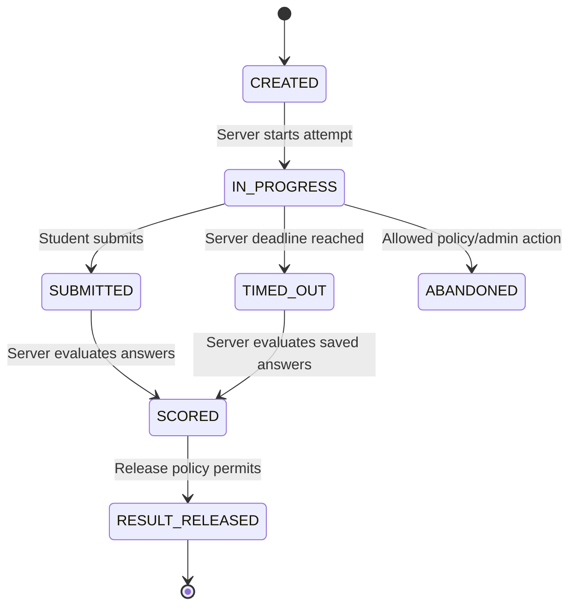
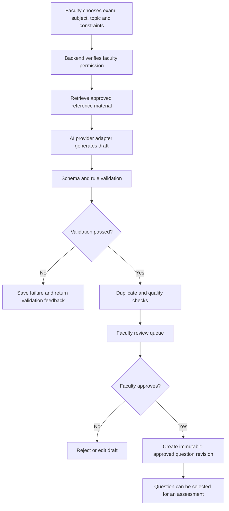
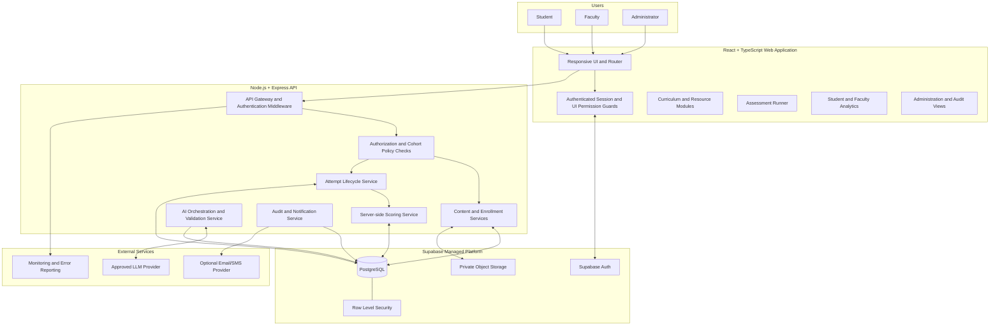

# NEET Prep LMS
## Final Product Overview, Requirements, Architecture, Data Model, Security Specification, and Delivery Plan

**Document version:** 2.0  
**Document status:** Finalized product direction and updated engineering specification  
**Prepared:** 4 November 2026  
**Supersedes:** Original `project_overview.md`  
**Initial product scope:** Single coaching institute, NEET-UG preparation  
**Planned future extensibility:** Additional exam tracks and multi-institute SaaS, subject to separate product decisions  

> **Document purpose:** This document defines the product that should be built, the behaviour it must provide, the technical architecture and data model required to support it, and the evidence needed before it can be treated as production-ready. It is a specification, not proof that every feature has already been implemented or independently tested.

---

## Table of Contents

1. [Final Product Decision](#1-final-product-decision)
2. [Executive Summary](#2-executive-summary)
3. [Problem Statement and Product Value](#3-problem-statement-and-product-value)
4. [Product Principles](#4-product-principles)
5. [Goals, Non-Goals, and Scope Boundaries](#5-goals-non-goals-and-scope-boundaries)
6. [Target Users and Permission Model](#6-target-users-and-permission-model)
7. [NEET-UG Exam Scope and Configuration Rules](#7-neet-ug-exam-scope-and-configuration-rules)
8. [Primary User Journeys](#8-primary-user-journeys)
9. [Functional Modules and Requirements](#9-functional-modules-and-requirements)
10. [Assessment and Scoring Specification](#10-assessment-and-scoring-specification)
11. [AI Features and Academic Quality Controls](#11-ai-features-and-academic-quality-controls)
12. [High-Level System Architecture](#12-high-level-system-architecture)
13. [Low-Level Application Architecture](#13-low-level-application-architecture)
14. [Technology Stack](#14-technology-stack)
15. [Database Design and Data Dictionary](#15-database-design-and-data-dictionary)
16. [Entity Relationship Diagram](#16-entity-relationship-diagram)
17. [Authorization and Row-Level Security Design](#17-authorization-and-row-level-security-design)
18. [Backend API Contract](#18-backend-api-contract)
19. [Security Architecture](#19-security-architecture)
20. [Privacy, Documents, and Data Governance](#20-privacy-documents-and-data-governance)
21. [Content Rights and Academic Integrity](#21-content-rights-and-academic-integrity)
22. [Non-Functional Requirements](#22-non-functional-requirements)
23. [User Experience, Accessibility, and Localization](#23-user-experience-accessibility-and-localization)
24. [Reliability, Monitoring, Backup, and Recovery](#24-reliability-monitoring-backup-and-recovery)
25. [Testing and Verification Strategy](#25-testing-and-verification-strategy)
26. [Deployment and Environment Strategy](#26-deployment-and-environment-strategy)
27. [Implementation Roadmap](#27-implementation-roadmap)
28. [Risks and Mitigations](#28-risks-and-mitigations)
29. [Success Metrics and Pilot Evaluation](#29-success-metrics-and-pilot-evaluation)
30. [Definition of Done and Production Exit Criteria](#30-definition-of-done-and-production-exit-criteria)
31. [Assumptions and Decisions to Revisit](#31-assumptions-and-decisions-to-revisit)
32. [Glossary](#32-glossary)
33. [Official and Technical References](#33-official-and-technical-references)
34. [Change Log](#34-change-log)

---

# 1. Final Product Decision

## 1.1 Finalized project idea

**NEET Prep LMS is a secure, AI-assisted learning and assessment management platform for a single NEET-UG coaching institute.** It brings student enrolment, batch management, NEET curriculum planning, learning resources, question-bank management, practice tests, mock examinations, verified scoring, academic analytics, faculty workflows, announcements, and institute administration into one web application.

The platform is intended to improve the institute's day-to-day academic operations and give students a structured environment for preparation. It is not an official examination authority, an NTA system, an admission portal, or a replacement for the official NEET examination.

## 1.2 Product decisions

| Decision | Final choice | Reason |
|---|---|---|
| Initial customer | One coaching institute | Keeps permissions, operations, and delivery manageable for the first release. |
| Initial examination | NEET-UG | Provides a focused, verifiable curriculum and assessment target. |
| Main user roles | Student, Faculty, Admin | Covers the required academic and operational responsibilities without inventing unnecessary roles. |
| Main platform | Responsive web application | Works on desktop, tablet, and mobile browsers without requiring separate native apps. |
| Initial curriculum | Physics, Chemistry, Biology | Matches the NEET-UG 2026 subject structure; Biology can be organized into Botany and Zoology content areas. |
| Assessment format | NEET-UG practice and mock tests | The application provides online practice; the official NEET-UG 2026 examination was pen-and-paper. |
| Scoring authority | Backend/database only | A browser must never be trusted to calculate or submit an authoritative score. |
| AI publishing policy | Faculty approval required | AI-generated material can contain factual, answer-key, and diagram errors. |
| Content protection | Access control, watermarking, traceability | Browser-based controls cannot guarantee prevention of screenshots or external recording. |
| First release | Secure LMS and assessment workflow | Establishes a dependable foundation before adding AI, payments, community, or international exams. |
| Future exam support | Versioned exam configuration | Other exams must have their own syllabus, question formats, timing, and scoring rules. |

## 1.3 Product positioning

The platform should be positioned as:

> **A coaching-institute learning and assessment platform that organizes NEET preparation, supports faculty-led assessment creation, and turns verified student practice results into actionable academic insights.**

Do not position it as:

- An official NTA or Government of India platform.
- An official NEET online examination delivery system.
- A guaranteed anti-cheating or screenshot-proof application.
- An AI system that guarantees correct medical or scientific answers.
- A system that predicts a student's admission or examination result with certainty.

## 1.4 What makes this idea useful

The product combines workflows that are commonly separated across spreadsheets, messaging groups, PDF folders, and independent test tools:

1. Student and cohort administration.
2. Organized syllabus and learning-resource access.
3. Faculty-managed question authoring and publishing.
4. Timed practice assessments with server-verified results.
5. Topic-level performance analysis.
6. Institute announcements and operational audit trails.

Its real-world value must be demonstrated through a pilot with an actual coaching institute. A feature-rich user interface alone is not evidence of product-market fit.

---

# 2. Executive Summary

Coaching institutes preparing students for NEET-UG need a dependable way to manage academic content, batches, assessments, student progress, and faculty activity. When these processes are spread across separate files and applications, students may struggle to locate current material, faculty may repeat manual test-preparation work, and administrators may find it difficult to maintain consistent records.

NEET Prep LMS addresses this operational problem through a role-based platform built around one institute's NEET-UG preparation programme.

The initial product includes:

- Secure student, faculty, and administrator accounts.
- Admin-controlled student enrolment and dynamic cohort assignment.
- Versioned NEET curriculum mapping for Physics, Chemistry, and Biology.
- Chapter and topic organization.
- Private notes, PDFs, diagrams, and lecture-video metadata.
- Faculty-managed question banks.
- Daily Practice Problems (DPPs), chapter tests, subject tests, and full-length mock tests.
- A timed online practice runner with answer saving and review navigation.
- Server-side answer evaluation and score persistence.
- Student dashboards showing verified assessment history and topic-level performance.
- Faculty dashboards for assigned cohorts, resources, questions, and student progress.
- Admin dashboards for enrolment, content, announcements, and audit records.

The next release can add AI-assisted question drafting and an academic tutor grounded in institute-approved material. Generated questions must pass automated validation and faculty review before publication.

The original concept also described IMAT, UCAT, and MCAT support. Those examinations are retained as possible future exam tracks, but they are not included in the first release. Their formats and scoring methods differ from NEET-UG and must not be forced into one universal subject or marking configuration.

The proposed stack is React, TypeScript, Vite, Tailwind CSS, Node.js, Express, Supabase Auth, PostgreSQL, private Supabase Storage, and Recharts. The exact dependency versions must be selected from maintained and security-supported releases at implementation time rather than frozen in this long-lived specification.

---

# 3. Problem Statement and Product Value

## 3.1 Problems to validate with the institute

The following are product hypotheses. They must be validated through interviews and baseline measurements with the target institute rather than treated as universal facts about every coaching centre.

| Problem hypothesis | Operational consequence | Product response |
|---|---|---|
| Learning materials are spread across PDFs, drives, and messaging groups. | Students spend time locating the correct version of a resource. | Searchable subject, chapter, and topic resource library. |
| Different batches follow different teaching schedules. | Students may receive content too early, too late, or from the wrong cohort. | Dynamic cohort assignments and server-enforced resource visibility. |
| Faculty repeatedly prepare and distribute tests manually. | More repetitive work and inconsistent test configuration. | Reusable question bank and assessment builder. |
| Students receive only a total score or a basic answer key. | Weak chapters and recurring errors are not easy to identify. | Verified attempt history and topic-level analytics. |
| Administrators use manual records for enrolment and access. | Status changes and access decisions may be inconsistent. | Centralized student, cohort, and access administration. |
| AI question tools may produce unreviewed questions. | Incorrect explanations or answer keys can mislead students. | AI drafts with validation, review, approval, and revision history. |

## 3.2 Product value by user

### Students

- Find the correct syllabus, chapter notes, and practice tests in one place.
- View cohort-specific content and announcements.
- Take timed practice tests on supported devices.
- Review correct answers and faculty explanations after the configured release time.
- Understand performance by subject, chapter, and topic.

### Faculty

- Organize resources around the institute's curriculum.
- Reuse approved questions across multiple assessments.
- Create and schedule assessments for assigned cohorts.
- Review generated AI questions rather than publishing unverified outputs.
- Identify students or topics that may need academic support.

### Administrators

- Manage admissions to the institute's learning platform and cohort assignments.
- Control user roles and faculty assignments.
- Publish institute-wide or cohort-specific announcements.
- Monitor content publishing and operational activity.
- Review access and audit records.

## 3.3 Value proposition to test

The pilot should test whether the platform:

- Reduces the time required to prepare and publish an assessment.
- Reduces the time students spend locating learning material.
- Reduces errors in cohort and content access management.
- Improves the usefulness of post-test feedback.
- Makes institute operations more traceable.

No percentage improvement should be advertised until it has been measured against the institute's pre-pilot workflow.

---

# 4. Product Principles

1. **Exam-specific correctness:** Exam rules, curriculum, scoring, and timing are versioned configuration, not scattered constants in frontend code.
2. **Server is authoritative:** Identity, permissions, assessment deadlines, answer keys, scoring, and publication state are validated on trusted backend/database components.
3. **Least privilege:** Each user receives only the data and actions required for their role and assigned cohort.
4. **Faculty remains accountable:** AI can assist with drafting but cannot autonomously publish academic questions.
5. **Privacy by design:** Collect only student data required for a defined institute purpose.
6. **Traceable changes:** Important administrative and academic changes are auditable.
7. **Accessible by default:** The interface must work with keyboard navigation, assistive technology, zoom, and a range of device sizes.
8. **Reliable under weak connectivity:** Save progress safely and communicate network state. Do not claim unsupported offline examination capability.
9. **No false security claims:** Watermarking and access controls deter and trace misuse; they do not make browser content impossible to capture.
10. **Deliver in stages:** Complete and test the NEET MVP before adding multi-exam, payment, community, or multi-institute complexity.

---

# 5. Goals, Non-Goals, and Scope Boundaries

## 5.1 MVP goals

The first production pilot must allow one institute to:

- Create and manage students, faculty, and administrator accounts.
- Assign students to cohorts and faculty to subjects/cohorts.
- Maintain a versioned NEET-UG curriculum.
- Publish protected learning resources.
- Build and publish question banks and assessments.
- Run timed online practice assessments.
- Store answers safely and calculate scores on the backend.
- Provide results and actionable performance breakdowns.
- Publish announcements.
- Audit important administrative actions.

## 5.2 Explicit non-goals for MVP

The MVP will not:

- Conduct or claim to conduct the official NTA NEET examination.
- Replace the official pen-and-paper examination process.
- Support all of NEET, IMAT, UCAT, and MCAT as fully configured products from day one.
- Guarantee screenshot, screen recording, or external-device prevention.
- Provide live remote proctoring or automated misconduct judgments.
- Automatically publish AI-generated questions.
- Store payment-card details or operate as a payment processor.
- Require medical-fitness certificates for ordinary learning-platform access.
- Provide a public social network or unrestricted student discussion forum.
- Guarantee uninterrupted offline exam submission.
- Make admission, rank, or success guarantees.

## 5.3 Scope by release

| Capability | MVP | Phase 2 | Phase 3 |
|---|---:|---:|---:|
| Student/faculty/admin accounts | Yes | Improve | — |
| Dynamic cohorts and enrolment | Yes | Improve | Multi-institute extension considered |
| NEET-UG curriculum | Yes | Version updates | Additional exam blueprints |
| Protected resource library | Yes | Better indexing/search | Offline resource package, if justified |
| Question bank and manual assessments | Yes | Improve authoring | Advanced item types |
| Server-side scoring and attempt history | Yes | Improve | Formal exam analytics |
| Student/faculty/admin dashboards | Basic | Advanced | Institution-wide reporting |
| Announcements | Basic | Scheduling and notifications | Integrations |
| Academic calendar | Basic | Advanced | Integrations |
| AI question drafting | No | Yes | Improve/evaluate |
| AI academic tutor | No | Yes | Improve/evaluate |
| Student support FAQ assistant | Optional | Yes | Integrations |
| Optional document verification | No | Only if justified | Improve governance |
| Discussion forum | No | No | Yes, with moderation |
| Payments | No | Optional discovery | Only with business need and gateway |
| Offline exam mode | No | Research only | Only after threat and recovery design |
| Multi-institute SaaS | No | Architecture review | Separate product release |

---

# 6. Target Users and Permission Model

## 6.1 Primary roles

### Student

A student is enrolled by the institute or completes a registration flow that remains pending until the institute approves it.

Allowed activities:

- View and update permitted profile fields.
- View own enrolment and cohort information.
- View published resources assigned to the student's active cohort.
- View published assessments available to the student's cohort.
- Start, resume where policy permits, and submit own attempts.
- View own results after the configured result-release time.
- View own topic and subject analytics.
- Read announcements and calendar events visible to the student.
- Ask the academic assistant questions within its approved capabilities, when enabled.

Not allowed:

- View another student's private profile, documents, answers, or results.
- Read answer keys while an assessment is active.
- Change scores, attempt deadlines, role assignments, cohort membership, or published assessment content.
- Upload or publish academic material unless a separate permission is explicitly granted.

### Faculty

Faculty members are assigned to one or more subjects and cohorts by an administrator.

Allowed activities:

- View assigned cohorts and permitted student progress.
- Create and edit draft resources for assigned subjects/cohorts.
- Create and maintain questions and explanations.
- Build assessments from approved question revisions.
- Review AI-generated question drafts when the feature is enabled.
- Publish or request publication according to institute policy.
- Publish academic announcements if granted permission.
- Review assessment results for assigned cohorts.

Not allowed by default:

- Change user roles or institute-level settings.
- Access unrelated cohorts.
- Review private admission documents unless a specific duty and permission require it.
- Change a student's submitted answers or score without a traceable correction process.

### Administrator

The administrator manages the institute's platform configuration and academic operations.

Allowed activities:

- Create, suspend, reactivate, and manage users.
- Assign roles through a trusted administrative workflow.
- Approve or reject student registration/enrolment.
- Create academic programmes, academic years, and cohorts.
- Assign faculty to subjects and cohorts.
- Manage curriculum, resource visibility, assessment publication, and announcements.
- Review audit records and operational health.
- Configure assessment release rules and institute settings.

High-risk actions such as role changes, bulk exports, user suspension, and assessment-result corrections must be logged with actor, timestamp, target, reason, and relevant metadata.

## 6.2 Role assignment is not user self-service

A public signup request must never be able to grant itself `FACULTY` or `ADMIN` privileges by submitting a role field or metadata value.

- New public registrations default to a pending Student state.
- A trusted administrator approves enrolment.
- Faculty and Admin accounts are invited or provisioned through a trusted administrative process.
- Role changes are made server-side or through a tightly restricted database function.
- The system must not use user-editable authentication metadata as the source of authorization truth.
- If roles are copied into JWT claims for performance, the system must handle claim staleness and re-check critical role changes against trusted data.

## 6.3 No unrestricted impersonation

The original concept included administrator "View As" impersonation. For the MVP, replace it with a **read-only support preview**:

- Admin selects a student and provides a reason.
- The application renders the student's permitted view without issuing a reusable student session.
- The preview is read-only for student data and cannot submit an assessment, change a profile, or perform an action as the student.
- The preview has a short expiry and a visible administrator banner.
- The start, end, target account, and reason are recorded in an audit log.

A true impersonation capability should not be introduced without a separate threat model and approval process.

---

# 7. NEET-UG Exam Scope and Configuration Rules

## 7.1 Verified 2026 baseline

The official NTA NEET-UG 2026 Information Bulletin describes the following examination scheme:

| Item | NEET-UG 2026 official baseline |
|---|---|
| Subjects | Physics, Chemistry, Biology (Botany and Zoology) |
| Questions | 180 compulsory questions |
| Duration | 180 minutes (3 hours) |
| Total marks | 720 |
| Physics | 45 questions, 180 marks |
| Chemistry | 45 questions, 180 marks |
| Biology | 90 questions, 360 marks |
| Question format | MCQ with four options and one correct/best answer |
| Correct answer | +4 |
| Incorrect answer | -1 |
| Unanswered | 0 |
| Official examination mode | Pen-and-paper for NEET-UG 2026 |

**Important:** This is a 2026 reference configuration, not a guarantee that the next examination cycle will use identical rules. The NTA bulletin itself notes that information may be updated. Before enabling the next exam year, the administrator/content owner must review the latest official NTA and NMC information and approve a new blueprint version.

The full 2026 scheme and marking details are in Chapter 4 of the [official NEET-UG 2026 Information Bulletin](https://cdnbbsr.s3waas.gov.in/s37bc1ec1d9c3426357e69acd5bf320061/uploads/2026/02/202602231394640855.pdf), pages 21–22.

## 7.2 What the online assessment runner represents

The platform's timed online assessment runner is for:

- Daily practice problems.
- Chapter and subject tests.
- Institute mock tests.
- Revision tests.
- Practice based on published NEET patterns.

It must not claim to reproduce the official examination delivery method. NEET-UG 2026 was pen-and-paper; an online browser test is an institute practice experience.

## 7.3 Curriculum structure

Use the following logical hierarchy:

```text
Exam Track
  └── Exam Blueprint / Exam Year
        └── Subject
              └── Chapter
                    └── Topic
```

For the initial NEET-UG track:

- Physics.
- Chemistry.
- Biology.
  - Biology content may be grouped into Botany and Zoology for learning navigation, based on the current approved syllabus mapping.

Do not hardcode a universal list of seven academic subjects. The original seven-subject design mixed NEET subjects with areas associated with other entrance examinations. Those subjects do not form one shared NEET syllabus.

## 7.4 Curriculum source governance

- Import the applicable syllabus from the official NTA/NMC source for the selected examination year.
- Record the source URL, date retrieved, exam year, content owner, and approval date.
- Map every chapter and topic to the applicable syllabus version.
- Mark removed or changed topics without deleting historical references used by past assessments.
- Keep faculty-created learning resources linked to the curriculum version they support.
- Do not label an unofficial institute topic list as the official syllabus.

## 7.5 Future exam extensibility

IMAT, UCAT, and MCAT may be considered later, but each requires a separate blueprint.

Examples of why they cannot share one hardcoded exam model:

- UCAT contains separately timed Verbal Reasoning, Decision Making, Quantitative Reasoning, and Situational Judgement subtests; its official scoring uses scaled scores and Situational Judgement bands, with no negative marking for incorrect responses. See the [official UCAT format and scoring page](https://www.ucat.ac.uk/about-ucat/test-format-and-scoring/).
- MCAT has four separately scaled sections and no additional penalty for wrong answers. See the [AAMC MCAT scoring guidance](https://students-residents.aamc.org/mcat-scores/how-mcat-exam-scored).
- IMAT must be configured from the official examination-year source applicable to the target cycle, not from an old stored assumption.

Future exam support requires a product and academic review, current official source verification, syllabus mapping, test cases, and a separate acceptance sign-off.

---

# 8. Primary User Journeys

## 8.1 Student onboarding and enrolment

1. Student receives an institute invitation or submits a registration request.
2. Authentication verifies the account.
3. The system creates a basic profile with a non-privileged default state.
4. An administrator reviews the registration and assigns an academic programme/cohort.
5. The system records the enrolment status and start/end dates.
6. The student sees only published content permitted for the assigned cohort.
7. The student receives a welcome message and a link to the study dashboard.

## 8.2 Student learning journey

1. Student signs in.
2. Student opens the dashboard and sees upcoming tests, announcements, and progress.
3. Student opens a subject, chapter, or topic.
4. Student reads approved notes or views an authorized lecture resource.
5. Student starts a DPP or mock assessment.
6. The server creates an attempt and returns the approved question presentation payload without answer keys.
7. Student answers questions; changes are saved through an authenticated API.
8. Student submits, or the server finalizes the attempt at its deadline.
9. The server calculates the score and stores the result.
10. Student sees results when the release policy permits.
11. Student reviews explanations and topic-level feedback.

## 8.3 Faculty content and assessment journey

1. Faculty signs in and sees assigned subjects/cohorts.
2. Faculty creates or updates a resource draft.
3. Faculty tags the resource with subject, chapter, topic, and cohort visibility.
4. Faculty submits the resource for publication, or publishes it if granted that permission.
5. Faculty creates questions manually or requests AI drafts when enabled.
6. Faculty validates question text, four options, the answer key, explanation, syllabus relevance, and rights to diagrams or source material.
7. Faculty creates an assessment and selects question revisions.
8. The platform snapshots the approved question revisions into an immutable assessment version.
9. Faculty schedules or publishes the assessment for assigned cohorts.
10. Faculty reviews verified results and identifies topics needing additional instruction.

## 8.4 Administrator operations journey

1. Admin signs in with a protected account.
2. Admin reviews pending registrations and user status.
3. Admin creates academic years, programmes, and cohorts.
4. Admin assigns students to cohorts and faculty to subjects/cohorts.
5. Admin reviews resource and assessment publication states.
6. Admin publishes institute-wide or cohort-specific announcements.
7. Admin reviews audit logs and operational alerts.
8. Admin exports only the records needed for a defined institute purpose.

---

# 9. Functional Modules and Requirements

The requirement identifiers below should be used in backlog tickets, test cases, and release checklists.

## 9.1 Authentication and session governance

| ID | Requirement | Acceptance condition |
|---|---|---|
| FR-AUTH-001 | Support secure sign-in and sign-out. | Valid users can sign in; invalid credentials do not create sessions; logout invalidates the active application session. |
| FR-AUTH-002 | Support password reset or the selected secure recovery method. | Recovery does not reveal whether an email address is registered. |
| FR-AUTH-003 | Create a profile after account provisioning. | Profile creation is idempotent and cannot assign privileged roles from user-editable metadata. |
| FR-AUTH-004 | Enforce Student, Faculty, and Admin permissions. | Protected API and database operations reject unauthorized calls even when invoked outside the UI. |
| FR-AUTH-005 | Support account suspension. | Suspended accounts cannot perform protected actions; existing sessions are invalidated or rejected according to the session policy. |
| FR-AUTH-006 | Protect administrator accounts. | Admin access requires strong authentication; MFA should be enabled for administrators where supported. |
| FR-AUTH-007 | Restrict faculty/admin account creation. | Public registration cannot self-assign staff roles. |

## 9.2 Student profile and enrolment

- Student profile includes name, verified contact details where collected, profile status, created/updated timestamps, and permitted preferences.
- Student academic details are stored separately from authentication credentials.
- A student can have multiple enrolment records over time.
- The platform must support cohort transfer with an effective date and an audit record.
- Historical attempts remain linked to the enrolment/cohort context under which they occurred.
- Students must not be allowed to change their own cohort or role.

## 9.3 Academic programme, year, and cohort management

- Create academic years with start and end dates.
- Create programmes such as NEET-UG long-term preparation or repeater preparation.
- Create dynamic cohorts/batches with names, schedules, capacity, start/end dates, and active state.
- Do not hardcode the original labels `Batch 1 (Dec)` and `Batch 2 (May/June)` in application logic.
- Assign students to cohorts through `student_enrollments`.
- Assign faculty to subjects and cohorts through explicit assignment records.
- A cohort transfer must not rewrite historical test or attendance context.

## 9.4 Curriculum management

- Maintain exam, blueprint year/version, subject, chapter, and topic records.
- Support ordering and visibility of chapters/topics.
- Associate content and questions with syllabus nodes.
- Track student progress at chapter/topic level.
- Allow the administrator to mark a curriculum version as current, draft, archived, or superseded.
- Prevent a published assessment from silently changing because the current curriculum tree was edited.

## 9.5 Learning resource management

### Supported resource types

- Notes.
- PDF study material.
- Faculty-approved book extracts or links where permitted by rights.
- Daily Practice Problems.
- Previous Year Question resources where the institute has permission to use and distribute them.
- Lecture videos or approved external video links.
- Images and diagrams.

### Requirements

- Store file metadata separately from the binary file.
- Store protected resources in private storage buckets.
- Use short-lived authenticated downloads or signed URLs generated after server-side authorization.
- Validate file size, MIME type, extension, and actual content where feasible.
- Scan uploaded files using an appropriate malware-scanning workflow before publication.
- Limit allowed upload types to the institute's actual requirements.
- Record uploader, owner, upload time, checksum, storage path, resource status, and curriculum mapping.
- Support `DRAFT`, `PENDING_REVIEW`, `PUBLISHED`, `ARCHIVED`, and `REJECTED` states.
- Recheck cohort and enrolment authorization before issuing a download authorization.
- Avoid storing long-lived public URLs for paid or restricted resources.

### Viewer behaviour

- Provide an accessible PDF viewer with page navigation, zoom, and readable text where available.
- Provide a responsive video player with playback controls and captions where supplied.
- Provide image zoom/pan without losing keyboard accessibility.
- Do not promise that in-browser viewing prevents photography, screenshots, or external recording.

## 9.6 Question bank

### MVP question type

The MVP should focus on the NEET-UG 2026 baseline: single-select MCQ with four options and one correct/best answer. The database may be designed for later question types, but unsupported formats must remain disabled until their scoring and review rules are implemented.

### Question fields

- Logical question ID.
- Revision ID and revision number.
- Question statement.
- Subject, chapter, and topic.
- Question type.
- Options and option ordering.
- Correct answer key stored outside student-readable data access.
- Explanation/rationale.
- Optional image/diagram reference and accessibility description.
- Difficulty label assigned by faculty, not treated as an objective measurement unless calibrated.
- Source/reference notes and content-rights status.
- Author, reviewer, approval status, and timestamps.

### Question states

`DRAFT -> IN_REVIEW -> APPROVED -> PUBLISHED -> ARCHIVED`

Rejected or withdrawn revisions remain auditable and must not be silently reused in a new assessment.

### Question versioning

- Published question revisions are immutable.
- Editing a published question creates a new revision.
- A published assessment references exact question revision IDs.
- Historical attempts continue to reference the exact revision used at the time of the attempt.
- Correct-answer changes require a correction reason and audit event.

## 9.7 Assessment builder

### Assessment types

- DPP.
- Chapter test.
- Subject test.
- Full mock test.
- Revision test.
- PYQ practice set, only where the institute has rights to use the material.

### Assessment configuration

- Title and description.
- Exam and blueprint version.
- Assessment type.
- Subject/chapter/topic scope.
- Target cohort(s).
- Question revision list and order.
- Duration and availability window.
- Scoring profile.
- Attempt limit and retake policy.
- Navigation policy.
- Answer/result release policy.
- Publication and archival state.

A published assessment version is immutable. To change questions, timing, or marking, create a new assessment version.

## 9.8 Online assessment runner

The practice runner must provide:

- Clear assessment instructions before the attempt begins.
- Server-created attempt ID and server-authoritative start/deadline timestamps.
- A question display that does not expose answer-key data.
- Single-select answer controls for the NEET MVP.
- Question palette showing answered, unanswered, and marked-for-review states.
- Previous/next navigation and question review.
- Answer save status and network status indicators.
- A submit confirmation step.
- Automatic finalization after the server-side deadline.
- A safe response when a student's network is interrupted.
- Recovery/resume only when allowed by assessment policy and validated by the server.

Fullscreen may be offered as an optional concentration aid, but it must not be treated as a security boundary. Do not force an unsupported browser-lock or anti-capture promise.

## 9.9 Results and performance analytics

### Student result view

- Assessment title and attempt date.
- Correct, incorrect, unanswered counts.
- Raw score and maximum score.
- Accuracy and completion status.
- Subject/chapter/topic breakdown where sample size is meaningful.
- Time spent, where it can be measured reliably.
- Correct answer and explanation after result release.
- Historical score trend.

### Faculty view

- Cohort-level completion and score distribution.
- Subject/chapter/topic accuracy.
- Students needing follow-up based on defined thresholds.
- Comparison of assessment versions only where the assessments are meaningfully comparable.

### Analytics rules

- Analytics must use server-verified attempt results.
- Define each metric in code and documentation.
- Show sample size when aggregating scores.
- Avoid presenting a small sample as a reliable mastery estimate.
- Do not infer a student's medical condition, intelligence, or admission outcome from scores.
- Do not generate a predicted NEET rank unless a separate validated model and responsible-use review justify it; it is outside the MVP.

## 9.10 Announcements and academic calendar

### Announcements

- Admin may publish institute-wide announcements.
- Authorized faculty may publish to assigned cohorts.
- Fields include title, body, audience, priority, publication time, expiry, author, and status.
- Students see only announcements for their role/cohort.
- Editing or withdrawing a published critical announcement creates an audit record.

### Calendar

- Store event title, description, event type, start/end time, target cohort, author, and publication status.
- Support lectures, tests, deadlines, and institute events.
- Render local timezone consistently; store timestamps in UTC and display in the configured institute timezone.
- Calendar reminders are optional and should be added only when notification delivery is reliable.

## 9.11 Notifications

MVP notifications may be in-app. Email/SMS/push delivery can be phased in later.

- Avoid sending duplicate notifications after retries.
- Record delivery state where an external provider is used.
- Do not include sensitive student records in notification body text.
- Allow users to control non-essential notifications.

## 9.12 Student document management — optional and restricted

Document verification is not a required core feature for a NEET learning platform. Add it only when the institute has a clear operational or legal need.

If enabled:

- Configure required document types per institute policy.
- Collect the minimum information necessary.
- Do not require a medical fitness certificate by default.
- Store files in a private bucket.
- Restrict access to specifically authorized administrators.
- Record reviewer, review time, status, and reason.
- Show students a limited status view without exposing internal notes unnecessarily.
- Define a retention and deletion schedule.
- Do not reuse uploaded documents for AI training or unrelated purposes.

Document states: `NOT_SUBMITTED`, `PENDING_REVIEW`, `VERIFIED`, `REJECTED`, `EXPIRED`, `DELETED`.

## 9.13 Community discussion — post-MVP

A discussion forum is not necessary to prove the core product. If added later, it must include:

- Thread and reply relationships.
- Reporting and moderation workflows.
- Role labels.
- Spam and abuse controls.
- Clear content rules.
- Audit records for moderator actions.
- Protection against file/link abuse.

Do not launch unrestricted nested discussion before assigning moderation responsibility.

## 9.14 Administration and audit logging

Audit the following events at minimum:

- User created, suspended, reactivated, or role changed.
- Student enrolled, transferred, or removed from a cohort.
- Faculty assignment changed.
- Resource uploaded, approved, published, archived, or deleted.
- Question revised, approved, published, withdrawn, or answer key corrected.
- Assessment created, published, versioned, cancelled, or rescheduled.
- Attempt manually adjusted or reopened.
- Document reviewed or exported, if document module is enabled.
- Administrator support preview started/ended.
- Bulk export initiated.

Audit fields: actor ID, action, entity type, entity ID, event timestamp, request/correlation ID, reason where required, and structured metadata that excludes secrets.

Audit records should be append-only for normal application roles. Do not log passwords, access tokens, signed URLs, or unnecessary personal information.

---

# 10. Assessment and Scoring Specification

## 10.1 Scoring configuration

Scoring rules are defined in a versioned `scoring_profile` linked to the exam blueprint/assessment version. Do not hardcode `+4/-1` in the React component or shared UI utilities.

For the NEET-UG 2026 reference baseline:

```text
Correct answer:   +4
Incorrect answer: -1
Unanswered:        0
```

For the normal single-correct case:

```text
raw_score = (correct_count * 4) - (incorrect_count * 1)
```

Unanswered questions add zero. The total possible marks in the 2026 baseline is 720.

## 10.2 Special question adjudication

The 2026 NTA bulletin also describes how questions found to have multiple correct options, all correct options, or no correct option/a dropped question are treated. The practice platform should support a controlled question-resolution workflow instead of assuming every item always has one permanent key.

Support an adjudication state such as:

- `NORMAL_SINGLE_KEY` — one correct option.
- `MULTIPLE_ACCEPTED_KEYS` — more than one answer is accepted after review.
- `ALL_OPTIONS_ACCEPTED` — all options are accepted for the applicable policy.
- `DROPPED_OR_INVALID` — the item is invalidated and the configured scoring profile determines its treatment.

For a NEET-UG 2026-aligned scoring profile, encode the applicable bulletin policy for these cases and test it separately. A question correction after attempts have been submitted must trigger a versioned rescore operation with a reason and an audit record. Preserve both the original and recalculated score snapshots.

## 10.3 Server-authoritative assessment lifecycle



The browser countdown is a display aid. The server's `started_at` and `deadline_at` are authoritative.

## 10.4 Starting an attempt

The backend must validate:

1. User is authenticated and active.
2. User has Student role.
3. Student has an active enrolment in a cohort targeted by the assessment.
4. Assessment is published and currently available.
5. Attempt limit has not been exceeded.
6. No conflicting active attempt exists, where the policy disallows one.
7. The assessment version and question revisions are still valid.

The server creates the attempt and returns only the permitted question presentation payload.

## 10.5 Answer saving

- Each answer is associated with an attempt and a specific assessment-question row.
- Use an idempotency key or deterministic upsert strategy to handle repeated network requests.
- Enforce one answer record per question per attempt unless the design explicitly stores an event history plus current response.
- Validate that the submitted option belongs to the exact question revision being attempted.
- Do not accept marks, correctness flags, or totals from the browser.
- Store the last server-confirmed answer state and timestamp.
- If an answer request arrives after the deadline, reject it or apply a documented grace/recovery rule; do not silently accept it.

## 10.6 Submission and scoring

On submission:

1. Verify attempt ownership.
2. Verify attempt state and server time.
3. Lock or atomically transition the attempt so duplicate submission cannot score twice.
4. Load question revisions and answer keys from a protected server-side location.
5. Calculate score using the versioned scoring profile and any approved item adjudications.
6. Persist answer outcomes, score, counts, completion state, and timestamps in one transaction where possible.
7. Return a submission receipt and result-release state.
8. Make the scoring operation idempotent.

Never trust a payload such as `{"score":720,"accuracy":100}` sent by the client. The client submits answer selections; the server computes the result.

## 10.7 Answer-key protection

- Correct-answer information must not be included in the API response used by an active student attempt.
- Do not expose `is_correct`, answer-key JSON, or hidden explanation fields through a student-readable table/view.
- Keep answer keys in a non-exposed schema or a backend-only data path.
- Review PostgREST/Supabase exposed schemas and column privileges.
- Test with a real Student access token and direct API requests, not just the frontend.
- Release answers only after the configured assessment result-release condition is met.

## 10.8 Attempt recovery and network loss

MVP requirements:

- Show online/offline state.
- Retry safe answer-save requests with idempotency.
- Keep a small in-memory or local pending queue only for unsent answer changes, with clear disclosure and safe handling of shared devices.
- On reconnect, reconcile pending answers with server state and reject stale writes when conflicts occur.
- Offer resume only if the assessment policy permits it and the server confirms the attempt remains active.
- Do not promise full offline assessment or guaranteed submission without a separate offline design, device-security analysis, and conflict-recovery testing.

---

# 11. AI Features and Academic Quality Controls

AI is a supporting service, not an authority for academic correctness.

## 11.1 AI capabilities by release

### Phase 2A: Faculty AI question-drafting assistant

Inputs:

- Exam blueprint/version.
- Subject, chapter, and topic.
- Desired question count and difficulty mix.
- Approved reference material or faculty instructions.
- Question type supported by the active exam profile.
- Language.

Outputs:

- Draft question statement.
- Four options for the NEET MVP.
- Proposed correct answer.
- Explanation.
- Syllabus/topic mapping.
- Reference/source note when grounded source material is available.
- Optional draft diagram description or SVG asset.
- Model/provider metadata for audit and evaluation.

### Phase 2B: Student academic tutor

The student tutor should answer questions from approved institute materials using retrieval-augmented generation (RAG).

Requirements:

- Retrieve only approved resources available to the student's cohort.
- Enforce cohort authorization before retrieval.
- Provide source titles, chapter/topic, and relevant references with answers where practical.
- State when the source material does not answer the question.
- Avoid inventing a source or pretending that unsupported information came from the institute.
- Avoid diagnosis, treatment recommendations, or other medical advice; this is an exam-preparation tutor.
- Do not retrieve other students' profiles, attempts, or documents.

### Student support FAQ assistant

A separate FAQ assistant may answer operational questions from approved institute policy, such as class schedules, enrolment steps, or assessment rules. It should call narrowly scoped backend functions for a student's own permitted status rather than receiving broad database access.

## 11.2 Question generation workflow



## 11.3 Mandatory controls

- AI output remains a draft until faculty approval.
- Validate all outputs against a strict JSON schema.
- Confirm the exact number of options and supported question type.
- Validate that the proposed answer refers to an existing option.
- Check for missing explanations, repeated options, malformed markup, and duplicate questions.
- Run a content-quality check for ambiguity and multiple plausible answers; this check is advisory and does not replace faculty review.
- Require faculty to inspect scientific correctness, calculations, diagrams, answer keys, and explanations.
- Record model provider, model identifier, generation timestamp, prompt/template version, reference material IDs, and reviewer decision.
- Limit request size and apply rate limits and usage budgets.
- Handle provider timeouts, quota errors, and model unavailability gracefully.
- Use a provider adapter so model IDs can be changed without rewriting business logic.
- Re-evaluate model quality when changing providers or model versions.
- Treat uploaded documents and retrieved content as untrusted input; they may contain prompt-injection instructions.
- Do not send student identity, admission documents, or unnecessary learner-performance records to a third-party model.
- Confirm the provider's current data-processing and retention terms before sending institute content.

## 11.4 Generated diagrams

- AI-generated SVGs are drafts, not verified teaching material.
- Sanitize SVG content before rendering or storing it.
- Prevent script execution, external resource loading, and unsafe embedded content.
- Faculty must inspect scientific labels, orientation, scale, and annotations.
- Prefer licensed faculty-created diagrams or trusted educational assets where they are more reliable.
- An image question must never default to Option A as its correct answer. The faculty member must explicitly verify the answer key.

## 11.5 Model fallback

Do not permanently hardcode a model sequence such as a specific model ID from a vendor. Model availability, pricing, and support may change.

Use configuration such as:

```text
AI_PROVIDER=groq
AI_MODEL=<approved-model-id>
AI_FALLBACK_PROVIDER=<optional-provider>
AI_FALLBACK_MODEL=<approved-fallback-id>
AI_TIMEOUT_MS=<configured-value>
AI_MAX_RETRIES=<configured-value>
```

A fallback model must pass the same schema checks and academic evaluation suite. A successful HTTP response does not mean the generated content is correct.

---

# 12. High-Level System Architecture

## 12.1 Logical architecture



## 12.2 Trust boundaries

- The browser is an untrusted client.
- Supabase publishable/anonymous credentials may be present in the browser only when protected by RLS and appropriate API configuration.
- Supabase service-role credentials and database secrets must remain server-side.
- The backend authenticates requests and performs authorization checks for every sensitive operation.
- The database enforces RLS as a second authorization layer for user-scoped data.
- The scoring service retrieves answer keys only through protected server-side access.
- External AI providers receive only the minimum required prompt context.

## 12.3 Primary data flow

- The frontend authenticates with Supabase Auth.
- The frontend sends a user access token with protected API requests.
- The backend validates the token and resolves the user's current role and enrolment/assignment context.
- The backend or Supabase Data API accesses only rows permitted by RLS.
- Sensitive actions such as role changes, attempt scoring, question-key access, and document review use narrow server/database operations.
- File delivery is authorized before a short-lived access URL or authenticated download is issued.

---

# 13. Low-Level Application Architecture

## 13.1 Frontend module structure

Suggested structure:

```text
src/
  app/
    App.tsx
    router.tsx
    providers/
  components/
    layout/
    navigation/
    forms/
    feedback/
    accessibility/
  features/
    auth/
    dashboard/
    profile/
    enrollment/
    cohorts/
    curriculum/
    resources/
    question-bank/
    assessments/
    assessment-runner/
    results/
    analytics/
    announcements/
    calendar/
    admin/
    faculty/
    ai-assistant/          # Phase 2
  hooks/
  lib/
    api-client.ts
    supabase-client.ts
    permissions.ts
    validation/
  styles/
  types/
```

Frontend permission checks improve navigation and user experience but are not security controls. Every sensitive operation must be enforced by the backend and/or database.

## 13.2 Backend module structure

Suggested structure:

```text
server/
  src/
    app.ts
    server.ts
    config/
    middleware/
      authenticate.ts
      authorize.ts
      rate-limit.ts
      request-id.ts
      error-handler.ts
    modules/
      users/
      enrollments/
      cohorts/
      curriculum/
      resources/
      questions/
      assessments/
      attempts/
      scoring/
      analytics/
      announcements/
      audit/
      ai/                   # Phase 2
    services/
    repositories/
    schemas/
    jobs/
    utils/
  tests/
```

## 13.3 Architectural responsibilities

| Component | Responsibility |
|---|---|
| React frontend | Display state, collect user input, provide accessible workflows. |
| Authentication middleware | Validate user token/session and resolve identity. |
| Authorization layer | Check role, enrolment, cohort, faculty assignment, and resource ownership. |
| Repository/data layer | Execute validated database queries and transactions. |
| Assessment service | Start, resume, save, submit, and finalize attempts. |
| Scoring service | Compute scores from protected answer keys and scoring profiles. |
| AI orchestration service | Generate drafts, validate outputs, and manage provider failures. |
| Audit service | Record security-sensitive and operational events. |
| PostgreSQL | Store normalized relational data, constraints, and durable state. |
| Private storage | Store protected resource and optional document binaries. |

## 13.4 State management

- Use server-state caching for API data and clear cache invalidation after mutations.
- Keep the active assessment's unsaved client state minimal and synchronized to the server.
- Do not store answer keys, privileged roles, or secret credentials in frontend state.
- Avoid putting large PDF/video binaries into local storage or Base64 database columns.
- Define cache expiry and logout clearing behaviour for shared devices.

---

# 14. Technology Stack

## 14.1 Recommended stack

| Layer | Technology | Usage |
|---|---|---|
| Frontend | React + TypeScript | Component-based responsive web application. |
| Build tooling | Vite | Development server and production bundling. |
| Styling | Tailwind CSS | Consistent responsive styling and design tokens. |
| Routing | React Router or an equivalent maintained router | Role-aware application routes. |
| Server-state management | TanStack Query or equivalent | Fetching, caching, retry, and invalidation. |
| Charts | Recharts | Student and faculty performance visualizations. |
| Backend | Node.js + Express + TypeScript | Authenticated REST APIs and business workflows. |
| Request validation | Zod or equivalent schema validator | Validate request and provider response shapes. |
| Database | Supabase PostgreSQL | Relational data, constraints, transactions, and RLS. |
| Authentication | Supabase Auth | User authentication and session lifecycle. |
| Object storage | Supabase Storage, private buckets | Learning resources and optional documents. |
| AI provider | Provider adapter; Groq may be an initial provider | Faculty drafting and approved-resource tutor. |
| Testing | Vitest/Jest, Playwright, API integration tests | Unit, integration, and end-to-end coverage. |
| Load testing | k6 or equivalent | Concurrent assessment and API validation. |
| Source control/CI | GitHub and CI pipeline or equivalent | Review, tests, migrations, and deployment gates. |

## 14.2 Version policy

- Select maintained, security-supported versions at implementation time.
- Pin versions in the package lockfile.
- Apply dependency updates through reviewed pull requests.
- Run vulnerability scanning as part of CI.
- Avoid relying on an unmaintained library for authentication, PDF handling, sanitization, or assessment security.
- Review breaking changes before major upgrades.

## 14.3 Supabase usage policy

- Use Supabase Auth for user identity.
- Use PostgreSQL RLS for row-level data isolation.
- Use private Storage buckets for protected documents and resources.
- Use migrations as the source of truth for schema changes.
- Keep service-role credentials on the server only.
- Use database functions for transactional data operations only when their privileges and execution scope are carefully controlled.
- Do not assume that enabling RLS alone makes every query safe; test policies and function privileges.

---

# 15. Database Design and Data Dictionary

## 15.1 Database design rules

1. Use UUID primary keys for core entities unless a documented reason requires another key.
2. Use foreign keys and unique constraints to preserve relationships.
3. Store UTC timestamps as `TIMESTAMPTZ`.
4. Use explicit status fields with constrained values.
5. Store files in object storage, not as Base64 blobs in relational tables.
6. Separate logical questions from immutable question revisions.
7. Separate assessment definitions from assessment versions and student attempts.
8. Preserve historical context for enrolments, published content, and attempts.
9. Keep answer keys outside student-readable schemas/views/API payloads.
10. Add indexes based on measured queries and query plans.
11. Record all important corrections and administrative changes.
12. Add tenant/institute identifiers only when the single-institute boundary and later multi-institute requirements are clearly defined; do not claim multi-tenant isolation until it is implemented and tested.

## 15.2 Core identity and institute tables

### `profiles`

Stores non-authentication profile information.

- `id` UUID PK, references the authentication user ID.
- `full_name` TEXT NOT NULL.
- `phone` TEXT NULL, if collected and needed.
- `avatar_path` TEXT NULL.
- `locale` TEXT DEFAULT `en`.
- `status` TEXT NOT NULL.
- `created_at`, `updated_at` TIMESTAMPTZ.

### `role_assignments`

Stores trusted role grants. This is not populated from user-editable signup metadata.

- `id` UUID PK.
- `profile_id` UUID FK to `profiles.id`.
- `role` constrained to `STUDENT`, `FACULTY`, `ADMIN`.
- `status` constrained to `ACTIVE`, `REVOKED`.
- `assigned_by` UUID FK to `profiles.id`.
- `assigned_at`, `revoked_at` TIMESTAMPTZ.
- Optional reason/reference field.

Constraint: one active assignment per user and role unless multi-role behaviour is explicitly required. A user should not be able to create or modify their own role assignment.

### `students`

- `id` UUID PK.
- `profile_id` UUID UNIQUE FK to `profiles.id`.
- `student_code` TEXT UNIQUE within institute, if used.
- `admission_status` TEXT.
- `created_at`, `updated_at` TIMESTAMPTZ.

### `faculty`

- `id` UUID PK.
- `profile_id` UUID UNIQUE FK to `profiles.id`.
- `designation` TEXT NULL.
- `employment_status` TEXT.
- `created_at`, `updated_at` TIMESTAMPTZ.

### `academic_years`

- `id` UUID PK.
- `name` TEXT.
- `starts_on`, `ends_on` DATE.
- `status` TEXT.

### `programs`

- `id` UUID PK.
- `name` TEXT, for example NEET-UG Long-Term or Repeater.
- `exam_id` UUID FK to `exam_definitions.id`.
- `description` TEXT.
- `status` TEXT.

### `cohorts`

- `id` UUID PK.
- `program_id` UUID FK to `programs.id`.
- `academic_year_id` UUID FK to `academic_years.id`.
- `name` TEXT.
- `starts_on`, `ends_on` DATE.
- `capacity` INTEGER NULL.
- `status` TEXT.

### `student_enrollments`

Supports current and historical enrolments.

- `id` UUID PK.
- `student_id` UUID FK to `students.id`.
- `cohort_id` UUID FK to `cohorts.id`.
- `status` constrained to `PENDING`, `ACTIVE`, `COMPLETED`, `TRANSFERRED`, `WITHDRAWN`.
- `starts_at`, `ends_at` TIMESTAMPTZ.
- `approved_by` UUID FK to `profiles.id`.
- `created_at`, `updated_at` TIMESTAMPTZ.

Constraint: prevent conflicting active enrolments according to institute policy. Preserve old enrolment rows after a transfer.

### `faculty_assignments`

- `id` UUID PK.
- `faculty_id` UUID FK to `faculty.id`.
- `cohort_id` UUID FK to `cohorts.id`.
- `subject_id` UUID FK to `subjects.id`.
- `starts_at`, `ends_at` TIMESTAMPTZ.
- `status` TEXT.

## 15.3 Exam and curriculum tables

### `exam_definitions`

- `id` UUID PK.
- `code` TEXT UNIQUE, e.g. `NEET_UG`.
- `name` TEXT.
- `authority_name` TEXT.
- `official_website` TEXT.
- `status` TEXT.

### `exam_blueprints`

An immutable or versioned configuration for a specific exam cycle.

- `id` UUID PK.
- `exam_id` UUID FK to `exam_definitions.id`.
- `exam_year` INTEGER.
- `version` INTEGER.
- `source_url` TEXT.
- `source_published_at` DATE NULL.
- `verified_at` TIMESTAMPTZ.
- `verified_by` UUID FK to `profiles.id`.
- `status` constrained to `DRAFT`, `VERIFIED`, `ACTIVE`, `ARCHIVED`.
- `notes` TEXT.

Unique constraint: `(exam_id, exam_year, version)`.

### `exam_sections`

Optional sections/subsections within a blueprint. For NEET, this may represent Physics, Chemistry, and Biology.

- `id` UUID PK.
- `blueprint_id` UUID FK to `exam_blueprints.id`.
- `name` TEXT.
- `display_order` INTEGER.
- `question_count` INTEGER NULL.
- `duration_seconds` INTEGER NULL.
- `max_marks` NUMERIC NULL.

### `scoring_profiles`

- `id` UUID PK.
- `blueprint_id` UUID FK to `exam_blueprints.id`.
- `name` TEXT.
- `correct_marks` NUMERIC.
- `incorrect_marks` NUMERIC.
- `unanswered_marks` NUMERIC.
- `partial_marking_config` JSONB NULL.
- `invalid_item_policy` JSONB.
- `status` TEXT.

The JSON configuration must be validated against a documented schema. Avoid arbitrary executable scoring expressions.

### `subjects`

- `id` UUID PK.
- `code` TEXT UNIQUE.
- `name` TEXT.
- `description` TEXT NULL.

### `blueprint_subjects`

- `blueprint_id` UUID FK to `exam_blueprints.id`.
- `subject_id` UUID FK to `subjects.id`.
- `section_id` UUID FK to `exam_sections.id` NULL.
- `display_order` INTEGER.
- Composite PK or unique constraint on the blueprint/subject mapping.

### `chapters`

- `id` UUID PK.
- `subject_id` UUID FK to `subjects.id`.
- `name` TEXT.
- `display_order` INTEGER.
- `status` TEXT.

### `topics`

- `id` UUID PK.
- `chapter_id` UUID FK to `chapters.id`.
- `name` TEXT.
- `display_order` INTEGER.
- `status` TEXT.

### `blueprint_topics`

Maps the currently approved topics to a particular exam blueprint and preserves year-specific syllabus coverage.

- `blueprint_id` UUID FK to `exam_blueprints.id`.
- `topic_id` UUID FK to `topics.id`.
- `inclusion_status` TEXT, e.g. `INCLUDED`, `EXCLUDED`, `REVIEW_REQUIRED`.
- `source_reference` TEXT NULL.
- Composite unique constraint on `(blueprint_id, topic_id)`.

## 15.4 Resource tables

### `resources`

- `id` UUID PK.
- `title` TEXT NOT NULL.
- `description` TEXT NULL.
- `resource_type` constrained to `NOTE`, `PDF`, `BOOK_REFERENCE`, `DPP`, `PYQ`, `VIDEO`, `IMAGE`, `LINK`.
- `subject_id`, `chapter_id`, `topic_id` nullable FKs.
- `blueprint_id` UUID FK to `exam_blueprints.id` NULL.
- `created_by` UUID FK to `profiles.id`.
- `status` constrained to `DRAFT`, `PENDING_REVIEW`, `PUBLISHED`, `ARCHIVED`, `REJECTED`.
- `created_at`, `updated_at`, `published_at` TIMESTAMPTZ.

### `resource_files`

- `id` UUID PK.
- `resource_id` UUID FK to `resources.id`.
- `bucket_id` TEXT.
- `storage_path` TEXT NOT NULL.
- `file_name` TEXT NOT NULL.
- `mime_type` TEXT NOT NULL.
- `file_size_bytes` BIGINT NOT NULL.
- `checksum_sha256` TEXT NULL.
- `scan_status` TEXT.
- `created_at` TIMESTAMPTZ.

### `resource_cohort_access`

- `resource_id` UUID FK to `resources.id`.
- `cohort_id` UUID FK to `cohorts.id`.
- Composite PK `(resource_id, cohort_id)`.

An explicit `ALL_ACTIVE_COHORTS`/institute-wide policy may be represented in a separate visibility field if needed. Do not use a magic string in `cohort_id`.

## 15.5 Question bank and assessment tables

### `question_bank_items`

Represents the logical identity of a question.

- `id` UUID PK.
- `subject_id`, `chapter_id`, `topic_id` FKs.
- `created_by` UUID FK to `profiles.id`.
- `current_revision_id` UUID NULL.
- `created_at`, `archived_at` TIMESTAMPTZ.

### `question_revisions`

- `id` UUID PK.
- `question_item_id` UUID FK to `question_bank_items.id`.
- `revision_number` INTEGER.
- `question_text` TEXT.
- `question_type` constrained for MVP to `SINGLE_SELECT_MCQ`.
- `explanation` TEXT NULL.
- `difficulty_label` TEXT NULL.
- `diagram_storage_path` TEXT NULL.
- `diagram_alt_text` TEXT NULL.
- `source_reference` TEXT NULL.
- `rights_status` TEXT.
- `approval_status` constrained to `DRAFT`, `IN_REVIEW`, `APPROVED`, `REJECTED`, `PUBLISHED`, `ARCHIVED`.
- `created_by`, `reviewed_by` UUID references.
- `reviewed_at`, `created_at` TIMESTAMPTZ.

Unique constraint: `(question_item_id, revision_number)`.

### `question_revision_options`

Stores options for a specific question revision.

- `id` UUID PK.
- `question_revision_id` UUID FK to `question_revisions.id`.
- `option_label` TEXT, e.g. A, B, C, D.
- `option_text` TEXT.
- `display_order` INTEGER.
- Unique `(question_revision_id, option_label)` and `(question_revision_id, display_order)`.

For the NEET-UG 2026 MVP, the published revision must have exactly four options. Correctness must not be exposed to student clients.

### `assessment_definitions`

- `id` UUID PK.
- `title` TEXT.
- `description` TEXT NULL.
- `assessment_type` constrained to `DPP`, `CHAPTER_TEST`, `SUBJECT_TEST`, `MOCK_TEST`, `REVISION_TEST`, `PYQ_PRACTICE`.
- `blueprint_id` UUID FK to `exam_blueprints.id`.
- `created_by` UUID FK to `profiles.id`.
- `status` TEXT.
- `created_at`, `updated_at` TIMESTAMPTZ.

### `assessment_versions`

- `id` UUID PK.
- `assessment_id` UUID FK to `assessment_definitions.id`.
- `version_number` INTEGER.
- `duration_seconds` INTEGER.
- `scoring_profile_id` UUID FK to `scoring_profiles.id`.
- `available_from`, `available_until` TIMESTAMPTZ NULL.
- `attempt_limit` INTEGER NULL.
- `navigation_policy` JSONB.
- `result_release_policy` JSONB.
- `status` constrained to `DRAFT`, `PUBLISHED`, `CLOSED`, `ARCHIVED`.
- `published_by` UUID FK to `profiles.id`.
- `published_at` TIMESTAMPTZ.

Unique `(assessment_id, version_number)`.

### `assessment_cohort_access`

- `assessment_version_id` UUID FK to `assessment_versions.id`.
- `cohort_id` UUID FK to `cohorts.id`.
- Composite PK.

### `assessment_questions`

- `id` UUID PK.
- `assessment_version_id` UUID FK to `assessment_versions.id`.
- `question_revision_id` UUID FK to `question_revisions.id`.
- `question_order` INTEGER.
- `marks_override` NUMERIC NULL.
- `negative_marks_override` NUMERIC NULL.
- Unique `(assessment_version_id, question_order)`.
- Unique `(assessment_version_id, question_revision_id)` unless repeated-item behaviour is intentionally supported.

The selected question revision and any per-item scoring override are frozen when the assessment version is published.

### `question_answer_keys` — protected data

The answer key should be kept in a schema not exposed to student Data API access or through a protected backend service.

- `question_revision_id` UUID PK/FK to `question_revisions.id`.
- `accepted_option_ids` UUID array or normalized child rows.
- `resolution_type` TEXT.
- `reviewed_by` UUID.
- `updated_at` TIMESTAMPTZ.

Do not return this table or its correctness fields to an active student attempt. If using Supabase, verify the exposed-schema configuration, privileges, and RLS behaviour. A separate non-exposed schema or strictly restricted server-side repository is preferred.

## 15.6 Attempt and scoring tables

### `attempts`

- `id` UUID PK.
- `assessment_version_id` UUID FK to `assessment_versions.id`.
- `student_id` UUID FK to `students.id`.
- `enrollment_id` UUID FK to `student_enrollments.id`.
- `attempt_number` INTEGER.
- `status` constrained to `IN_PROGRESS`, `SUBMITTED`, `TIMED_OUT`, `ABANDONED`, `SCORED`, `RESULT_RELEASED`.
- `started_at` TIMESTAMPTZ NOT NULL.
- `deadline_at` TIMESTAMPTZ NOT NULL.
- `submitted_at` TIMESTAMPTZ NULL.
- `scored_at` TIMESTAMPTZ NULL.
- `raw_score` NUMERIC NULL.
- `maximum_score` NUMERIC NULL.
- `correct_count`, `incorrect_count`, `unanswered_count` INTEGER NULL.
- `scoring_snapshot` JSONB NULL, containing the effective scoring profile version and adjudication identifiers, not answer-key secrets.
- `idempotency_key` TEXT.
- `created_at`, `updated_at` TIMESTAMPTZ.

Constraints:

- Unique `(assessment_version_id, student_id, attempt_number)`.
- Enforce at most one active attempt per student/assessment when policy requires it, using an appropriate partial unique index.
- Check `deadline_at > started_at`.
- Do not trust client-supplied score fields.

### `attempt_answers`

- `id` UUID PK.
- `attempt_id` UUID FK to `attempts.id`.
- `assessment_question_id` UUID FK to `assessment_questions.id`.
- `question_revision_id` UUID FK to `question_revisions.id`.
- `selected_option_id` UUID NULL FK to `question_revision_options.id`.
- `answer_status` constrained to `ANSWERED`, `UNANSWERED`, `MARKED_FOR_REVIEW` as appropriate.
- `saved_at` TIMESTAMPTZ.
- `evaluated_is_correct` BOOLEAN NULL, written by the scoring service only.
- `marks_awarded` NUMERIC NULL, written by the scoring service only.

Constraint: unique `(attempt_id, assessment_question_id)`.

Add a composite integrity constraint or equivalent transaction validation so `selected_option_id` belongs to the exact `question_revision_id` associated with the assessment question. A foreign key to an arbitrary option row is not sufficient by itself.

### `attempt_events`

Append-only operational event history for assessment lifecycle actions.

- `id` UUID PK.
- `attempt_id` UUID FK.
- `event_type` TEXT.
- `server_recorded_at` TIMESTAMPTZ.
- `request_id` TEXT NULL.
- `metadata` JSONB restricted to non-secret operational fields.

Do not collect unnecessary keystroke, webcam, or device-surveillance data.

### `score_adjustments`

- `id` UUID PK.
- `attempt_id` UUID FK.
- `old_score` NUMERIC.
- `new_score` NUMERIC.
- `reason` TEXT NOT NULL.
- `adjusted_by` UUID FK to `profiles.id` or trusted system identity.
- `created_at` TIMESTAMPTZ.
- `adjudication_reference` TEXT NULL.

A score correction must not silently overwrite history.

## 15.7 Progress, announcements, calendar, and AI tables

### `student_topic_progress`

- `id` UUID PK.
- `student_id` UUID FK.
- `topic_id` UUID FK.
- `status` TEXT, e.g. `NOT_STARTED`, `IN_PROGRESS`, `COMPLETED`.
- `completed_at` TIMESTAMPTZ NULL.
- `updated_at` TIMESTAMPTZ.
- Unique `(student_id, topic_id)` or a blueprint-aware unique key if syllabus versions need independent progress.

### `announcements`

- `id` UUID PK.
- `title`, `body` TEXT.
- `audience_type` TEXT.
- `created_by` UUID FK.
- `priority` TEXT.
- `published_at`, `expires_at` TIMESTAMPTZ NULL.
- `status` TEXT.

### `announcement_cohorts`

- `announcement_id` UUID FK.
- `cohort_id` UUID FK.
- Composite PK.

### `calendar_events`

- `id` UUID PK.
- `title`, `description` TEXT.
- `event_type` TEXT.
- `starts_at`, `ends_at` TIMESTAMPTZ.
- `created_by` UUID FK.
- `visibility` TEXT.
- `status` TEXT.

### `calendar_event_cohorts`

- `event_id` UUID FK.
- `cohort_id` UUID FK.
- Composite PK.

### `ai_generation_jobs` — Phase 2

- `id` UUID PK.
- `requested_by` UUID FK.
- `exam_blueprint_id` UUID FK.
- `subject_id`, `chapter_id`, `topic_id` FKs.
- `provider` TEXT.
- `model_id` TEXT.
- `prompt_template_version` TEXT.
- `status` TEXT.
- `input_metadata` JSONB with no unnecessary personal data.
- `error_code` TEXT NULL.
- `created_at`, `completed_at` TIMESTAMPTZ.

### `ai_question_drafts` — Phase 2

- `id` UUID PK.
- `generation_job_id` UUID FK.
- `draft_payload` JSONB validated against a versioned schema.
- `validation_status` TEXT.
- `review_status` TEXT.
- `reviewed_by` UUID NULL.
- `reviewed_at` TIMESTAMPTZ NULL.
- `published_question_revision_id` UUID NULL.

### `ai_reference_sources` — Phase 2

- `id` UUID PK.
- `generation_job_id` UUID FK.
- `resource_id` UUID FK or approved source identifier.
- `source_locator` TEXT NULL.
- `excerpt_hash` TEXT NULL.
- `created_at` TIMESTAMPTZ.

## 15.8 Optional and future tables

Only add these when the corresponding feature is approved:

- `student_documents` and `document_reviews` for optional institute document verification.
- `discussion_threads`, `discussion_replies`, and `moderation_actions` for a moderated community.
- `notification_jobs` and `notification_deliveries` for outbound notification services.
- `payment_orders` and `payment_webhook_events` only if payment integration is added. Use a compliant payment provider; do not store card credentials.
- `organizations` and `organization_memberships` only when a multi-institute SaaS product is actually scoped. Then every tenant-owned table, storage path, API, and background job must enforce tenant isolation.

## 15.9 Required constraints and indexes

Suggested indexes, subject to `EXPLAIN ANALYZE` and actual workload:

```sql
-- Curriculum
CREATE INDEX IF NOT EXISTS idx_chapters_subject_order
  ON public.chapters(subject_id, display_order);

CREATE INDEX IF NOT EXISTS idx_topics_chapter_order
  ON public.topics(chapter_id, display_order);

-- Cohort and student lookup
CREATE INDEX IF NOT EXISTS idx_enrollments_student_status
  ON public.student_enrollments(student_id, status);

CREATE INDEX IF NOT EXISTS idx_enrollments_cohort_status
  ON public.student_enrollments(cohort_id, status);

-- Resources and cohort access
CREATE INDEX IF NOT EXISTS idx_resources_status_type
  ON public.resources(status, resource_type);

CREATE INDEX IF NOT EXISTS idx_resource_cohort_access_cohort
  ON public.resource_cohort_access(cohort_id, resource_id);

-- Assessment and attempts
CREATE INDEX IF NOT EXISTS idx_assessment_versions_status_window
  ON public.assessment_versions(status, available_from, available_until);

CREATE INDEX IF NOT EXISTS idx_attempts_student_started
  ON public.attempts(student_id, started_at DESC);

CREATE INDEX IF NOT EXISTS idx_attempts_assessment_status
  ON public.attempts(assessment_version_id, status);

CREATE INDEX IF NOT EXISTS idx_attempt_answers_attempt
  ON public.attempt_answers(attempt_id);

CREATE INDEX IF NOT EXISTS idx_attempt_events_attempt_time
  ON public.attempt_events(attempt_id, server_recorded_at);
```

Do not add every possible index pre-emptively. Extra indexes increase write cost and storage use. Measure representative queries.

---

# 16. Entity Relationship Diagram

The diagram below shows the main MVP relationships. It is a logical overview, not a complete rendering of every optional table or every composite constraint.

```mermaid
erDiagram
    AUTH_USERS ||--|| PROFILES : identity
    PROFILES ||--o{ ROLE_ASSIGNMENTS : has
    PROFILES ||--o| STUDENTS : student_profile
    PROFILES ||--o| FACULTY : faculty_profile

    ACADEMIC_YEARS ||--o{ COHORTS : schedules
    PROGRAMS ||--o{ COHORTS : contains
    EXAM_DEFINITIONS ||--o{ PROGRAMS : targets
    STUDENTS ||--o{ STUDENT_ENROLLMENTS : enrols
    COHORTS ||--o{ STUDENT_ENROLLMENTS : includes
    FACULTY ||--o{ FACULTY_ASSIGNMENTS : assigned
    COHORTS ||--o{ FACULTY_ASSIGNMENTS : staffed
    SUBJECTS ||--o{ FACULTY_ASSIGNMENTS : teaches

    EXAM_DEFINITIONS ||--o{ EXAM_BLUEPRINTS : versions
    EXAM_BLUEPRINTS ||--o{ EXAM_SECTIONS : contains
    EXAM_BLUEPRINTS ||--o{ SCORING_PROFILES : defines
    EXAM_BLUEPRINTS ||--o{ BLUEPRINT_SUBJECTS : maps
    SUBJECTS ||--o{ BLUEPRINT_SUBJECTS : included
    SUBJECTS ||--o{ CHAPTERS : contains
    CHAPTERS ||--o{ TOPICS : contains
    EXAM_BLUEPRINTS ||--o{ BLUEPRINT_TOPICS : includes
    TOPICS ||--o{ BLUEPRINT_TOPICS : mapped

    RESOURCES ||--o{ RESOURCE_FILES : stores
    RESOURCES ||--o{ RESOURCE_COHORT_ACCESS : targets
    COHORTS ||--o{ RESOURCE_COHORT_ACCESS : receives

    QUESTION_BANK_ITEMS ||--o{ QUESTION_REVISIONS : versions
    QUESTION_REVISIONS ||--o{ QUESTION_REVISION_OPTIONS : offers
    QUESTION_REVISIONS ||--o| QUESTION_ANSWER_KEYS : keyed
    SUBJECTS ||--o{ QUESTION_BANK_ITEMS : categorizes
    CHAPTERS ||--o{ QUESTION_BANK_ITEMS : groups
    TOPICS ||--o{ QUESTION_BANK_ITEMS : tags

    ASSESSMENT_DEFINITIONS ||--o{ ASSESSMENT_VERSIONS : versions
    ASSESSMENT_VERSIONS ||--o{ ASSESSMENT_QUESTIONS : contains
    QUESTION_REVISIONS ||--o{ ASSESSMENT_QUESTIONS : selected
    ASSESSMENT_VERSIONS ||--o{ ASSESSMENT_COHORT_ACCESS : targets
    COHORTS ||--o{ ASSESSMENT_COHORT_ACCESS : receives
    SCORING_PROFILES ||--o{ ASSESSMENT_VERSIONS : scores

    STUDENTS ||--o{ ATTEMPTS : takes
    STUDENT_ENROLLMENTS ||--o{ ATTEMPTS : context
    ASSESSMENT_VERSIONS ||--o{ ATTEMPTS : attempted
    ATTEMPTS ||--o{ ATTEMPT_ANSWERS : records
    ASSESSMENT_QUESTIONS ||--o{ ATTEMPT_ANSWERS : answered
    ATTEMPTS ||--o{ ATTEMPT_EVENTS : logs
    ATTEMPTS ||--o{ SCORE_ADJUSTMENTS : adjusted

    STUDENTS ||--o{ STUDENT_TOPIC_PROGRESS : progresses
    TOPICS ||--o{ STUDENT_TOPIC_PROGRESS : tracked
    ANNOUNCEMENTS ||--o{ ANNOUNCEMENT_COHORTS : targets
    COHORTS ||--o{ ANNOUNCEMENT_COHORTS : receives
    CALENDAR_EVENTS ||--o{ CALENDAR_EVENT_COHORTS : targets
    COHORTS ||--o{ CALENDAR_EVENT_COHORTS : receives
```



---

# 17. Authorization and Row-Level Security Design

## 17.1 General rule

Authorization must be enforced at the server and database layers. Hiding a button or route in React is not authorization.

## 17.2 Access matrix

| Data/action | Student | Faculty | Admin |
|---|---|---|---|
| Read own profile | Yes | Yes | Yes |
| Update own allowed profile fields | Yes | Yes | Yes |
| Read other student private profile | No | Only assigned cohort fields needed for teaching | Institute scope |
| Read published resources | Enrolled cohort only | Assigned scope | Institute scope |
| Upload resources | No | Assigned scope | Yes |
| Publish resources | No | If explicitly granted | Yes |
| Read question drafts | No | Assigned/review scope | Yes |
| Create questions | No | Assigned subjects | Yes |
| Approve AI questions | No | Assigned reviewer role | Yes |
| Read active assessment question payload | Own active attempt only | Assessment authoring scope, not student answer keys | Administrative scope as defined |
| Read answer keys during active attempt | No | Only author/reviewer workflow when required | Restricted audit workflow |
| Start and submit own attempt | Yes | No, except a separate test account | No, except a separate test account |
| Read own results | Yes, after release | Assigned cohort | Institute scope |
| Read another student's results | No | Assigned cohort, purpose-limited | Institute scope |
| Change user role | No | No | Yes, audited |
| Manage cohorts | No | No | Yes |
| Read audit logs | No | Limited own activity if needed | Yes |

## 17.3 RLS policy requirements

- Enable RLS on every table reachable through the Supabase Data API that contains protected records.
- Define explicit policies for `SELECT`, `INSERT`, `UPDATE`, and `DELETE`; do not assume one policy protects all operations.
- Use `auth.uid()` or trusted role/enrolment lookup logic.
- Check that the student has an active enrolment before returning cohort content.
- Check faculty assignments before allowing access to assigned cohort records.
- Restrict updates to permitted columns where necessary.
- Keep answer-key data in a non-exposed schema or protected backend-only path.
- Protect `storage.objects` with policies that validate bucket, object path, owner, and cohort access.
- Test both permitted and denied access for every role.

## 17.4 Supabase-specific precautions

- Supabase documents that `raw_user_meta_data` can be changed by an authenticated user and is not suitable for authorization data. Do not assign role privileges from this field.
- `raw_app_meta_data` is not user-editable in the same way, but claims can remain stale until the JWT is refreshed. For critical actions, check current trusted database state.
- The service-role key bypasses RLS. Keep it on the backend only and wrap any use in narrow, audited operations.
- Prefer `SECURITY INVOKER` functions.
- If a `SECURITY DEFINER` function is required, set `search_path = ''`, schema-qualify every object, verify row ownership in the function body, and revoke execution from `PUBLIC`/`anon` unless explicitly required.
- Do not place a privileged function in an exposed schema without a reviewed reason.

## 17.5 RLS test cases

For each protected table and storage bucket, test:

- Anonymous request is denied.
- Student A cannot read Student B's profile, attempt, answers, or documents.
- Student in Cohort A cannot read Cohort B's unpublished resources or assessments.
- Faculty assigned to Cohort A cannot access Cohort B's private student records.
- Faculty cannot grant themselves Admin role.
- Student cannot read question answer keys through REST, RPC, views, joins, or storage metadata.
- Suspended user cannot use an old token to perform a protected write after the suspension policy takes effect.
- Admin access is limited to the institute scope.
- Expired or revoked enrolment no longer provides access to protected cohort resources.

---

# 18. Backend API Contract

All routes below are illustrative versioned API endpoints. Implementations may differ, but security and behaviour must remain equivalent.

## 18.1 Authentication and profile

| Method | Endpoint | Purpose |
|---|---|---|
| GET | `/api/v1/me` | Return the authenticated profile and permitted role summary. |
| PATCH | `/api/v1/me` | Update permitted profile fields only. |
| POST | `/api/v1/admin/users/invitations` | Create an authorized staff/student invitation. |
| PATCH | `/api/v1/admin/users/:userId/status` | Suspend/reactivate a user. |
| POST | `/api/v1/admin/users/:userId/roles` | Grant a role through trusted Admin-only logic. |

## 18.2 Enrolment and cohorts

| Method | Endpoint | Purpose |
|---|---|---|
| GET | `/api/v1/me/enrollments` | List the current user's enrolments. |
| POST | `/api/v1/admin/enrollments` | Create/approve an enrolment. |
| PATCH | `/api/v1/admin/enrollments/:id/transfer` | Transfer a student with an effective date and audit entry. |
| GET | `/api/v1/cohorts/:id/summary` | Return an authorized cohort summary. |

## 18.3 Curriculum and resources

| Method | Endpoint | Purpose |
|---|---|---|
| GET | `/api/v1/curriculum` | Return the active approved curriculum for the user's exam/cohort. |
| GET | `/api/v1/resources` | List resources the user is permitted to discover. |
| POST | `/api/v1/resources` | Create a resource draft. |
| POST | `/api/v1/resources/:id/files` | Request an authorized upload flow. |
| POST | `/api/v1/resources/:id/publish` | Publish after permission and review checks. |
| POST | `/api/v1/resources/:id/access` | Request a protected download/view authorization. |

## 18.4 Question bank and assessment

| Method | Endpoint | Purpose |
|---|---|---|
| GET | `/api/v1/questions` | Search questions within faculty permission scope. |
| POST | `/api/v1/questions` | Create a question draft. |
| POST | `/api/v1/questions/:id/revisions` | Create a new immutable revision. |
| POST | `/api/v1/questions/:revisionId/review` | Record reviewer decision. |
| POST | `/api/v1/assessments` | Create an assessment definition/version. |
| POST | `/api/v1/assessments/:id/publish` | Publish an immutable assessment version. |
| GET | `/api/v1/assessments` | List published assessments for the authenticated user. |

## 18.5 Attempt lifecycle

| Method | Endpoint | Purpose |
|---|---|---|
| POST | `/api/v1/assessments/:versionId/attempts` | Validate eligibility and start a server-timed attempt. |
| GET | `/api/v1/attempts/:attemptId` | Return the user's permitted attempt state. |
| GET | `/api/v1/attempts/:attemptId/questions` | Return sanitized questions and options, never answer keys. |
| PUT | `/api/v1/attempts/:attemptId/answers/:assessmentQuestionId` | Save an answer with idempotency and deadline validation. |
| POST | `/api/v1/attempts/:attemptId/submit` | Submit and trigger server-side scoring. |
| GET | `/api/v1/attempts/:attemptId/result` | Return result only when release policy permits. |

## 18.6 AI endpoints — Phase 2

| Method | Endpoint | Purpose |
|---|---|---|
| POST | `/api/v1/ai/question-drafts` | Create an AI generation job after faculty authorization. |
| GET | `/api/v1/ai/question-drafts/:jobId` | Return generation state and validated draft. |
| POST | `/api/v1/ai/question-drafts/:draftId/review` | Approve/reject/edit through faculty workflow. |
| POST | `/api/v1/ai/tutor/query` | Answer from approved, cohort-authorized learning resources. |

## 18.7 API requirements

- Require authentication for protected endpoints.
- Validate body, query, and path parameters.
- Authorize on every request and every referenced object.
- Use pagination and bounded page sizes.
- Rate-limit authentication, AI, upload, and attempt endpoints.
- Use idempotency for attempt creation, answer saves, and submission.
- Return consistent errors without exposing stack traces, database internals, or secrets.
- Include request/correlation IDs for tracing.
- Do not include answer-key fields in active question responses.
- Use HTTPS only in deployed environments.

---

# 19. Security Architecture

## 19.1 Security objectives

- Confidentiality of student, institute, and answer-key data.
- Integrity of enrolment, assessment content, answers, scores, and audit records.
- Availability of learning and assessment functions during expected institute usage.
- Traceability of privileged actions.
- Least-privilege access for all roles and external services.

## 19.2 Authentication and authorization controls

- Use a maintained authentication provider.
- Enforce administrator MFA where available.
- Prevent self-assignment of privileged roles.
- Validate user status and permissions server-side.
- Use session expiry, refresh, and revocation policies.
- Protect password reset and invitation flows against account enumeration and token leakage.
- Use exact CORS allowlists in production.
- Apply CSRF protections if cookie-based authentication is used.
- Do not place secrets in browser bundles or source control.

## 19.3 Database and API controls

- RLS on user-scoped tables and storage objects.
- Column-level access restrictions where a row contains fields with different visibility.
- Protected answer-key schema/path.
- Parameterized queries.
- Input validation and output encoding.
- Safe handling of HTML/Markdown/MathJax or other rich question content.
- Rate limits and abuse detection.
- Safe error handling.
- Audit logs for sensitive changes.
- Dependency and secret scanning in CI.

## 19.4 Content protection and realistic anti-piracy controls

A browser cannot reliably stop every screenshot, operating-system capture, external recorder, or use of a second device. Keyboard shortcuts, context-menu blocking, CSS selection controls, JavaScript monkey-patching, blur detection, and forced fullscreen are bypassable and must not be described as bank-grade DRM.

Use the following realistic controls instead:

1. Private object storage.
2. Authenticated, expiring access authorization.
3. Per-user visible watermarking for appropriate resources.
4. Optional subtle resource/session trace IDs where legally and ethically appropriate.
5. Rate-limited resource access and unusual-download monitoring.
6. Resource access logs with a defined retention period.
7. Clear terms of use and rights notices.
8. Revocation of future access when enrolment ends or an account is suspended.

Watermarks deter casual redistribution and may help trace a leak; they do not prove who created a copy in every circumstance. Avoid covert tracking or collecting unnecessary device fingerprints.

## 19.5 File upload security

- Allowlist MIME types and extensions.
- Set maximum size per file type.
- Generate storage object names server-side.
- Keep uploaded files private until reviewed.
- Scan files for malware where the deployment supports it.
- Prevent HTML/SVG uploads from executing as active content.
- Sanitize SVG and rich text before rendering.
- Store uploads outside the public web root and serve through controlled paths.
- Log upload, review, and deletion events.

## 19.6 Security assurance standard

Use the [OWASP Application Security Verification Standard (ASVS)](https://asvs.owasp.org/) as a structured security verification checklist. Select a practical assurance level for the product and document exceptions. Conduct independent penetration testing before wider production adoption.

---

# 20. Privacy, Documents, and Data Governance

## 20.1 Data minimization

Collect only information required to provide the institute's learning services. A learning platform does not automatically need every document an examination candidate may hold.

Default profile data should be limited to operational needs such as:

- Name.
- Login identifier.
- Contact information if required by the institute.
- Cohort/enrolment record.
- Learning/assessment records.

Do not collect medical fitness records by default. Do not collect government ID copies unless a documented and lawful institute process genuinely requires them.

## 20.2 Data classification

| Data class | Examples | Required handling |
|---|---|---|
| Public | Published course description, public help page | May be publicly accessible after review. |
| Internal | Course schedules, internal announcements | Authenticated access as configured. |
| Personal | Name, phone, enrolment, test results | Role- and purpose-restricted access. |
| Sensitive/high-impact operational records | Identity documents, optional disability/medical documents, payment evidence | Collect only where justified; private storage, narrow access, audit, retention/deletion controls. |
| Secrets | Passwords, tokens, API keys, service-role keys | Never log or expose; managed secret storage. |

## 20.3 Storage and retention

- Use private storage buckets for personal documents and paid/restricted learning resources.
- Generate short-lived download URLs only after permission checks.
- Keep document metadata and binary object access separately controlled.
- Define retention periods for profile data, documents, attempts, audit logs, and AI generation records.
- Support correction and deletion workflows subject to applicable legal and institutional retention requirements.
- Keep backups protected under the same confidentiality expectations.
- Avoid using personal data for AI training or unrelated analytics.

## 20.4 Indian data protection review

The Digital Personal Data Protection Rules, 2025 were published in the Gazette of India on 13 November 2025 with phased commencement. The Gazette states that Rules 3, 5–16, 22, and 23 commence eighteen months after publication, while Rule 4 commences after one year; the detailed commencement schedule must be read rule by rule. The product team should verify the Act, rules, commencement notifications, and any amendments applicable at the time of launch.

This document is an engineering specification, not legal advice. Before processing real students' personal data, the institute should obtain appropriate legal review, prepare clear privacy notices, document purposes and retention, establish grievance/contact handling, and confirm processor/vendor arrangements.

Official source: [Gazette of India — Digital Personal Data Protection Rules, 2025](https://www.meity.gov.in/static/uploads/2025/11/53450e6e5dc0bfa85ebd78686cadad39.pdf).

---

# 21. Content Rights and Academic Integrity

- The institute must own or have permission to upload, store, display, and distribute every resource and question.
- Public availability on the internet does not automatically grant redistribution rights.
- Previous-year questions must be used in a manner permitted by applicable rights and source terms.
- Record source and rights metadata for imported or generated learning content.
- Do not copy protected commercial coaching content into the platform without authorization.
- AI-generated content must be reviewed for factual accuracy and unintended copying or close paraphrase.
- Keep a process for reporting an incorrect or rights-infringing resource.
- Remove or restrict disputed content while it is reviewed.
- Maintain an audit trail of publication and withdrawal decisions.

---

# 22. Non-Functional Requirements

Targets below are **proposed pilot acceptance targets**, not measured performance claims. They must be verified in a representative deployment and adjusted using the institute's real peak concurrency and budget.

## 22.1 Performance

| ID | Proposed target | Verification |
|---|---|---|
| NFR-PERF-001 | Common authenticated read APIs: p95 response time at or below 500 ms under the agreed pilot load, excluding external provider time. | Load test and server tracing. |
| NFR-PERF-002 | Answer-save API: p95 acknowledgement at or below 1 second under agreed pilot load. | Concurrent answer-save test. |
| NFR-PERF-003 | Score a 180-question attempt within 2 seconds at p95 after accepted submission, excluding external dependencies. | Scoring benchmark. |
| NFR-PERF-004 | Initial dashboard usable within 3 seconds on the agreed test device/network profile. | Browser performance test. |
| NFR-PERF-005 | No unbounded list endpoints or unpaginated large exports. | API contract and database review. |

## 22.2 Concurrency and capacity

- Initial load-test scenario: at least 100 concurrent student sessions, unless pilot enrollment requires a higher target.
- Test a realistic peak at which students begin the same scheduled mock at nearly the same time.
- Test answer autosave bursts, concurrent submissions, analytics reads, and admin activity during a mock.
- Confirm database connection-pool behaviour and query latency.
- Maintain agreed capacity headroom and document the tested maximum.
- Re-run load tests after major schema, scoring, or infrastructure changes.

## 22.3 Availability and reliability

- Define a pilot availability target with the institute and hosting provider before launch.
- Target graceful degradation when AI or notification providers are unavailable; core learning and assessment functions must not depend on AI availability.
- Display stale/cached data clearly.
- Do not silently replace real student records with seed/demo data during outages.
- Record application errors, failed jobs, and database failures.
- Provide operational alerts for critical incidents.

## 22.4 Data integrity

- Use transactions for attempt finalization and score persistence.
- Make submission idempotent.
- Use unique constraints to prevent duplicate answers and duplicate attempt creation where policy disallows them.
- Keep immutable published assessment/question revisions.
- Preserve original scoring snapshots after a correction.
- Use migrations and schema constraints as the source of truth.

## 22.5 Maintainability

- Use TypeScript across frontend and backend where practical.
- Separate UI, domain services, repositories, and provider integrations.
- Validate API inputs and external AI responses.
- Maintain automated tests and architecture notes.
- Keep exam-year rules in data/configuration rather than frontend constants.
- Add structured logs and correlation IDs.
- Use code review and required CI checks.

## 22.6 Portability and extensibility

- Keep exam blueprints independent of frontend layouts.
- Keep model-provider integration behind an adapter.
- Keep storage paths independent from display URLs.
- Use database migrations that can be reviewed and rolled forward safely.
- Do not claim multi-institute support until tenant isolation has been tested across every data and storage path.

---

# 23. User Experience, Accessibility, and Localization

## 23.1 Interface principles

- Mobile-first responsive design without locking the interface to a fixed aspect ratio.
- Clear navigation for Student, Faculty, and Admin.
- Consistent loading, empty, error, and success states.
- Clear labels for draft, published, closed, and archived content.
- Avoid excessive animations during assessments.
- Show autosave/network status clearly.
- Use charts only when they communicate an actionable pattern.
- Provide accessible alternatives to color-only status indicators.

## 23.2 Accessibility target

Target WCAG 2.2 AA for the product's key user journeys. This is a target that must be tested; it is not a claim of conformance until a suitable audit verifies it.

Minimum implementation requirements:

- Semantic HTML and accessible labels.
- Full keyboard navigation.
- Visible focus indicators.
- Sufficient color contrast.
- Text resizing and browser zoom support.
- Screen-reader accessible question controls and navigation.
- Text alternatives for diagrams and instructional images.
- Captions/transcripts for videos where available.
- Reduced-motion support.
- Avoid information communicated only through color or animation.
- Clear validation messages and error recovery.
- Assessment accommodations controlled by the institute's documented policy.

Reference: [W3C Web Content Accessibility Guidelines (WCAG) 2.2](https://www.w3.org/TR/WCAG22/).

## 23.3 Localization

- Keep UI strings externalized rather than hardcoded in components.
- English is the initial interface language.
- Hindi may be added after translation review.
- Support Unicode content and localized date/time display.
- Store exam content language as metadata.
- Academic translations must be reviewed by qualified faculty; automatic translation must not silently change a scientific meaning, formula, or answer key.

## 23.4 Assessment usability

- Provide readable question text and diagrams.
- Maintain consistent option spacing and selection feedback.
- Provide a clear question palette and review marker.
- Make it clear whether an answer is saved or pending.
- Avoid unnecessary visual distractions.
- Do not treat fullscreen or browser blur as proof of misconduct.
- Explain the practice assessment's duration, marking policy, and result-release timing before starting.

---

# 24. Reliability, Monitoring, Backup, and Recovery

## 24.1 Monitoring

Monitor at least:

- API request rate, latency, and error rate.
- Authentication failures and abnormal sign-in activity.
- Database availability, slow queries, connection saturation, and storage usage.
- Assessment start, answer-save, submission, timeout, and scoring failures.
- AI provider latency, error rate, and usage/cost where AI is enabled.
- File upload failures and malware scan status.
- Background job failures.
- Audit log write failures.

Do not log access tokens, passwords, full signed URLs, answer keys, or unnecessary personal data.

## 24.2 Backups

- Define database backup frequency and retention with the hosting plan.
- Verify whether point-in-time recovery is available for the selected plan.
- Back up storage metadata and understand the provider's object-recovery options.
- Keep migration files and infrastructure configuration in source control.
- Protect backups with restricted access.

## 24.3 Recovery objectives

Proposed initial pilot objectives for business discussion:

- **RPO (Recovery Point Objective):** up to 24 hours of data loss, unless the institute requires a stricter target.
- **RTO (Recovery Time Objective):** restore critical learning/assessment service within 8 hours, subject to the selected hosting and support plan.

These are proposed targets, not provider guarantees. The team must test an actual backup restore and document the measured recovery time before production approval.

## 24.4 Outage behaviour

- AI outage must not block non-AI content or assessment workflows.
- Notification-provider outage must not block an assessment.
- Database outage must not result in false confirmation that an answer was saved.
- The UI must distinguish saved answers from pending unsaved changes.
- Do not switch to a default seed dataset in production when the cloud service is unavailable.
- Use a tested recovery process rather than an unverified local-storage fallback for critical student records.

---

# 25. Testing and Verification Strategy

## 25.1 Testing layers

### Unit tests

- Scoring functions for correct, incorrect, unanswered, multiple accepted keys, all-options-accepted, and dropped-item policies.
- Attempt state transitions.
- Deadline calculations and timezone boundaries.
- Cohort and role permission functions.
- Input validation schemas.
- Analytics calculations.
- AI output schema validators.

### Integration tests

- Supabase Auth/profile provisioning.
- RLS policy evaluation using Student, Faculty, Admin, and anonymous identities.
- Resource upload and signed access.
- Assessment version publication.
- Answer save, submit, timeout, and scoring transaction.
- Audit log insertion.
- AI provider timeout and invalid JSON handling.

### End-to-end tests

- Student enrolment and login.
- Student opens only assigned resources.
- Faculty creates and publishes an approved assessment.
- Student takes an assessment and resumes after a refresh/network interruption when permitted.
- Server submits a timed-out attempt.
- Student receives result only after release.
- Admin transfers a student and audit log is created.

### Security tests

- Student cannot read another student's records.
- Student cannot access answer keys via table queries, API responses, RPC, views, or object metadata.
- Student cannot modify score, deadline, role, or cohort through request tampering.
- Faculty cannot modify records outside assigned scope.
- Student cannot self-promote using signup metadata.
- Service-role secrets are not present in frontend bundles or logs.
- File upload rejects unsupported types and unsafe content.
- Rate limits apply to sensitive APIs.
- Session revocation works for suspended accounts.

### Performance and resilience tests

- At least 100 concurrent users in the initial pilot scenario, or higher if the institute's peak requires it.
- Simultaneous mock start.
- Burst answer saves.
- Concurrent submissions.
- Repeated/idempotent submit calls.
- Network loss and reconnect.
- Database latency and connection saturation.
- Restore from backup.

### Accessibility tests

- Keyboard-only navigation.
- Screen-reader review of login, curriculum, assessment, and results.
- Contrast and zoom checks.
- Touch target and mobile layout checks.
- Motion and focus behaviour.

### AI evaluation tests — Phase 2

- JSON/schema validity.
- Correct number of options.
- Answer-key references exist.
- Duplicate question detection.
- Syllabus/topic relevance.
- Explanation quality.
- Scientific accuracy against a faculty-validated evaluation set.
- Hallucination and prompt-injection resistance.
- Provider failover behaviour.

## 25.2 NEET scoring acceptance examples

For a normal 2026-aligned single-correct test:

| Correct | Incorrect | Unanswered | Expected raw score |
|---:|---:|---:|---:|
| 10 | 0 | 0 | 40 |
| 8 | 2 | 0 | 30 |
| 8 | 0 | 2 | 32 |
| 0 | 10 | 0 | -10 |
| 0 | 0 | 10 | 0 |

Also test:

- Student attempts all questions and submits twice; only one final scoring result is created.
- Answer save arrives after deadline; server applies the defined rejection/grace policy.
- A question revision changes after an assessment is published; the existing assessment still references the old revision.
- A question is invalidated after attempts; a controlled rescore is run and all affected attempt changes are auditable.

## 25.3 Evidence required for test completion

For each release, retain:

- Test command and commit hash.
- Unit and integration test reports.
- End-to-end test report.
- RLS test report for every role.
- Load-test results and tested concurrency.
- Security scan and penetration-test findings, where performed.
- Accessibility findings.
- Backup-restore evidence.
- Known issue and risk register.

A reported 100% pass rate in an earlier document is not independently verified by this specification. Existing test claims should be accepted only after reviewing the actual test code, CI logs, environment, and coverage. Passing functional tests does not by itself establish production readiness.

---

# 26. Deployment and Environment Strategy

## 26.1 Environments

Maintain separate environments:

- Local development.
- Automated test/CI.
- Staging/pre-production.
- Production.

Do not use real student records in development or test unless explicitly approved and protected. Use synthetic test data.

## 26.2 Environment configuration

Example variable names (values must be kept in a secret manager or deployment environment):

```text
VITE_SUPABASE_URL=
VITE_SUPABASE_PUBLISHABLE_KEY=
API_BASE_URL=
SUPABASE_URL=
SUPABASE_SERVICE_ROLE_KEY=
DATABASE_URL=
AI_PROVIDER=
AI_MODEL=
AI_API_KEY=
CORS_ALLOWED_ORIGINS=
APP_ENV=
LOG_LEVEL=
```

Rules:

- `SUPABASE_SERVICE_ROLE_KEY`, `DATABASE_URL`, and `AI_API_KEY` must never be exposed in browser bundles.
- Only the publishable/anonymous key intended for browser use may be included in frontend configuration, and only with correct RLS policies.
- Do not commit `.env` files containing secrets.
- Rotate secrets after suspected exposure.
- Keep different credentials for each environment.

## 26.3 CI/CD release gates

A production deployment should require:

1. Code review approval.
2. Type checking and linting.
3. Unit and integration test success.
4. RLS/security test success.
5. Database migration review.
6. Dependency vulnerability scan.
7. Frontend build success.
8. Staging smoke test.
9. Backup or rollback plan.
10. Release notes and monitored deployment.

## 26.4 Database migrations

- Use migration files for schema changes.
- Never make untracked production-only schema edits.
- Review destructive changes and data backfills.
- Test migrations on a staging copy.
- Preserve compatibility during rolling deployments where frontend/backend versions may overlap.
- Document rollback or forward-fix steps.

---

# 27. Implementation Roadmap

## Phase 0 — Discovery and foundation

**Goal:** Confirm the pilot institute's actual workflow and produce an approved baseline.

Deliverables:

- Interview administrator, faculty, students, and operations staff.
- Map existing enrolment, resource, and test workflows.
- Confirm the first cohort structure and faculty responsibilities.
- Confirm legal and content rights requirements.
- Verify the currently applicable official NEET syllabus and examination information.
- Establish UX wireframes and design tokens.
- Create repository, CI, environments, and database migrations.
- Approve threat model, permission matrix, and data classification.

Exit criteria:

- Product scope approved by the institute.
- NEET blueprint source is documented and approved.
- Role and access model reviewed.
- Core data model and migrations reviewed.

## Phase 1 — Secure core LMS MVP

**Goal:** Deliver a usable learning and assessment platform without AI dependency.

Deliverables:

- Authentication and profile management.
- Trusted role assignment.
- Student registration approval and enrolment.
- Academic year, programme, and cohort management.
- NEET curriculum hierarchy and blueprint versioning.
- Faculty assignment management.
- Private resource upload, review, and delivery.
- Manual question-bank authoring and revision history.
- Assessment builder and publication workflow.
- Timed assessment runner.
- Backend answer saving and scoring.
- Result release and student performance dashboard.
- Basic faculty and administrator dashboards.
- Announcements and audit logs.

Exit criteria:

- Student/faculty/admin access tests pass.
- Student cannot read answer keys.
- Assessment score is calculated only by the backend.
- Attempt submission is idempotent.
- Basic load and recovery tests pass.
- Pilot users can complete core workflows without staff workarounds.

## Phase 2 — AI and academic intelligence

**Goal:** Reduce faculty effort while improving student feedback.

Deliverables:

- AI provider adapter and generation-job queue.
- Faculty AI MCQ drafting assistant.
- Schema validation, duplicate checks, and reviewer workflow.
- Approved-resource RAG academic tutor.
- Student support FAQ assistant, if operationally useful.
- Better chapter/topic analytics.
- Scheduled announcements and calendar improvements.
- Optional document management only after data-minimization and legal review.

Exit criteria:

- AI drafts cannot be published without faculty approval.
- Academic evaluation set meets a faculty-approved acceptance threshold.
- Provider outage does not affect core LMS functions.
- AI data handling is reviewed and documented.

## Phase 3 — Expansion

**Goal:** Expand only after the NEET pilot proves operational value.

Possible deliverables:

- Additional exam blueprints (IMAT, UCAT, MCAT) with independent academic validation.
- Moderated student discussion forum.
- Optional payment gateway integration.
- Additional localization.
- More advanced reporting.
- Carefully designed offline learning packages.
- Multi-institute architecture and tenancy isolation, if business demand is demonstrated.

Every new exam requires its own blueprint, scoring tests, syllabus mapping, academic review, and official source verification.

---

# 28. Risks and Mitigations

| Risk | Impact | Mitigation | Priority |
|---|---|---|---|
| User-controlled role assignment | Unauthorized Admin/Faculty access | Trusted role table and server-side assignment only | Critical |
| Frontend-authoritative scoring | Manipulated scores and invalid results | Server-side scoring and protected answer keys | Critical |
| Incorrect RLS policies | Cross-student or cross-cohort data exposure | Per-role RLS tests and negative access tests | Critical |
| AI-generated academic errors | Students learn incorrect information | Faculty review and evaluation suite | High |
| Unverified exam pattern | Wrong timing, syllabus, or scoring | Versioned blueprint sourced from current official bulletin | High |
| Overstated DRM | False security expectations | Watermarking, private storage, access logging, honest limitations | High |
| Excessive document collection | Privacy and compliance risk | Data minimization and optional document module | High |
| Large simultaneous test load | Slow or failed assessment | Load testing, query optimization, connection limits | High |
| Network interruptions | Lost answers or incomplete attempts | Idempotent saves, server state, recovery tests | High |
| Question revision changes history | Incorrect old results | Immutable revisions and assessment snapshots | High |
| Unlicensed learning content | Legal and takedown risk | Rights review and source metadata | High |
| External AI outage | Faculty workflow interruption | Provider adapter and manual fallback | Medium |
| Multi-exam scope creep | Delayed MVP and inaccurate formats | NEET-first roadmap | High |
| Admin impersonation misuse | Privacy breach and untraceable actions | Read-only support preview with reason and audit | High |
| Backup not restorable | Permanent loss of important records | Scheduled restore drills | High |

---

# 29. Success Metrics and Pilot Evaluation

Collect a baseline before the pilot. Do not invent improvement percentages after launch.

## 29.1 Product adoption

- Weekly active students.
- Percentage of enrolled students who sign in.
- Assessment participation rate.
- Resource views by subject/chapter.
- Percentage of faculty using the assessment builder.

## 29.2 Operational efficiency

- Median faculty time to create and publish a test.
- Time required to assign a new student to the correct cohort.
- Number of cohort-access mistakes reported.
- Time required to publish an updated resource.
- Support tickets per active student.

## 29.3 Learning support

- Assessment completion rate.
- Score trend by assessment type and syllabus area.
- Repeat errors by topic.
- Resource usage before/after practice tests.
- Faculty-reported usefulness of weak-topic analysis.

Learning outcome improvements must be interpreted carefully. Differences may reflect cohort mix, teaching quality, study time, assessment difficulty, and other factors. Do not attribute all score movement to the application.

## 29.4 Reliability and safety

- Assessment start success rate.
- Answer-save success rate.
- Submission and scoring error rate.
- Duplicate or conflicting attempt count.
- Unauthorized access attempts blocked.
- Critical security findings open/closed.
- Backup restore success.
- AI question rejection/correction rate after faculty review, once AI is enabled.

## 29.5 Pilot evaluation

At the end of the pilot:

1. Compare the measured workflow with the baseline.
2. Interview students, faculty, and administrators.
3. Review incidents and support requests.
4. Verify that the system reduced rather than shifted manual work.
5. Decide which features should be improved, removed, or expanded.
6. Do not add another exam track until the NEET workflow is stable and the next exam's official format has been reviewed.

---

# 30. Definition of Done and Production Exit Criteria

A feature is not complete merely because its screen renders. It is complete when its functional behaviour, permissions, failure states, accessibility, and tests are covered.

## 30.1 MVP production checklist

### Product and academic

- [ ] Initial institute and target user workflows approved.
- [ ] Applicable NEET-UG syllabus and exam blueprint source recorded.
- [ ] Subject, chapter, and topic mapping approved by faculty.
- [ ] Assessment rules reviewed for the applicable exam year.
- [ ] Content ownership/permission process documented.

### Authentication and authorization

- [ ] Public signup cannot assign privileged roles.
- [ ] Admin role assignment requires trusted authorization.
- [ ] Student, Faculty, and Admin permissions are tested at API/database level.
- [ ] RLS tests include positive and negative cases.
- [ ] Suspended/revoked users lose access according to policy.
- [ ] Service-role and database secrets are not exposed to the browser.

### Assessment integrity

- [ ] Correct answer keys are unavailable to an active student attempt.
- [ ] Server creates attempt start/deadline timestamps.
- [ ] Server validates answer ownership and deadline.
- [ ] Answer writes are idempotent.
- [ ] Submission is idempotent and transactional.
- [ ] Score is calculated on the server.
- [ ] Score adjustment is versioned and audited.
- [ ] Published question and assessment revisions are immutable.
- [ ] Timeout and network-recovery tests pass.

### Resource and privacy protection

- [ ] Restricted resources are in private storage.
- [ ] Access is checked before issuing a file authorization.
- [ ] Upload validation and scan workflow are implemented.
- [ ] Retention and deletion policy is documented.
- [ ] Optional document collection has a defined purpose and limited access.
- [ ] Privacy notice and consent/notice workflow has been reviewed.

### Reliability and operations

- [ ] Agreed concurrency load test passes.
- [ ] Error monitoring and alerting are configured.
- [ ] Backup restore test passes.
- [ ] Recovery objectives and operational owner are documented.
- [ ] Production migrations are reviewed and reproducible.
- [ ] Runbook covers common failures.

### User experience

- [ ] Key user journeys work on target mobile and desktop browsers.
- [ ] Keyboard and screen-reader checks are completed.
- [ ] Assessment states are clear and understandable.
- [ ] Network and save status are visible.
- [ ] WCAG 2.2 AA target has been assessed; no unsupported conformance claim is made.

### Release governance

- [ ] Automated tests and security checks pass.
- [ ] Known issues are documented and accepted by the owner.
- [ ] Support contact and incident escalation process exist.
- [ ] User training and release notes are prepared.
- [ ] Institute owner accepts the pilot release.

## 30.2 What production-ready means here

The platform may be described as production-ready for the defined pilot only after the above criteria have passed with evidence from the intended deployment environment. A successful local demo, feature checklist, or unit-test pass rate is not enough.

---

# 31. Assumptions and Decisions to Revisit

The following items require confirmation with the pilot institute. They do not prevent defining the product direction, but they affect configuration and delivery effort.

| Item | Current assumption | Revisit when |
|---|---|---|
| Institute size | One institute and an initial pilot cohort | Actual enrolment and peak concurrency are known. |
| Cohort model | Students belong to an active cohort at a time; history is retained | Institute permits concurrent programmes or cross-cohort access. |
| Registration | Invitation or admin-approved student registration | Institute chooses open self-registration. |
| Staff accounts | Admin-provisioned | Faculty invitation workflow is agreed. |
| NEET blueprint | 2026 official bulletin is a reference fixture | Official next-cycle bulletin/syllabus is published and reviewed. |
| Result release | Institute-configured | Faculty requests instant or delayed solutions. |
| Resource access | Cohort-based | Institute requires paid subscriptions or finer permissions. |
| Payments | Out of MVP | Commercial model requires fee collection. |
| Documents | Out of MVP unless justified | Institute documents a lawful necessity and retention rule. |
| AI provider | Provider adapter; initial provider selected after terms review | Model quality, latency, cost, and data terms are evaluated. |
| Language | English initially | Hindi or other supported language is prioritized. |
| Offline mode | Not in MVP | User research demonstrates a need and safe synchronization is designed. |
| Multi-institute SaaS | Future possibility, not current product commitment | Business owner validates demand and tenancy economics. |

---

# 32. Glossary

| Term | Meaning |
|---|---|
| LMS | Learning Management System. |
| NEET-UG | National Eligibility-cum-Entrance Test for undergraduate medical education in India. |
| NTA | National Testing Agency. |
| NMC | National Medical Commission. |
| DPP | Daily Practice Problems. |
| PYQ | Previous Year Questions. |
| Cohort/Batch | A group of students following a defined programme or schedule. |
| Exam blueprint | Versioned definition of an exam cycle's subjects/sections, question counts, timing, and scoring policies. |
| Question revision | An immutable version of a question and its associated content. |
| Assessment version | An immutable published configuration of an assessment and its selected question revisions. |
| Attempt | One student's execution of a specific assessment version. |
| RLS | Row-Level Security; database rules restricting which rows a database user can access. |
| RBAC | Role-Based Access Control. |
| ABAC | Attribute-Based Access Control; permissions depend on attributes such as cohort membership or assignment. |
| RAG | Retrieval-Augmented Generation; an AI system retrieves approved source material before generating an answer. |
| DRM | Digital Rights Management. In this project, the preferred description is realistic content protection and anti-piracy deterrence, not perfect browser-level prevention. |
| RPO | Recovery Point Objective; the acceptable amount of data loss measured in time. |
| RTO | Recovery Time Objective; the acceptable time to restore service. |

---

# 33. Official and Technical References

The following sources support the examination, security, privacy, and accessibility decisions in this document. Official rules can change; the owner must verify the source again when activating a new examination cycle or making a compliance decision.

## 33.1 NEET-UG and examination format

1. **National Testing Agency — NEET-UG 2026 Information Bulletin.** Official source for the 2026 subject structure, question count, duration, marking rules, special question handling, and pen-and-paper mode.  
   https://cdnbbsr.s3waas.gov.in/s37bc1ec1d9c3426357e69acd5bf320061/uploads/2026/02/202602231394640855.pdf
2. **NTA NEET-UG official website.** Use for current notices, future-year information bulletins, syllabus documents, and updates.  
   https://neet.nta.nic.in/
3. **UCAT Consortium — Test Format and Scoring.** Evidence that UCAT uses separately timed sections, scaled scores, Situational Judgement bands, and no negative marking for incorrect responses.  
   https://www.ucat.ac.uk/about-ucat/test-format-and-scoring/
4. **AAMC — How is the MCAT Exam Scored?** Evidence that MCAT uses section-scaled scores and does not impose an additional penalty for wrong answers.  
   https://students-residents.aamc.org/mcat-scores/how-mcat-exam-scored

## 33.2 Supabase and PostgreSQL security

5. **Supabase — Row Level Security.** Guidance on `auth.uid()`, user-editable `raw_user_meta_data`, trusted `raw_app_meta_data`, and policy design.  
   https://supabase.com/docs/guides/database/postgres/row-level-security
6. **Supabase — Database Functions.** Guidance on `SECURITY INVOKER`/`SECURITY DEFINER`, empty `search_path`, schema qualification, and execution grants.  
   https://supabase.com/docs/guides/database/functions
7. **Supabase — Storage Access Control.** Guidance on policies for `storage.objects` and service-key bypass considerations.  
   https://supabase.com/docs/guides/storage/security/access-control
8. **Supabase — Storage Buckets.** Explanation of private bucket access and time-limited signed URLs.  
   https://supabase.com/docs/guides/storage/buckets/fundamentals

## 33.3 Security verification

9. **OWASP Application Security Verification Standard (ASVS).** Structured security requirements for application design, implementation, and verification.  
   https://asvs.owasp.org/
10. **OWASP Web Security Testing Guide.** Guidance for building a security testing process and reviewing authentication, authorization, session management, data protection, and related controls.  
    https://owasp.org/www-project-web-security-testing-guide/

## 33.4 Privacy and accessibility

11. **Government of India, Gazette of India — Digital Personal Data Protection Rules, 2025.** Official notification dated 13 November 2025 with phased commencement provisions.  
    https://www.meity.gov.in/static/uploads/2025/11/53450e6e5dc0bfa85ebd78686cadad39.pdf
12. **W3C — Web Content Accessibility Guidelines (WCAG) 2.2.** Accessibility requirements for web content and user journeys.  
    https://www.w3.org/TR/WCAG22/

---

# 34. Change Log

## Version 2.0 — 4 November 2026

This revision finalizes and corrects the product direction based on the original project overview and current official/technical references.

Major changes:

1. Narrowed initial delivery to a single-institute NEET-UG LMS; other exams are future independently configured tracks.
2. Corrected the curriculum from a universal seven-subject structure to a NEET-UG Physics, Chemistry, and Biology structure, with year-specific syllabus mapping.
3. Documented the official NEET-UG 2026 reference format and clarified that the 2026 official examination was pen-and-paper; the browser runner is for institute practice/mock tests.
4. Removed any claim that browser JavaScript can guarantee screenshot or screen-recording prevention.
5. Replaced the original `raw_user_meta_data` role-assignment approach with trusted server-side role assignment.
6. Made backend/database scoring authoritative and added protected answer-key requirements.
7. Added immutable question and assessment versioning, answer integrity constraints, idempotent submissions, and controlled score corrections.
8. Made faculty approval mandatory for AI-generated questions and added validation, provenance, prompt-injection, and provider-failure controls.
9. Replaced unrestricted administrator impersonation with a read-only, reasoned, audited support-preview concept.
10. Reworked document collection to be optional and data-minimized; medical fitness documents are not required by default.
11. Added a more complete relational model for enrolments, cohorts, exam blueprints, scoring profiles, resources, questions, assessment attempts, analytics, announcements, and audit events.
12. Added API boundaries, RLS testing, privacy, accessibility, performance targets, backup/recovery, testing evidence, roadmap, risk register, and production exit criteria.
13. Removed unsupported claims that passing feature tests alone proves production readiness.

## Version 1.0 — Original concept

The earlier project overview described a broader multi-exam medical LMS with seven subjects, dual AI systems, advanced browser anti-capture controls, batch isolation, assessment analytics, document verification, community features, and operational administration. Those ideas are retained where appropriate but reorganized, narrowed, and corrected in this specification.

---

**End of document.**
