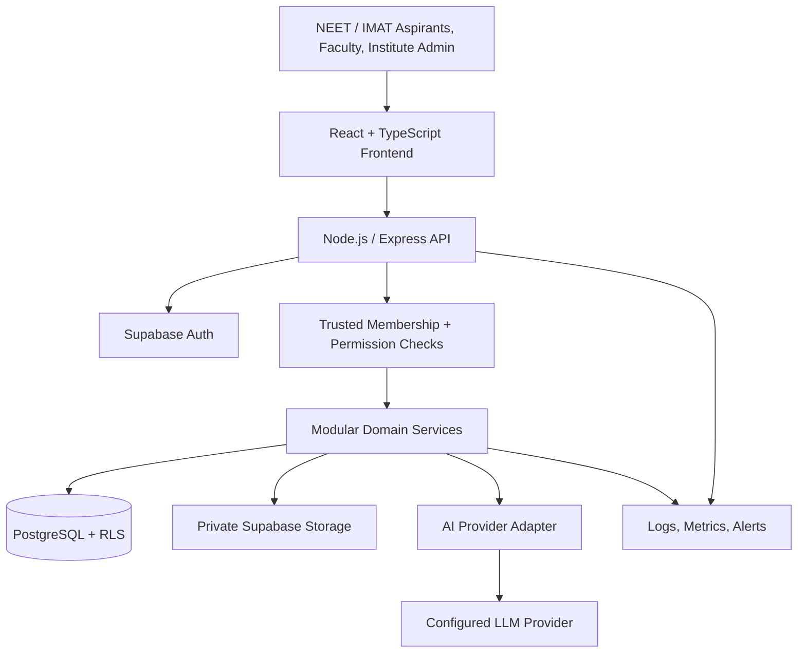
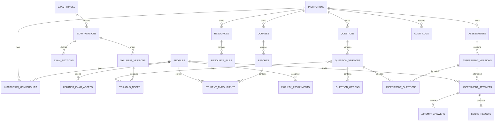
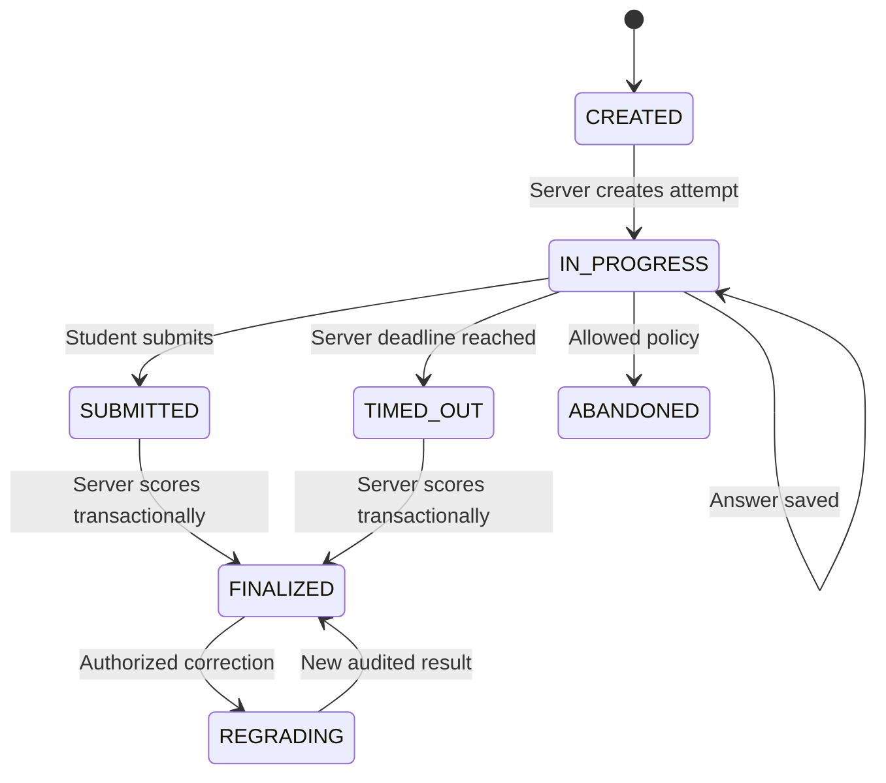

# MedPrep
## NEET-UG and IMAT Aspirant Learning, Practice & Assessment Platform

**Updated project overview, product requirements, examination specifications, architecture, data model, security controls, testing strategy, and implementation roadmap**

| Document field | Value |
|---|---|
| Document version | 3.0 |
| Prepared / verified against published information | 6 November 2026 |
| Product scope | NEET-UG and IMAT only |
| Primary users | NEET-UG and IMAT aspirants |
| Supporting users | Faculty, tutors, coaching-institute administrators |
| Initial delivery approach | Aspirant-facing platform with institute / batch workspaces |
| Initial examination baseline | NEET-UG 2026 and IMAT 2026/27 |
| Architecture direction | React + TypeScript, Node.js/Express, Supabase/PostgreSQL |
| Implementation status | Product and technical specification; implementation claims require separate verification |

> **Important scope decision:** This product is specifically for **NEET-UG and IMAT aspirants**. It is not a generic LMS for every competitive examination. It will maintain two distinct exam-preparation tracks with shared platform services and separate syllabi, question formats, assessment rules, content, and analytics. UCAT, MCAT, and unrelated examinations are out of scope.

---

# 0. Final Product Decision

## 0.1 Finalized idea

**MedPrepOS is a specialized NEET-UG and IMAT preparation platform that gives aspirants one place to study the correct exam-specific syllabus, access reviewed learning resources, practise questions, take exam-pattern mock tests, understand their performance, and receive structured revision support.**

It supports two distinct preparation tracks:

1. **NEET-UG track** — aligned to the applicable National Testing Agency (NTA) bulletin and National Medical Commission (NMC) syllabus for the selected examination year.
2. **IMAT track** — aligned to the applicable Italian Ministry of University and Research (MUR) decree, syllabus, and official test materials for the selected academic year.

A student may prepare for NEET-UG, IMAT, or both. If a student selects both, the platform must keep their syllabus progress, question banks, mock tests, scoring, and analytics separated by examination track.

The platform combines:

- Exam-specific curriculum and syllabus tracking.
- Structured study material and resource management.
- Reviewed question banks and previous-paper practice, subject to content rights.
- Distinct NEET-UG and IMAT assessment configurations.
- Timed tests, answer saving, scoring, and solution review.
- Subject / section / topic-level performance analytics.
- AI-assisted question drafting and study assistance, with academic safeguards.
- Faculty, tutor, batch, and institute tools where the learner is part of a coaching programme.
- A secure account, access-control, and audit foundation.

## 0.2 The correct product positioning

**Recommended product description:**

> MedPrepOS is a dual-track medical entrance preparation platform for NEET-UG and IMAT aspirants. It combines exam-specific learning resources, syllabus-based practice, realistic mock assessments, performance analytics, and AI-assisted academic support. Its assessment engine applies the rules configured for the selected exam and year, while faculty and academic reviewers retain control over the quality and publication of learning content.

## 0.3 Primary product value

The platform should answer six practical questions for an aspirant:

1. What should I study for *my selected examination and examination year*?
2. Which resources and practice questions belong to each syllabus topic?
3. Am I practising with the correct number of options, timing, and marking rules?
4. Which subjects, sections, and topics require more revision?
5. How has my performance changed across comparable tests?
6. What should I revise or practise next?

## 0.4 Product audiences and business approach

The **aspirant is the primary user**. The platform may serve an aspirant directly or through a participating coaching institute.

| Audience | Value provided |
|---|---|
| Independent aspirant | Personal study plan, resources, topic practice, mock tests, progress tracking |
| Institute-enrolled aspirant | Assigned courses, batches, faculty resources, scheduled tests, academic feedback |
| Faculty / tutor | Curriculum mapping, resource publishing, question authoring, assessment creation, learner progress |
| Coaching institute | Student and batch management, content governance, assessment administration, reports |
| Platform administrator | Product operations, institution setup, platform-level governance |

Recommended initial commercial approach:

- Validate the core learner experience with a small pilot group.
- Support a pilot institute and individual learner accounts without building a complex billing system first.
- Add paid learner subscriptions or institute plans only after product usage and willingness to pay are validated.
- Do not make a claim about revenue, market size, or guaranteed outcomes without market research.

## 0.5 Product boundaries

| The platform will provide | The platform will not claim to provide |
|---|---|
| NEET-UG and IMAT preparation workflows | Official NTA or MUR examination services |
| Practice papers and mock assessments | The official examination itself |
| Exam-year-specific scoring configurations | Guaranteed official scores, ranks, or admission |
| Performance indicators and revision recommendations | Guaranteed rank or admission prediction |
| AI-generated draft questions reviewed by faculty | Guaranteed correctness of unreviewed AI output |
| Content access control and piracy deterrence | Screenshot-proof or piracy-proof DRM |
| Exam information links and preparation resources | Official application, registration, or counselling decisions |

---

# 1. Problem Statement and Product Opportunity

## 1.1 Problems the product addresses

NEET-UG and IMAT aspirants prepare for different admission tests, but both need reliable and organized preparation workflows. Common problems to validate with real aspirants and institutes include:

- Study notes, videos, question banks, and mock tests are scattered across different tools.
- Students may follow a generic syllabus or an outdated exam pattern.
- Question practice may not match the current examination's number of options, section distribution, timing, or marking rules.
- Students receive total marks but not sufficiently useful topic-level feedback.
- Faculty may spend significant time drafting, checking, organizing, and publishing practice questions.
- Students taking two examinations may mix their study plans and misunderstand the differences between the examinations.
- Institutes may manage batches, assignments, and test results manually.
- Students may not know which resources are approved, current, or relevant to their selected exam year.

These are product hypotheses, not quantified market findings. Validate them through interviews, observation, and pilot usage before claiming that the platform saves a particular amount of time or improves scores by a particular percentage.

## 1.2 Proposed solution workflow

```text
Aspirant creates an account
          |
          v
Selects NEET-UG, IMAT, or both
          |
          v
Selects available exam-year / syllabus version
          |
          v
Gets a separate exam-specific dashboard
          |
          v
Studies syllabus topics and approved resources
          |
          v
Practises topic-wise and full-length questions
          |
          v
Takes the corresponding exam-pattern assessment
          |
          v
Server saves answers and calculates the result
          |
          v
Student reviews solutions and performance
          |
          v
Uses revision recommendations and continues practice
```

Faculty and institutes can add a parallel workflow:

```text
Institute / Faculty setup
          |
          v
Assigns exam track, course, faculty and batch
          |
          v
Publishes exam-specific resources and questions
          |
          v
Creates and schedules practice assessments
          |
          v
Reviews participation and academic progress
```

## 1.3 What should make the product different

The product's strongest differentiator is not merely having a quiz interface or chatbot. It is **maintaining two accurate and separate preparation experiences within one platform**.

- NEET-UG and IMAT have different question formats and scoring policies.
- They have different syllabus organization and topic priorities.
- They need separate exam-year content and test configurations.
- Their raw scores must not be treated as directly comparable.
- An aspirant preparing for both should be able to switch between tracks without mixing progress or test rules.

---

# 2. Examination Scope and Verified Reference Baselines

## 2.1 Exam-year principle

Examination patterns, syllabi, official instructions, and admission processes can change. The platform must treat each year's official documentation as a versioned source of truth.

The values in this section are a **verified reference baseline based on published 2026 materials**. They must not be hardcoded as permanent rules. Before activating a later cycle, the platform owner or academic reviewer must check the latest official bulletin or decree and publish a new configuration version.

## 2.2 NEET-UG 2026 reference baseline

The NTA's NEET-UG 2026 Information Bulletin specifies the following examination pattern:

| Attribute | NEET-UG 2026 reference |
|---|---|
| Organizing authority | National Testing Agency (NTA), with relevant regulatory syllabus / admission rules |
| Main academic areas | Physics, Chemistry, Biology (Botany and Zoology) |
| Total questions | 180 compulsory questions |
| Physics | 45 questions |
| Chemistry | 45 questions |
| Biology | 90 questions |
| Question type | MCQ with four options and one correct / best answer |
| Duration | 180 minutes (3 hours) |
| Maximum marks | 720 |
| Correct answer | +4 |
| Incorrect answer | -1 |
| Unanswered | 0 |
| Official delivery mode for 2026 | Pen-and-paper |
| Question-paper languages listed for 2026 | English, Hindi, Assamese, Bengali, Gujarati, Kannada, Malayalam, Marathi, Odia, Punjabi, Tamil, Telugu, Urdu |

**Important NEET-UG 2026 marking exceptions in the NTA bulletin:**

- If more than one option is found correct, +4 is awarded only to candidates who marked any of the correct options.
- If all options are found correct, +4 is awarded to candidates who attempted the question.
- If no option is correct, a question is found wrong, or a question is dropped, +4 is awarded to all candidates who appeared, whether they attempted the question or not.

These exceptions mean that a simplistic `correct ? +4 : incorrect ? -1 : 0` calculation is not sufficient for all official-paper adjudication cases.

**Accessibility note:** The NEET-UG 2026 bulletin describes compensatory time for eligible PwD/PwBD candidates with a physical limitation to write. Practice assessments should provide configurable, authorized accommodations. The platform must not independently determine a candidate's official disability eligibility or claim to reproduce every official accommodation rule.

### 2.2.1 NEET-UG curriculum structure

The initial curriculum should follow the current NMC-notified NEET-UG syllabus for the selected year.

Recommended organization:

```text
NEET-UG
  ├── Physics
  │    ├── Chapter
  │    │    └── Topic
  │    └── Practice questions
  ├── Chemistry
  │    ├── Physical Chemistry
  │    ├── Organic Chemistry
  │    ├── Inorganic Chemistry
  │    └── Topic practice
  └── Biology
       ├── Botany
       ├── Zoology
       └── Chapter / Topic practice
```

Do not treat the illustrative branches above as a replacement for the official syllabus. Each node must be imported or mapped against the applicable NMC/NTA syllabus version.

### 2.2.2 NEET-UG language support

The NEET-UG 2026 bulletin lists 13 examination-paper language options. The product should:

- Store the original language of each question and resource.
- Support translated versions only when they have been reviewed.
- Keep a canonical question identity across translations.
- Preserve option order and answer-key mapping across translations.
- Clearly identify the language version shown to the student.
- Avoid automatic machine translation as the only quality control for scientific terms.
- Apply the language choices of the relevant official year only when verified.

The product's interface language and the language of an examination question are separate settings.

### 2.2.3 NEET-UG official paper versus online practice

The official NEET-UG 2026 examination mode is pen-and-paper. MedPrepOS is a digital preparation product; its online test runner is therefore a practice simulation, not the official NTA examination interface.

Possible practice modes:

1. **Digital timed practice:** Select answers online and receive immediate or scheduled feedback.
2. **Paper simulation (later enhancement):** Provide a printable question paper and OMR-style response sheet, with manual response entry or a carefully validated capture workflow.
3. **Topic practice:** Untimed or lightly timed practice with explanations.

Do not tell students that completing an online mock is identical to sitting the official pen-and-paper test.

## 2.3 IMAT 2026/27 reference baseline

The Ministry of University and Research (MUR) published Ministerial Decree No. 1005 dated 6 August 2026 for the 2026/2027 English-language admission test cycle. The official MUR portal identifies the IMAT track and publishes the 2026 test calendar and question paper.

The 2026 paper and decree-based materials provide the following reference structure:

| Section / area | Questions |
|---|---:|
| Reading skills and knowledge acquired during studies | 4 |
| Logical reasoning and problem solving | 5 |
| Biology | 23 |
| Chemistry | 15 |
| Physics and Mathematics | 13 |
| **Total** | **60** |

| Attribute | IMAT 2026/27 reference |
|---|---|
| Authority / annual rules | MUR and the applicable official decree |
| Question type | Multiple-choice |
| Options per question | Five |
| Total questions | 60 |
| Duration | 100 minutes |
| Correct answer | +1.5 |
| Incorrect answer | -0.4 |
| Unanswered | 0 |
| Maximum raw score | 90 |
| Main scientific areas | Biology, Chemistry, Physics and Mathematics |
| Other areas | Reading skills / knowledge acquired during studies; logical reasoning / problem solving |
| Assessment language | English-language examination track |

The official 2026 MUR question-paper page states that the published version has option A as the correct answer for all questions. Treat that as a property of that published paper version, not as a general rule for future papers or generated questions.

### 2.3.1 IMAT curriculum structure

Use an IMAT-specific taxonomy:

```text
IMAT
  ├── Reading skills and knowledge acquired during studies
  ├── Logical reasoning and problem solving
  ├── Biology
  ├── Chemistry
  └── Physics and Mathematics
       ├── Physics topics
       └── Mathematics topics
```

The 2026 question distribution is important for test construction and preparation analytics. It must be stored in the `exam_version` / section configuration rather than assumed to remain identical in future years.

### 2.3.2 IMAT content and delivery safeguards

- Use English as the exam-question language for the IMAT preparation track unless a later official specification establishes otherwise.
- Keep the reading/knowledge section distinct from the logical reasoning section.
- Do not label the reading/knowledge section simply as an English grammar test.
- Keep Physics and Mathematics as a combined official question allocation where required by the exam configuration, while allowing study planning to track Physics and Mathematics topics separately.
- Do not reuse old IMAT distributions without checking the applicable annual decree.
- Do not infer admission eligibility, ranking thresholds, tie-break rules, or university seat availability from a practice score. Such information belongs to the official annual decree and admissions information, and can vary by candidate category and cycle.

## 2.4 NEET-UG versus IMAT: product design comparison

| Design dimension | NEET-UG | IMAT |
|---|---|---|
| Subject taxonomy | Physics, Chemistry, Biology (Botany/Zoology) | Reading/knowledge, reasoning, Biology, Chemistry, Physics/Mathematics |
| 2026 question count | 180 | 60 |
| 2026 option count | 4 | 5 |
| 2026 duration | 180 minutes | 100 minutes |
| 2026 correct mark | +4 | +1.5 |
| 2026 wrong mark | -1 | -0.4 |
| 2026 unanswered mark | 0 | 0 |
| 2026 maximum raw score | 720 | 90 |
| Official 2026 mode | Pen-and-paper | Follow MUR's applicable 2026 decree and instructions |
| Language approach | 13 listed paper languages in 2026 | English-language test |
| Special scoring cases | Multiple-correct, all-correct, dropped/invalid question rules in 2026 bulletin | Apply the applicable MUR decree's rules |

**Core engineering conclusion:** One assessment product can serve both examinations, but it must load an exam-specific configuration and scoring policy. It must never use a single universal `+4/-1` rule or a fixed four-option/five-option assumption.

## 2.5 Annual verification workflow

Before a new NEET-UG or IMAT cycle is activated:

1. Retrieve the latest official NTA/NMC or MUR documentation.
2. Record the official source URL, publication date, and applicable cycle.
3. Compare question count, subject/section distribution, option format, duration, scoring, languages, and accommodation rules with the previous version.
4. Update curriculum and assessment configuration.
5. Obtain academic review and approval.
6. Run scoring and assessment regression tests.
7. Publish the new version.
8. Retain the previous version for historical attempts.

No future-year pattern should be invented or assumed.

---

# 3. User Personas and Roles

## 3.1 Aspirant (primary persona)

An aspirant can:

- Select NEET-UG, IMAT, or both.
- Select an available examination year / syllabus version.
- Study subjects, sections, chapters, topics, and skills.
- Access eligible resources.
- Practise questions.
- Take topic, subject, section, and full-length mock tests.
- Review answers and explanations according to release rules.
- Track exam-specific performance.
- Receive revision suggestions.
- Use an AI study assistant where enabled.
- Manage language and accessibility preferences.

## 3.2 Faculty / tutor

A faculty member can:

- View assigned exam tracks, subjects, and batches.
- Upload and manage resources.
- Create and edit questions.
- Review AI-generated draft questions.
- Approve or reject academic content within assigned permission.
- Create and schedule assessments.
- Review assigned students' performance.
- Share announcements and revision plans.

## 3.3 Institute administrator

An institute administrator can:

- Manage the institute workspace.
- Invite faculty and students.
- Assign roles using trusted workflows.
- Create academic years, courses, and batches.
- Assign exam tracks and faculty.
- Enroll students.
- Assign resources and assessments.
- Review institute-level reports.
- Manage announcements and operational settings.
- View authorized audit events.

## 3.4 Platform administrator

A platform administrator can:

- Create and manage participating institutions.
- Manage platform-level exam templates and configuration releases.
- Manage platform content, where licensed and approved.
- Monitor service health and usage.
- Manage platform support processes.
- Review platform-level audit events.

Platform administration is separate from institute-level administration.

## 3.5 Optional support role

A support role may be added later with narrow permissions. Support access to a student's account or records must be justified, time-limited where possible, visible to the user or institution as appropriate, and audited.

---

# 4. Functional Requirements

## 4.1 Account onboarding and exam-track selection

Requirements:

- Register and authenticate users.
- Allow an aspirant to select NEET-UG, IMAT, or both.
- Allow exam-track selection to be changed without deleting historical progress.
- Store each selected track as a separate learner enrollment / preparation profile.
- Store the examination cycle and syllabus version selected by the learner.
- Allow a learner to join an institution or remain an independent learner.
- Support invitations for institute-enrolled learners.
- Support account recovery and session revocation.
- Avoid collecting unnecessary personal or identity information.

Acceptance criteria:

- A student enrolled in both tracks sees two separate track dashboards.
- NEET progress does not appear as IMAT progress, and vice versa.
- A student can switch tracks without losing saved attempts.
- A suspended account cannot use a cached session to gain access to protected server resources.

## 4.2 Student dashboard

The dashboard should show:

- Active exam track(s).
- Current exam cycle / syllabus version.
- Study progress for the selected track.
- Upcoming assessments.
- Recent attempts.
- Subject/section performance.
- Topics needing revision.
- Announcements.
- Recommended next study action.

Avoid mixing raw NEET marks and IMAT marks into one combined score. If the student prepares for both, show two independent summaries.

## 4.3 Curriculum and syllabus browser

Requirements:

- Separate NEET-UG and IMAT syllabus trees.
- Separate exam-year syllabus versions.
- Support subject/section → chapter/topic/skill hierarchy.
- Support faculty-approved syllabus mapping.
- Support display order and optional prerequisites.
- Support topic completion and revision status.
- Store syllabus source metadata.
- Show the year/version to the learner.
- Allow resources and questions to be mapped to exact syllabus nodes.
- Preserve historical mappings when the syllabus changes.

## 4.4 Study plans and topic progress

Students should be able to:

- Mark topics as not started, in progress, completed, or revise again.
- Record study sessions or revision dates.
- View subject/section completion.
- See recommended topics based on a transparent rule.
- Maintain separate study plans for NEET-UG and IMAT.

Faculty should be able to assign a study plan to a batch or learner, if permitted.

## 4.5 Learning resources

Supported content types:

- Study notes.
- PDF documents.
- Faculty-created summaries.
- Video lectures.
- Diagrams and images.
- DPP / topic practice sheets.
- Previous-year questions (PYQs), where permitted.
- External reference links.
- Revision checklists.

Requirements:

- Upload resource metadata and files.
- Store files in private object storage.
- Validate file type, size, and ownership.
- Map resources to exam track, exam year, syllabus nodes, course, and eligible batch.
- Support draft, review, published, archived, and withdrawn statuses.
- Record author, reviewer, and publisher.
- Provide in-app reading where practical.
- Support text alternatives for educational images and captions/transcripts where available.
- Use authenticated access or short-lived signed URLs.
- Allow expired or withdrawn content to become inaccessible.
- Respect copyright, license, and institute ownership terms.

The platform must not assume that every PDF, book, or previous-year paper can legally be republished. Content ingestion requires rights review.

## 4.6 Question bank

Requirements:

- Create questions manually.
- Support single-answer MCQ as the first supported format.
- Store option count per question and validate it against the selected exam configuration.
- Support four options for the NEET-UG 2026 reference format.
- Support five options for the IMAT 2026 reference format.
- Add other question types only when justified by the official pattern or a clearly labeled practice feature.
- Map each question to exam track, exam version, subject/section, chapter/topic, difficulty, and tags.
- Store explanation and source/reference metadata.
- Support image and diagram attachments with descriptive alternative text.
- Support draft, review, approved, published, rejected, and retired states.
- Track author, reviewer, and version history.
- Prevent a student from retrieving the answer key before release.
- Support reporting and correction of disputed questions.
- Do not assume a correct option based on its position.
- Validate that the answer key refers to a valid option.

## 4.7 Previous-year question practice

Requirements:

- Import only questions the platform is permitted to use.
- Record exam name, year, paper/set where applicable, source URL, license/permission status, and verification notes.
- Preserve the original question and answer-key relationship.
- Keep official answer-key updates and corrections as versioned records.
- Distinguish official past-paper questions from faculty-created practice questions and AI-generated drafts.
- Do not label an approximate or reconstructed question as an official PYQ.
- Ensure option shuffling updates the answer-key mapping correctly.
- Keep the published IMAT 2026 paper's answer-key convention as a property of that particular published paper, not a global rule.

## 4.8 Practice and assessment types

Supported assessment types:

- Topic-wise practice.
- Chapter test.
- Subject / section test.
- Daily Practice Problems (DPP).
- Timed mini-test.
- Previous-year paper practice.
- Full-length NEET-UG mock.
- Full-length IMAT mock.
- Revision / diagnostic test.
- Institute test series.

Every assessment must declare its exam track and configuration version.

## 4.9 NEET-UG assessment runner

For a NEET-UG 2026-compatible practice configuration:

- 180 compulsory questions.
- Physics 45, Chemistry 45, Biology 90.
- Four options for each standard single-answer MCQ.
- 180-minute full-length duration.
- +4 correct, -1 incorrect, 0 unanswered.
- Support question navigation and answer review.
- Support mark-for-review.
- Support section / subject filters for practice tests.
- Support scheduled and self-paced test modes.
- Save answers server-side.
- Calculate score on the backend.
- Support question-level adjudication for multiple-correct, all-correct, invalid, or dropped questions where a mock is designed to emulate the applicable official rule.
- Display a clear practice/simulation disclaimer.

For future NEET years, load the relevant published configuration instead of silently keeping the 2026 pattern.

## 4.10 IMAT assessment runner

For an IMAT 2026/27-compatible practice configuration:

- 60 questions.
- Five options per standard MCQ.
- 100-minute full-length duration.
- Section distribution: 4 reading/knowledge, 5 logical reasoning/problem solving, 23 Biology, 15 Chemistry, and 13 Physics/Mathematics.
- +1.5 correct, -0.4 incorrect, 0 unanswered.
- Show section progress and remaining time.
- Support question navigation and review.
- Preserve the combined Physics/Mathematics exam allocation while tracking Physics and Mathematics topics separately for study analytics.
- Save answers server-side.
- Score on the backend.
- Provide detailed explanations after the configured result-release point.
- Show raw score out of 90 and a clearly labeled percentage of the maximum raw score.

Do not use the previous year's section distribution without verifying the active MUR decree.

## 4.11 Common assessment-runner behavior

- Server creates the attempt and records the authoritative start time.
- Server calculates the deadline.
- Client countdown is only a visual display.
- Answers are saved periodically and on navigation where practical.
- UI shows whether an answer save was confirmed.
- Attempt can recover after refresh or temporary network interruption.
- Submission is idempotent.
- The server validates the learner's enrollment and assessment eligibility.
- The server rejects submissions outside the configured time policy.
- The answer key remains hidden until release.
- The server finalizes the attempt once.
- The server calculates the authoritative score.
- Accessibility settings and approved accommodations are applied by a trusted process.
- A network-loss policy is shown to the user before the assessment starts.

## 4.12 Scoring engine

Use separate policy handlers or rule configurations for NEET-UG and IMAT.

Suggested conceptual interface:

```ts
type ExamCode = "NEET_UG" | "IMAT";

interface ScoringPolicy {
  examCode: ExamCode;
  examYear: number;
  correctMarks: number;
  incorrectMarks: number;
  unansweredMarks: number;
  scoringPolicyVersion: string;
  supportsQuestionAdjudication: boolean;
}

interface QuestionAdjudication {
  status:
    | "STANDARD"
    | "MULTIPLE_CORRECT"
    | "ALL_OPTIONS_CORRECT"
    | "INVALID_OR_DROPPED";
  validOptionIds: string[];
  effectivePolicy: string;
}
```

This is illustrative, not a complete scoring implementation.

Scoring requirements:

- Calculate marks on the trusted backend.
- Never accept a final score from browser input.
- Store the scoring policy version used.
- Store the question version and adjudication used for each assessment.
- Support question-level invalidation / regrading.
- Support score recalculation with an audit trail.
- Keep raw score, percentage of maximum, and any scaled/band score as distinct fields.
- Never claim an official scaled score without a verified official conversion method.
- Do not compare raw marks between NEET-UG and IMAT as if they were the same scale.

## 4.13 Score release and solution review

Requirements:

- Configure immediate or scheduled score release.
- Configure when explanations become visible.
- Show selected answer, correct answer, marks awarded, and rationale.
- Show the question's exam, year, topic, and source classification.
- Show section/subsection results.
- Preserve the original scoring snapshot.
- Support faculty correction and authorized regrading.
- Record reason, actor, timestamp, previous result, and new result.

## 4.14 Performance analytics

### NEET-UG analytics

- Overall score out of the configured maximum.
- Physics, Chemistry, and Biology accuracy.
- Botany/Zoology breakdown if the curriculum and question mappings support it.
- Chapter/topic accuracy.
- Correct, incorrect, and unanswered counts.
- Time allocation indicators.
- Score progression across comparable NEET configurations.
- Topics selected for revision.

### IMAT analytics

- Raw score out of the configured maximum.
- Reading/knowledge performance.
- Logical reasoning/problem-solving performance.
- Biology performance.
- Chemistry performance.
- Physics/Mathematics performance.
- Separate Physics and Mathematics study-topic analytics.
- Correct, incorrect, and blank counts.
- Time allocation indicators.
- Score progression across comparable IMAT configurations.

### Analytics safeguards

- Show sample size with every topic-accuracy metric.
- Do not mark a topic as weak based on one or two questions.
- Distinguish no attempts from low performance.
- Compare only tests with compatible exam and scoring versions.
- Clearly label practice scores and projections.
- Do not guarantee rank or admission.
- Do not combine the two examination tracks into one misleading performance score.

## 4.15 Revision recommendations

Recommendations may be based on:

- Recent topic accuracy.
- Number of attempted questions.
- Recency of revision.
- Repeated errors.
- Unattempted syllabus topics.
- Faculty-assigned priorities.

Every recommendation should state why the topic is suggested, for example:

> "Revise Chemical Equilibrium: accuracy is below your configured target across 18 attempted questions."

Avoid unexplainable AI-generated advice that presents uncertain predictions as facts.

## 4.16 AI-assisted question generator

Purpose: help faculty and academic reviewers draft exam-specific practice questions.

Workflow:

1. Faculty selects NEET-UG or IMAT.
2. Faculty selects the exam year / syllabus version.
3. Faculty selects subject/section, chapter/topic, difficulty, question type, language, and count.
4. Backend verifies permissions and request limits.
5. AI provider generates draft content.
6. Backend validates structured output.
7. System checks option count, duplicate options, answer-key references, missing explanation, topic mapping, and unsupported markup.
8. Faculty reviews scientific/academic correctness.
9. Faculty edits, approves, or rejects each question.
10. Approved questions can be published into the question bank.

Exam-specific prompt constraints:

- NEET-UG prompts should follow the selected NEET syllabus, four-option question format, and appropriate depth.
- IMAT prompts should follow the selected IMAT syllabus and section, five-option format, and relevant reasoning/reading/science question style.
- Do not ask the model to create an IMAT "English grammar section" as a substitute for the official reading/knowledge category.
- Do not set Option A or any other position as the correct answer by default.
- Do not claim question quality merely because output is valid JSON.

## 4.17 AI study assistant

A student-facing AI study assistant may:

- Explain a concept in the context of the selected exam track.
- Summarize approved study resources.
- Create revision checklists.
- Explain a question after its answer-release policy allows it.
- Generate practice prompts from approved curriculum material.
- Point to relevant syllabus topics and resource citations.

Safety and quality rules:

- Ground responses in approved content where possible.
- Cite the source resource, syllabus node, or faculty-approved notes used.
- State uncertainty and avoid inventing official exam rules.
- Do not expose answer keys for active assessments.
- Do not treat model output as medical advice.
- Do not send unnecessary personal or assessment data to an external model provider.
- Allow the assistant to be disabled by an institution.
- Log only the information needed for service quality and security, with a defined retention policy.

## 4.18 Calendar and announcements

Requirements:

- Academic calendar events for lectures, tests, deadlines, and revision sessions.
- Announcement audience by exam track, course, batch, or role.
- Pin important notices.
- Show publication and expiry dates.
- Use the institution's configured timezone.
- Record publisher and edit history.
- Allow acknowledgement where needed.

## 4.19 Community and discussion (post-MVP)

Optional features:

- Question discussion threads.
- Nested replies.
- Faculty answers.
- Moderation and reporting.
- Pinning/locking.
- Rate limits and spam controls.
- Audit trail for moderation actions.

Do not let community features delay assessment reliability.

## 4.20 Notification system (later phase)

Potential channels:

- In-app notifications.
- Email notifications.
- Push notifications, if a suitable application client is introduced.
- SMS or WhatsApp only through compliant, approved providers and consent/communication rules.

Use a notification outbox so important events are not lost when a provider is temporarily unavailable. Avoid sending assessment answers or sensitive personal information in notification text.

## 4.21 Subscription and payment management (later phase)

Possible business models:

- Direct aspirant subscription.
- Institute-sponsored access.
- Institute licence / batch-based plans.
- Freemium topic practice with paid test series.

Do not build payment features before the pricing and customer model are validated. If added, use a reputable payment provider, server-side verification, webhook signature validation, idempotent payment events, refunds, and clear subscription status.

---

# 5. User Interface and Screen Inventory

## 5.1 Shared screens

- Landing page and product explanation.
- Sign up / login / reset password.
- Exam-track selection.
- Profile and preferences.
- Help and support.
- Privacy and account settings.

## 5.2 Student screens

- Student home.
- NEET-UG dashboard.
- IMAT dashboard.
- Exam-year / syllabus version selector.
- Subject/section browser.
- Chapter/topic view.
- Resource library and reader.
- Topic practice.
- Mock test list.
- Assessment instructions.
- Timed assessment runner.
- Submission confirmation.
- Results and solutions.
- Performance analytics.
- Revision planner.
- Calendar and announcements.
- AI study assistant.

## 5.3 Faculty screens

- Faculty dashboard.
- Assigned exam tracks and batches.
- Curriculum browser.
- Resource upload and editing.
- Question bank.
- Question editor.
- AI question generator.
- Draft/review/approval queue.
- Assessment builder.
- Test scheduling.
- Student and batch performance.
- Announcements.

## 5.4 Institute administrator screens

- Institute overview.
- Student and faculty management.
- Invitations and enrollment.
- Academic years and batches.
- Courses and exam-track assignment.
- Faculty assignment.
- Resource governance.
- Assessment governance.
- Calendar and announcements.
- Reports and exports.
- Audit log.
- Institute settings.

## 5.5 Platform administration screens

- Institute directory.
- Institute activation/suspension.
- Global NEET/IMAT exam template administration.
- Exam-year source verification and publication.
- Global content governance (if licensed).
- Platform monitoring.
- Support access governance.
- Platform audit events.

---

# 6. Content Governance and Academic Quality

## 6.1 Content states

Recommended resource and question states:

```text
DRAFT
  -> SUBMITTED_FOR_REVIEW
  -> APPROVED
  -> PUBLISHED
  -> ARCHIVED / WITHDRAWN
```

Not every state transition should be available to every role.

## 6.2 Question quality checklist

Before publication, reviewers should confirm:

- The question belongs to the chosen exam track.
- The exam-year syllabus mapping is valid.
- The topic and section are correct.
- Option count matches the intended format.
- Only the intended answer choice(s) are keyed.
- The answer key is correct.
- The explanation is understandable and accurate.
- The question is not ambiguous.
- Images/diagrams are legible and properly licensed.
- Difficulty is reasonable for the intended practice purpose.
- The source or author is recorded.
- The wording does not improperly reproduce copyrighted material.

## 6.3 Versioning

- Do not overwrite a published question in a way that changes a completed attempt.
- Create a new question version for corrections.
- Preserve the answer key and explanation used in historic attempts.
- Regrading is an explicit, audited operation.
- Publish new exam-year syllabus versions without destroying old mappings.

---

# 7. Security and Authorization Architecture

## 7.1 Core security principles

- Least privilege.
- Deny by default.
- Server-side authorization.
- Database-enforced row-level isolation.
- Tenant isolation.
- No trusted role assignment from user-editable metadata.
- No client-authoritative scoring.
- Private content storage.
- Short-lived access links.
- Auditable privileged actions.

## 7.2 Authentication and role escalation

The original design's proposed pattern of taking a role from `auth.users.raw_user_meta_data` is not safe for authorization. Supabase documents that user-editable metadata must not be trusted for authorization or RLS decisions.

Correct design:

- Public sign-up creates a basic student/pending account.
- Faculty and administrator accounts are invited or approved through trusted workflows.
- Privileged roles are stored in a protected membership/permissions model.
- The backend validates membership and permissions on each protected action.
- RLS policies independently enforce database access.
- Role changes create audit events.
- Service-role credentials are never exposed to the browser.

## 7.3 Institution and learner access boundaries

A student may be an independent learner or an institute-enrolled learner. A student may also prepare for both exam tracks.

Access checks must validate:

- Authenticated profile.
- Selected exam-track entitlement.
- Institution membership, when content is institution-scoped.
- Course/batch enrollment, when content is batch-scoped.
- Resource or assessment publication status.
- Applicable exam-year / syllabus version.
- Attempt count and availability window.
- Faculty subject/batch assignment.

Frontend filters are for usability, not security.

## 7.4 RLS checklist

For each protected table:

- Enable RLS.
- Define SELECT policy.
- Define INSERT policy.
- Define UPDATE policy.
- Define DELETE policy or explicitly deny deletion.
- Check tenant ownership.
- Check trusted membership role.
- Check student enrollment or faculty assignment as appropriate.
- Check relationships via secure joins or carefully designed helper functions.
- Test with real student, faculty, institute-admin, and platform-admin identities.
- Test direct requests and manipulated record IDs.

If using `SECURITY DEFINER` helpers:

- Use the narrowest possible privileges.
- Fix a safe `search_path`.
- Revoke unnecessary execution grants.
- Review the code for authorization bypasses.
- Avoid recursive RLS patterns.

## 7.5 Data and API security

- Validate all request payloads.
- Use parameterized queries or a safe database client.
- Rate-limit authentication, AI, uploads, and high-cost APIs.
- Use safe CORS configuration.
- Use secure headers.
- Avoid exposing internal error details.
- Keep secrets in server-side secret storage.
- Validate upload MIME type, size, and file ownership.
- Log request IDs, but not tokens or secrets.
- Review dependency vulnerabilities.
- Rotate compromised secrets promptly.

---

# 8. Content Protection and Assessment Integrity

## 8.1 Realistic browser security limits

A browser-based React application cannot guarantee prevention of screenshots, photographs, screen recordings, external capture software, or manual copying.

Blocking keyboard shortcuts, right-click, developer tools, or the browser's `getDisplayMedia` API does not control the user's operating system. Hiding the screen on tab blur may also create accessibility and usability problems.

Therefore, the platform must not promise "bank-grade DRM", "screenshot-proof", or "screen-recording-proof" protection.

## 8.2 Practical content-protection measures

- Private storage buckets.
- Server-authorized content access.
- Short-lived signed URLs.
- Dynamic watermarks on selected materials.
- Download restrictions where license terms permit.
- Access logging for sensitive content.
- Rate limiting and suspicious-activity signals.
- Assessment availability windows.
- Question/option randomization where appropriate.
- Server-side time and submission enforcement.
- Answer-key isolation.
- Controlled user access revocation.

These controls deter casual redistribution and reduce unauthorized access; they do not make copying impossible.

## 8.3 Assessment integrity

- Server creates each attempt.
- Server stores start and deadline timestamps.
- Server validates every answer save.
- Server validates assessment access.
- Server finalizes once.
- Server computes the score.
- Server retains question and scoring versions.
- Any regrade is audited.
- Suspicious activity may be flagged for review, not automatically treated as proof of misconduct.

---

# 9. Recommended Technology Stack

The original stack is appropriate for an MVP and can be retained with clearer service boundaries.

| Layer | Recommended technology | Responsibility |
|---|---|---|
| Frontend | React + TypeScript | Learner, faculty, and admin UI |
| Build tooling | Vite | Local development and production build |
| Styling | Tailwind CSS | Responsive design system |
| Charts | Recharts | Exam-specific performance views |
| Backend | Node.js + Express | Trusted API and domain services |
| Database | PostgreSQL through Supabase | Relational data, constraints, transactions |
| Authentication | Supabase Auth | Login and session management |
| Authorization | PostgreSQL RLS + backend checks | Learner / institute / role access |
| File storage | Supabase Storage | Private notes, PDFs, images, video assets |
| AI | Provider adapter; Groq can be an initial provider if verified | Question drafting and study assistance |
| Validation | Zod or equivalent | API and AI output schemas |
| Unit/integration tests | Vitest/Jest + Supertest | Business logic and API tests |
| Browser E2E tests | Playwright | Student/faculty/admin workflows |
| Monitoring | Structured logs and error/metrics service | Operational health |

Pin and verify package versions at implementation time. Do not assume a model name, endpoint, or provider fallback remains available indefinitely.

## 9.1 Architecture style

Use a **modular monolith** first. It is easier to develop, deploy, test, and debug than a premature microservices system. Separate modules by domain and split them later only if real traffic, team size, or reliability requirements justify it.

## 9.2 High-level architecture



## 9.3 Backend architecture and domain bounded contexts

The backend is structured as a **Modular Monolith** in `apps/api/src/` organized into cohesive Domain Bounded Contexts (Vertical Slices), preventing unbounded micro-folder sprawl:

```text
apps/api/src/
  server.ts                           # HTTP Process entry point
  app.ts                              # Express app composition & middleware pipeline
  worker.ts                           # Asynchronous job worker (AI generation, timeout sweeps)

  config/
    env.ts                            # Zod-validated environment variables
    cors.ts
    constants.ts

  middleware/
    authenticate.ts                   # Supabase Bearer JWT verification
    resolve-membership.ts             # Active institute RBAC injection
    require-permission.ts             # Granular permission check
    require-exam-access.ts            # Enforces NEET / IMAT track entitlement
    validate-request.ts               # Request payload Zod validation
    rate-limit.ts
    error-handler.ts

  domains/                            # Domain-Driven Bounded Contexts
    identity/                         # Profiles, auth credentials, memberships
    tenancy/                          # Multi-tenant institutions, batches, enrollments
    academics/                        # Official syllabus tree, chapters, topics
    examination/                      # Exam tracks, blueprint versions, adapters
    content-bank/                     # Questions, revisions, confidential answer keys, reviews
    assessments/                      # Test runner runtime, autosave sync, attempt lifecycle
    learning/                         # Study plans, student progress, AI study tutor
    communication/                    # Announcements, calendar events, discussions
    platform/                         # Audit logs, health checks, system metrics

  infrastructure/                     # Low-level external integration adapters
    database/                         # User-scoped & admin service-role Supabase clients
    storage/                          # Supabase private storage S3 & signed URLs
    ai/                               # LLM provider clients (Groq / OpenAI fallback)
    queue/                            # Background job queuing

  jobs/                               # Asynchronous job handlers
    ai-question-gen.job.ts
    attempt-timeout.job.ts
    notification-dispatch.job.ts

  shared/                             # Domain-agnostic utilities (errors, result, pagination)
```

Authoritative scoring algorithms (+4/-1 with NTA dropped-question adjudication for NEET-UG; +1.5/-0.4 for IMAT) are encapsulated within the isolated, deterministic workspace package `@medprepos/exam-engine`.

## 9.4 Frontend architecture and domain feature slices

The frontend is structured in `apps/web/src/` using a **Vertical Feature-Slice Architecture** combined with composed role pages, strictly avoiding role-duplication and exam-runner forks:

```text
apps/web/src/
  app/                                # Application shell & routing composition
    App.tsx
    main.tsx
    router/                           # Route tables, role guards, track guards
    providers/                        # AuthProvider, QueryClientProvider, ThemeProvider
    layouts/                          # PublicLayout, StudentLayout, FacultyLayout, AdminLayout

  features/                           # Self-contained domain capability slices
    exam-selection/                   # Dual-track switcher (NEET-UG vs IMAT vs both)
    curriculum/                       # Unified syllabus navigator & topic tree
    resources/                        # PDF document viewer, video player, DPP reader
    practice/                         # Topic question drill runner & scratchpad
    assessments/                      # Unified exam runner, question palette, autosave sync
    analytics/                        # Performance radars, subject breakdown, error analysis

  pages/                              # Composed views per Role Portal (Route targets)
    student/                          # Dashboard, SyllabusView, DrillPage, ExamLobby, Results
    faculty/                          # Dashboard, QuestionAuthoring, Reviews, AssessmentSetup
    institute-admin/                  # Batches, CohortEnrollments, FacultyAssignments, Reports
    platform-admin/                   # Institutions, BlueprintVerification, AuditLogs

  shared/                             # Genuinely reusable cross-cutting components & hooks
    components/                       # Buttons, modals, forms, data tables, math renderers
    hooks/                            # useDebounce, useCountdown, useAutosave
    utils/                            # Formatters, date helpers, LaTeX helpers
```

> **Crucial Rule:** NEET-UG and IMAT use a **unified assessment runner** driven dynamically by the server-authoritative exam blueprint (`question_count`, `option_count: 4 | 5`, `duration_minutes`, `sections`). Do not create separate `neet-runner` and `imat-runner` components.

---

# 10. Database Design

## 10.1 Database design principles

- Use UUID primary keys for application entities.
- Use foreign keys and uniqueness constraints.
- Use `timestamptz` for timestamps.
- Use exact numeric types or integer values for marks; do not use floating-point arithmetic for authoritative scoring.
- Keep published exam configurations versioned.
- Keep questions and answer keys versioned.
- Snapshot the assessment configuration used by each attempt.
- Make the assessment and scoring history reproducible.
- Use explicit eligibility/enrollment relationships.
- Add `institution_id` to institute-owned rows.
- Separate platform-managed shared content from institute-owned content with explicit access policies.
- Index real query patterns, not every possible column.

## 10.2 Main entity groups

### Identity and institutional access

- `profiles`
- `institutions`
- `institution_memberships`
- `invitations`
- `platform_roles` (if platform-level roles are used)

### Exam track and cycle

- `exam_tracks` — only `NEET_UG` and `IMAT`.
- `exam_versions` — annual/cycle-specific rules.
- `exam_sections`
- `exam_scoring_policies`
- `exam_language_options`
- `exam_source_documents`
- `exam_configuration_reviews`

### Learner access and academic organization

- `learner_exam_access`
- `academic_years`
- `courses`
- `batches`
- `student_enrollments`
- `faculty_assignments`

### Curriculum

- `syllabus_versions`
- `syllabus_nodes`
- `syllabus_node_relationships`
- `student_topic_progress`
- `study_plans`
- `study_plan_items`

### Resources

- `resources`
- `resource_files`
- `resource_eligibility`
- `resource_revisions`

### Question bank

- `questions`
- `question_versions`
- `question_options`
- `question_assets`
- `question_syllabus_mappings`
- `question_reviews`
- `question_sources`
- `question_adjudications`

### Assessments and results

- `assessments`
- `assessment_versions`
- `assessment_sections`
- `assessment_questions`
- `assessment_eligibility`
- `assessment_attempts`
- `attempt_answers`
- `attempt_events`
- `score_results`
- `regrade_events`

### Operations

- `announcements`
- `calendar_events`
- `notification_outbox`
- `audit_logs`
- `ai_generation_jobs`
- `ai_generation_reviews`

## 10.3 Conceptual ER diagram



This is a conceptual diagram. The final migration set must define the actual columns, composite constraints, indexes, delete behavior, and RLS policies.

## 10.4 Important table definitions

### `exam_tracks`

Seed only two active product tracks:

| `code` | Display name |
|---|---|
| `NEET_UG` | NEET-UG |
| `IMAT` | IMAT |

No UCAT, MCAT, or generic exam track should be exposed in this product scope.

### `exam_versions`

Suggested fields:

- `id`
- `exam_track_id`
- `exam_year`
- `academic_cycle`
- `version_number`
- `status` (`DRAFT`, `UNDER_REVIEW`, `VERIFIED`, `PUBLISHED`, `RETIRED`)
- `official_source_url`
- `source_published_at`
- `reviewed_by`
- `reviewed_at`
- `created_at`

Unique constraint: track + year/cycle + version number.

### `exam_sections`

Suggested fields:

- `id`
- `exam_version_id`
- `code`
- `name`
- `display_order`
- `question_count`
- `duration_seconds` (nullable if only overall timing applies)
- `option_count`
- `language_code`
- `scoring_policy_id`

For the IMAT 2026 reference, the section counts are 4, 5, 23, 15, and 13. For NEET-UG 2026, the subject counts are 45, 45, and 90. These are versioned data, not application constants.

### `exam_scoring_policies`

Suggested fields:

- `id`
- `exam_version_id`
- `policy_code`
- `correct_marks`
- `incorrect_marks`
- `unanswered_marks`
- `maximum_raw_score`
- `policy_json`
- `created_at`

Use `numeric` or scaled integer units for precise mark arithmetic.

NEET question adjudication rules should be stored separately from the ordinary correct/incorrect/blank mapping so multiple-correct and dropped-question cases can be represented explicitly.

### `learner_exam_access`

Suggested fields:

- `id`
- `profile_id`
- `exam_track_id`
- `exam_version_id` (optional until cycle selection)
- `access_source` (`PERSONAL`, `INSTITUTION`, `PROMOTIONAL`)
- `institution_id` (nullable for an independent learner)
- `status`
- `valid_from`
- `valid_until`
- `created_at`

This supports independent aspirants and institute-sponsored access without mixing exam tracks.

### `profiles`

Suggested fields:

- `id` referencing Supabase Auth user ID
- `full_name`
- `phone` only if needed
- `avatar_path`
- `preferred_interface_language`
- `created_at`
- `updated_at`

Do not store an authoritative admin/faculty role in user-editable metadata.

### `institutions`

Suggested fields:

- `id`
- `name`
- `slug`
- `status`
- `timezone`
- `settings_json`
- `created_at`
- `updated_at`

### `institution_memberships`

Suggested fields:

- `id`
- `institution_id`
- `profile_id`
- `role`
- `status`
- `invited_by`
- `joined_at`
- `created_at`
- `updated_at`

Roles may include `INSTITUTE_ADMIN`, `FACULTY`, and `STUDENT`. These values must be written only by authorized server-side workflows.

### `courses`, `batches`, and `student_enrollments`

A course must be associated with one exam track and a compatible exam version or curriculum version. A batch belongs to an institution and course. Student enrollment records should preserve transfer and withdrawal history rather than silently overwriting previous batch assignment.

### `syllabus_versions` and `syllabus_nodes`

Suggested node attributes:

- `id`
- `syllabus_version_id`
- `parent_node_id`
- `node_type` (`SUBJECT`, `SECTION`, `CHAPTER`, `TOPIC`, `SKILL`)
- `code`
- `name`
- `description`
- `display_order`
- `source_reference`
- `is_active`

The taxonomy must support both exam tracks. Do not force IMAT's reading/reasoning areas into a Biology/Chemistry/Physics-only schema.

### `resources`

Suggested fields:

- `id`
- `content_scope` (`PLATFORM`, `INSTITUTION`)
- `institution_id` (required for institution-owned content)
- `exam_version_id`
- `course_id`
- `title`
- `description`
- `resource_type`
- `language_code`
- `license_status`
- `status`
- `created_by`
- `reviewed_by`
- `published_at`
- `created_at`
- `updated_at`

Use explicit resource eligibility mappings for batches and learner access. Do not rely on frontend filtering.

### `questions` and `question_versions`

Separate stable question identity from a particular version.

`question_versions` should store:

- `question_id`
- `version_number`
- `exam_version_id`
- `section_id`
- `question_type`
- `question_text`
- `language_code`
- `difficulty`
- `explanation`
- `source_reference`
- `review_status`
- `created_by`
- `reviewed_by`
- `approved_at`
- `created_at`

`question_options` should store:

- `id`
- `question_version_id`
- `option_key`
- `option_text`
- `display_order`
- `is_correct` (not exposed to student-facing queries before release)

Question types and answer representations should be extensible, but only supported question types may be published for the relevant exam version.

### `question_adjudications`

Suggested fields:

- `id`
- `question_version_id`
- `exam_version_id`
- `adjudication_type`
- `valid_option_ids`
- `scoring_effect_json`
- `reason`
- `approved_by`
- `approved_at`

This is especially important for NEET-style question challenges and the official 2026 handling of multiple-correct, all-correct, and dropped/invalid questions.

### `assessments` and `assessment_versions`

An assessment version must snapshot:

- Exam track and exam version.
- Syllabus version.
- Section/question distribution.
- Duration and any section timing.
- Question versions.
- Option ordering or randomization seed where required.
- Scoring policy version.
- Availability window.
- Attempt limit and retake policy.
- Result-release policy.
- Explanation-release policy.
- Approved accommodation settings where applicable.

Published versions must not be silently edited after learners have started attempts.

### `assessment_attempts`

Suggested fields:

- `id`
- `assessment_version_id`
- `profile_id`
- `institution_id` (nullable for independent learner)
- `status`
- `started_at`
- `deadline_at`
- `submitted_at`
- `finalized_at`
- `idempotency_key`
- `created_at`
- `updated_at`

### `attempt_answers`

Suggested fields:

- `id`
- `attempt_id`
- `question_version_id`
- `selected_response_json`
- `saved_at`
- `finalized_at`

Correctness and marks awarded must be calculated by the trusted server. The browser must not submit authoritative `is_correct` or `marks_awarded` values.

### `score_results`

Suggested fields:

- `id`
- `attempt_id`
- `scoring_policy_version`
- `raw_score`
- `maximum_raw_score`
- `percentage_of_maximum`
- `correct_count`
- `incorrect_count`
- `unanswered_count`
- `section_breakdown_json`
- `finalized_at`

Keep any scaled/band score in separate fields with an explicit conversion method and source. Do not fabricate official scaled scores.

### `audit_logs`

Suggested fields:

- `id`
- `institution_id`
- `actor_profile_id`
- `action`
- `entity_type`
- `entity_id`
- `metadata_json`
- `request_id`
- `created_at`

Logs should not store passwords, access tokens, complete government identifiers, or unnecessary personal content. Ordinary application roles must not be able to update or delete historical audit records.

## 10.5 Indexing strategy

Potential indexes, to be confirmed against real query plans:

```sql
CREATE INDEX idx_learner_exam_access_profile
  ON learner_exam_access(profile_id, status, exam_track_id);

CREATE INDEX idx_exam_versions_track_year
  ON exam_versions(exam_track_id, exam_year, status);

CREATE INDEX idx_syllabus_nodes_parent
  ON syllabus_nodes(syllabus_version_id, parent_node_id, display_order);

CREATE INDEX idx_resources_exam_status
  ON resources(exam_version_id, status);

CREATE INDEX idx_questions_exam_status
  ON questions(exam_version_id, status);

CREATE INDEX idx_attempts_profile_started
  ON assessment_attempts(profile_id, started_at DESC);

CREATE INDEX idx_attempt_answers_attempt
  ON attempt_answers(attempt_id);

CREATE INDEX idx_audit_institution_created
  ON audit_logs(institution_id, created_at DESC);
```

Add indexes to foreign-key columns and common filter columns only after considering the access patterns and write overhead.

---

# 11. API Design

The following endpoints are proposed examples. They do not assert that the endpoints have already been implemented.

## 11.1 Account and exam selection

```text
GET    /api/me
GET    /api/me/exam-access
POST   /api/me/exam-access
PATCH  /api/me/exam-access/:accessId
DELETE /api/me/exam-access/:accessId
```

## 11.2 Exam configuration and curriculum

```text
GET    /api/exam-tracks
GET    /api/exam-tracks/:examCode/versions
GET    /api/exam-versions/:versionId
GET    /api/exam-versions/:versionId/curriculum
GET    /api/syllabus-nodes/:nodeId
```

Only `NEET_UG` and `IMAT` are valid product exam codes.

## 11.3 Learning resources

```text
GET    /api/resources
GET    /api/resources/:resourceId
POST   /api/resources
POST   /api/resources/:resourceId/files
POST   /api/resources/:resourceId/submit-review
POST   /api/resources/:resourceId/publish
```

## 11.4 Question bank and AI

```text
GET    /api/questions
POST   /api/questions
POST   /api/questions/:questionId/versions
POST   /api/question-versions/:versionId/review
POST   /api/question-versions/:versionId/approve
POST   /api/ai/question-drafts
GET    /api/ai/question-drafts/:draftId
POST   /api/ai/question-drafts/:draftId/submit-for-review
```

AI generation endpoints must be authorized, rate-limited, validated, and cost-controlled. They must never directly publish questions.

## 11.5 Assessments

```text
GET    /api/assessments
POST   /api/assessments
POST   /api/assessments/:assessmentId/versions
POST   /api/assessment-versions/:versionId/publish
POST   /api/assessment-versions/:versionId/attempts
```

## 11.6 Attempts and results

```text
GET    /api/attempts/:attemptId
PUT    /api/attempts/:attemptId/answers/:questionVersionId
POST   /api/attempts/:attemptId/submit
GET    /api/attempts/:attemptId/result
POST   /api/attempts/:attemptId/request-review
```

Every endpoint must derive the authenticated user and permitted exam/institution access from trusted session and membership data. Do not trust an arbitrary `profile_id`, role, score, answer key, or `institution_id` supplied by the browser.

---

# 12. Assessment Lifecycle and Failure Handling

## 12.1 Attempt lifecycle



## 12.2 Network interruption

- Keep the current response visible while the save is pending.
- Display `Saving`, `Saved`, or `Not saved` state.
- Retry safe saves using an idempotency strategy.
- Reconcile the latest response state with the server after reconnect.
- Do not show "Saved" before server confirmation.
- Apply the configured late/reconnection policy consistently.

## 12.3 Refresh, tab closure, or browser restart

- Fetch the active attempt from the backend.
- Restore answers saved by the server.
- Recalculate remaining time from `deadline_at`.
- Do not trust local-storage timers.
- Do not allow local answer keys or score values to override server state.

## 12.4 Duplicate submission

- Finalization must be idempotent.
- A repeated valid request should return the already finalized result.
- Repeated requests must not create duplicate score records.

## 12.5 Server restart

- Attempt state must live in durable storage.
- Resume using saved answers and the server deadline.
- Determine expiry on the server after restart.

## 12.6 Question correction

- Preserve the original question version.
- Record an adjudication or regrade event.
- Recalculate only through an authorized process.
- Preserve the previous score and new score.
- Notify affected learners when required by policy.

---

# 13. AI Architecture and Quality Controls

## 13.1 Provider abstraction

```ts
interface AIQuestionProvider {
  generateDraft(input: QuestionDraftRequest): Promise<unknown>;
}

interface QuestionDraftRequest {
  examCode: "NEET_UG" | "IMAT";
  examVersionId: string;
  sectionId: string;
  syllabusNodeId: string;
  difficulty: "EASY" | "MEDIUM" | "HARD";
  questionType: string;
  count: number;
  languageCode: string;
}
```

The AI provider is configurable. The platform must not couple assessment scoring or core academic data to one model vendor.

## 13.2 Validation layers

### Structural validation

- Required fields exist.
- Question type is permitted.
- Correct number of options is present.
- Option IDs are unique.
- Correct answer references a valid option.
- Explanation exists if required.
- Exam section and syllabus IDs exist.
- Language is permitted for the selected track/version.
- No unexpected executable markup is present.

### Academic review

A qualified faculty member must evaluate:

- Factual correctness.
- Correct answer.
- Explanation quality.
- Ambiguity.
- Syllabus alignment.
- Difficulty.
- Relevance to NEET-UG or IMAT.
- Diagram correctness.
- Question uniqueness and quality.

Schema validation does not prove academic correctness.

## 13.3 AI quality evaluation

Maintain a reviewed evaluation set and measure:

- Correct answer rate from expert review.
- Ambiguity rate.
- Explanation correctness.
- Syllabus alignment.
- Difficulty alignment.
- Duplicate rate.
- Invalid output rate.
- Faculty edit/reject rate.
- Cost and latency.

Do not publish accuracy percentages until measured against a sufficiently reviewed evaluation set.

## 13.4 Student AI assistant safeguards

- Ground answers in approved course material where possible.
- Link the relevant resource or syllabus topic.
- Distinguish an official exam rule from a general study explanation.
- State uncertainty.
- Do not reveal active assessment answer keys.
- Do not make admission or rank guarantees.
- Do not provide medical diagnosis or treatment advice.
- Do not send unnecessary personal data to the provider.
- Apply institution and exam-track access filters to retrieved content.

---

# 14. Analytics, Reports, and Learner Guidance

## 14.1 NEET-UG report

- Overall score out of the selected version's maximum.
- Physics, Chemistry, Biology performance.
- Botany/Zoology split, where mapped.
- Chapter/topic accuracy.
- Correct / incorrect / unanswered counts.
- Time allocation by subject and question, when reliable.
- Trend across comparable NEET tests.
- Revision list.

## 14.2 IMAT report

- Raw score out of the selected version's maximum.
- Reading/knowledge section.
- Logical reasoning/problem solving.
- Biology.
- Chemistry.
- Physics/Mathematics.
- Separate Physics/Math topic analytics.
- Correct / incorrect / blank counts.
- Time allocation.
- Trend across comparable IMAT tests.
- Revision list.

## 14.3 Cross-track view for dual aspirants

A user preparing for both examinations can see:

- Separate NEET-UG and IMAT progress cards.
- Separate test histories.
- Separate study plans.
- Separate revision lists.
- Shared calendar items only when explicitly assigned to both.

Do not merge raw scores, use a shared rank estimate, or compare a NEET percentage with an IMAT raw mark as if the underlying exams were equivalent.

---

# 15. Privacy, Data Governance, and Accessibility

## 15.1 Data minimization

The platform may process names, contact details, study activity, exam attempts, academic results, and optional documents.

Collect only what is required for:

- Account access.
- Course or institution enrollment.
- Academic delivery.
- Test and result management.
- Support and security.
- Billing, if later introduced.

Avoid collecting government identity documents, marksheets, or disability documents unless a clearly defined institutional process requires them. The platform is not an official examination registration authority.

## 15.2 Privacy requirements

- Publish a clear privacy notice.
- Document purposes for each type of personal data.
- Define the institution/platform responsibilities for processing.
- Restrict who can view academic records.
- Define data retention and deletion schedules.
- Support appropriate user correction and request workflows.
- Protect data in transit and at rest through the deployment/provider configuration.
- Review data processors and third-party AI provider terms.
- Maintain a breach and incident response plan.
- Apply age-appropriate safeguards and parental-consent requirements where relevant.
- Obtain legal advice on the applicable Indian and other jurisdictional obligations.

The Digital Personal Data Protection Act, 2023 and DPDP Rules, 2025 are relevant to an India-focused platform. The commencement notification phases provisions over time. The project must assess the provisions actually in force at the time of deployment and must not claim legal compliance merely because technical controls are present.

## 15.3 Accessibility

- Responsive support for common mobile and desktop screen sizes.
- Keyboard-accessible navigation.
- Screen-reader labels.
- Visible focus states.
- Sufficient contrast.
- Text alternatives for diagrams.
- Captions/transcripts for video where available.
- Text resizing and zoom support.
- Reduced-motion settings.
- Accessible validation errors.
- Configurable assessment time accommodations through an authorized policy.
- Do not use color alone to communicate question status.

For NEET-UG, the 2026 NTA bulletin includes a specific compensatory-time provision for eligible PwD/PwBD candidates with physical writing limitations. The app's practice accommodations should be configurable and reviewed for each exam year. It must not claim to grant official exam entitlement.

## 15.4 Data retention

Define separate retention periods for:

- Account profile.
- Assessment attempts and results.
- Uploaded resources.
- Optional verification documents.
- Support tickets.
- AI prompts and outputs.
- Audit logs.
- Payment records, if introduced.

Do not keep sensitive documents forever merely because storage is available.

---

# 16. Performance, Reliability, and Operational Requirements

## 16.1 Performance targets

Initial targets to validate in staging under agreed pilot load:

- Common API read operations: p95 target under 500 ms, excluding external provider and large file transfer latency.
- Answer-save API: p95 target under 500 ms under the agreed assessment concurrency.
- Dashboard loads: paginate and aggregate server-side.
- Large reports: use asynchronous generation if necessary.
- Files: stream appropriately and use safe caching.
- Avoid fetching all questions or all attempts into the browser.

These are proposed test targets, not measured performance claims.

## 16.2 Reliability

- Separate development, test, staging, and production environments.
- Use database backups and test restoration.
- Define recovery point objective (RPO) and recovery time objective (RTO).
- Use bounded retries and backoff for transient provider errors.
- Do not retry non-idempotent actions without idempotency protection.
- Keep assessment state durable.
- Display understandable outage messages.
- Monitor answer-save and scoring failures.
- Maintain a rollback plan for releases and migrations.

## 16.3 Monitoring

Monitor:

- API error rate.
- API latency.
- Database query and connection health.
- Authentication failures.
- Storage errors.
- AI provider latency, error rate, and cost.
- Assessment answer-save failures.
- Submission and scoring failures.
- Notification failures.
- Backup failures.

A health badge must reflect an actual check. Do not show fabricated database ping values or constant "healthy" indicators.

## 16.4 Deployment pipeline

1. Lint and type-check.
2. Run unit tests.
3. Run integration tests against a disposable test database.
4. Run RLS/security tests.
5. Run migrations in staging.
6. Build frontend and backend.
7. Run end-to-end smoke tests.
8. Obtain release approval.
9. Deploy production.
10. Monitor and retain rollback capability.

---

# 17. Testing and Acceptance Criteria

A test suite passing is evidence only for the test cases it covers. It does not independently prove security, scalability, academic correctness, or production readiness.

## 17.1 Unit tests

- NEET-UG ordinary scoring.
- NEET-UG multiple-correct adjudication.
- NEET-UG all-options-correct handling.
- NEET-UG invalid/dropped-question handling.
- IMAT +1.5 / -0.4 / 0 scoring.
- Maximum score calculations.
- Option-count validation.
- Exam version selection.
- Section distribution validation.
- Attempt deadline calculation.
- Attempt state transitions.
- Eligibility checks.
- Analytics aggregation.

## 17.2 Required scoring test vectors

### NEET-UG 2026 ordinary scoring

For a 10-question practice test with 7 correct, 2 incorrect, and 1 unanswered:

`7 × 4 + 2 × (-1) + 1 × 0 = 26`

### IMAT 2026/27 ordinary scoring

For a 10-question practice test with 6 correct, 3 incorrect, and 1 unanswered:

`6 × 1.5 + 3 × (-0.4) + 1 × 0 = 7.8`

These examples validate raw scoring mechanics only. They are not official predicted scores or admission thresholds.

## 17.3 Integration tests

- Authenticated user selects NEET.
- Authenticated user selects IMAT.
- User selects both and data remains separated.
- Institution member accesses institute-owned resources.
- Independent learner accesses only personally entitled and platform-public content.
- Student cannot access another student's attempt.
- Faculty cannot access an unassigned batch.
- Cross-institution data is denied.
- Student cannot retrieve answer keys before release.
- AI draft requires human approval.
- Question publication uses the right exam/version.
- Answer saves persist after refresh.
- Final submission creates one score result.
- Regrading records an audit event.

## 17.4 Exam-specific integration tests

### NEET-UG

- 180-question full-length configuration.
- Physics = 45, Chemistry = 45, Biology = 90 for the 2026 version.
- Four-option single-answer MCQ.
- 180-minute full-length timer.
- +4/-1/0 normal scoring.
- Multiple-correct question adjudication.
- All-options-correct adjudication.
- Invalid/dropped-question adjudication.
- Configured language version displayed correctly.
- Practice assessment clearly distinguished from official pen-and-paper test.

### IMAT

- 60-question full-length configuration.
- Five options per standard MCQ.
- 100-minute timer.
- 4/5/23/15/13 section allocation for the 2026/27 version.
- +1.5/-0.4/0 scoring.
- Reading/knowledge and logical reasoning sections remain distinct.
- Physics/Mathematics combined question allocation is preserved.
- English question content and explanations.
- Historical question version remains reproducible.

## 17.5 Security tests

- User cannot change their role through editable metadata.
- Student cannot change their `profile_id` in API calls to read another user's data.
- Student cannot read another institution's resources.
- Student cannot access an unassigned assessment by changing the UUID.
- Faculty cannot edit another institution's content.
- Client-submitted score is ignored/rejected.
- Answer key is not returned by student endpoints.
- Expired signed URL cannot be used after its validity window.
- Suspended membership loses protected access.
- Service-role and AI keys are never delivered to the browser.

## 17.6 Reliability tests

- Browser refresh during a test.
- Temporary network interruption.
- Repeated answer save.
- Duplicate submission.
- Submission at the deadline.
- Submission after the deadline.
- Concurrent tabs.
- Server restart during an active attempt.
- Question correction and regrading.
- Database restore from backup.

## 17.7 Accessibility tests

- Keyboard-only navigation.
- Screen-reader labels.
- Focus management.
- Color contrast.
- Text resize and zoom.
- Reduced motion.
- Accessible timer/status communication.
- Approved extended-time settings.

## 17.8 Release gates

Do not approve a production release until:

- No unresolved critical/high security issues remain.
- RLS and tenant isolation tests pass.
- NEET and IMAT scoring test vectors pass.
- Exam configurations have academic review.
- AI drafts cannot auto-publish.
- Assessment recovery and duplicate-submission tests pass.
- Backup restoration is tested.
- Monitoring and incident response are active.
- Privacy and legal review appropriate to the deployment has been completed.

---

# 18. Development Roadmap

## Phase 0 — Product validation and specification

**Goal:** Confirm learner problems and the first delivery scope.

Tasks:

- Interview NEET aspirants.
- Interview IMAT aspirants, including learners preparing in English for Italian university admissions.
- Interview a small number of coaching institutes or tutors.
- Validate independent learner and institute-enrolled workflows.
- Confirm the first NEET and IMAT exam-year baselines.
- Review content licensing and ownership.
- Define MVP acceptance criteria.
- Prototype core student flows.

Deliverable: validated product scope, user journeys, and examination configuration baseline.

## Phase 1 — Secure learner foundation

**Goal:** Build a reliable platform foundation.

Build:

- Authentication and profiles.
- Exam-track selection.
- Independent learner access.
- Institute membership and invitations.
- NEET/IMAT exam version model.
- Separate syllabus trees.
- Course, batch, and enrollment management.
- Basic student dashboard.
- Resource upload and private delivery.
- Basic faculty/admin screens.
- RLS and security tests.

Exit criteria:

- Students can select NEET, IMAT, or both.
- Data and access are separated by track.
- Students see only eligible resources.
- Institution boundaries are enforced.
- Roles cannot be escalated by the browser.

## Phase 2 — Question bank and assessment engine

**Goal:** Deliver accurate exam-pattern practice.

Build:

- Versioned question bank.
- Question review and approval.
- NEET-UG assessment configuration.
- IMAT assessment configuration.
- Assessment builder and scheduling.
- Timed assessment runner.
- Server-backed autosave.
- Server deadline enforcement.
- Server-side scoring.
- Result and solution review.
- Basic exam-specific analytics.

Exit criteria:

- NEET test configuration follows the selected official year.
- IMAT test configuration follows the selected official year.
- Separate scoring test suites pass.
- Attempts are recoverable and finalization is idempotent.
- Historical attempts remain reproducible.

## Phase 3 — AI and revision intelligence

**Goal:** Improve faculty and learner productivity.

Build:

- AI question drafting with separate NEET/IMAT prompts.
- Structured output validation.
- Faculty approval workflow.
- AI evaluation dataset and quality reporting.
- Student AI study assistant grounded in approved resources.
- Topic-level weakness detection.
- Transparent revision recommendations.
- Study plan support.

Exit criteria:

- AI drafts cannot publish without human approval.
- Model/provider failure does not corrupt academic records.
- Student AI does not expose active answer keys.
- Recommendations show their underlying evidence.

## Phase 4 — Pilot and operational hardening

**Goal:** Validate the system with real aspirants and at least one participating institute if available.

Build/refine:

- Accessibility.
- Notification delivery.
- Performance optimization.
- Backup and disaster recovery.
- Security assessment.
- Support workflows.
- Content governance.
- User onboarding.
- Operational monitoring.
- Pilot feedback and product iteration.

Exit criteria:

- Critical student workflows are reliable.
- Security and privacy controls have been reviewed.
- Measured performance meets the agreed pilot targets.
- Support and recovery processes are documented.

## Phase 5 — Growth and monetization

Build only when validated:

- Student subscription plans.
- Institute plans.
- Payment integration.
- Advanced reporting.
- Multiple institute onboarding.
- Community discussions.
- Native mobile client if justified.
- Additional content partnerships.

**No other examination track is in this roadmap.** Future expansion beyond NEET-UG and IMAT would require a separate product-scope decision.

---

# 19. MVP Definition

## 19.1 Must-have MVP

- User registration/login.
- NEET-UG and IMAT track selection.
- Separate student dashboards.
- Exam-year configuration baseline.
- Separate syllabus trees.
- Student profile and progress.
- Resource library.
- Faculty-managed question bank.
- Four-option NEET-UG question support.
- Five-option IMAT question support.
- NEET-UG scoring configuration.
- IMAT scoring configuration.
- Topic-wise and full-length tests.
- Timed assessment runner.
- Server-side answer save and scoring.
- Result review.
- Basic analytics.
- Faculty/admin management.
- RLS and access-control tests.

## 19.2 Should-have

- AI question drafting with approval.
- Academic calendar.
- Announcements.
- Study plan and topic revision states.
- Printable NEET OMR practice sheet.
- Better IMAT section/time analytics.
- Multilingual NEET content where reviewed translations are available.

## 19.3 Later

- Student AI study assistant.
- Advanced recommendation engine.
- Subscription and payment system.
- Community discussions.
- Notification integrations.
- Advanced institute reporting.
- Multiple institute self-service onboarding.
- Optional document verification only if justified.

## 19.4 Explicitly excluded from MVP

- UCAT, MCAT, and other examinations.
- Official NTA/MUR registration or counselling.
- Admission guarantee or rank guarantee.
- Unverified official-score conversion.
- Unreviewed AI publishing.
- Screenshot-proof DRM claims.
- Full offline official exam simulation.
- Unnecessary government identity document collection.
- Premature microservices.

---

# 20. Pilot Success Metrics

Measure the product's real learning and operational value.

| Metric | What it measures |
|---|---|
| Learners selecting and activating an exam track | Onboarding clarity |
| Learner weekly active usage by track | Engagement |
| Study-topic completion | Curriculum usefulness |
| Mock test completion rate | Assessment usability |
| Answer-save failure rate | Assessment reliability |
| Duplicate/inconsistent attempt rate | Attempt integrity |
| Faculty time to prepare a test | Authoring efficiency |
| Percentage of AI drafts accepted after review | AI usefulness, not correctness by itself |
| Question correction/rejection rate | Academic quality |
| Topic-level analytics usefulness | Revision support |
| Support requests per active learner | Usability and operations |
| Cross-track access test results | Security correctness |

Set numerical targets only after pilot baseline measurement. Do not present invented targets as evidence of impact.

---

# 21. Risks and Mitigations

| Risk | Impact | Mitigation |
|---|---|---|
| NEET pattern changes | Incorrect practice tests | Year-versioned configuration and official-source review |
| IMAT pattern changes | Incorrect practice tests | MUR decree verification for every cycle |
| NEET dropped/multiple-correct question handling is simplified | Incorrect mock scores | Explicit adjudication policies and test vectors |
| IMAT content is mapped to the wrong section | Misleading analytics | Exam-specific taxonomy and faculty review |
| User role escalation | Unauthorized access | Trusted membership records, RLS, server checks |
| Cross-student or cross-institute data leakage | Serious privacy incident | Tenant-aware schema and security testing |
| AI answer-key error | Academic harm | Mandatory faculty review and audit |
| Forged browser score | Assessment fraud | Server-authoritative scoring |
| Network loss during an assessment | Lost work / inconsistent result | Server-backed autosave and recovery |
| Content copyright infringement | Legal exposure | Source/permission records and content governance |
| Screenshot copying | Content leakage | Realistic access control and watermark deterrence |
| Personal data breach | Legal and reputational impact | Data minimization and incident response |
| Provider outage | Interrupted service | Bounded retries and graceful degradation |
| Feature overload | Delayed delivery | NEET/IMAT MVP and phased roadmap |

---

# 22. Decisions Required Before Production

Record these decisions with an owner and date:

1. Will the first release support both independent aspirants and institute-enrolled aspirants, or begin with one acquisition route?
2. Which exact NEET-UG year is the launch baseline?
3. Which exact IMAT academic year is the launch baseline?
4. Who verifies and approves annual exam configuration updates?
5. Will students taking both tracks have one combined account with separate exam profiles?
6. Which NEET languages will be available at launch?
7. Who reviews translated scientific content?
8. Will mock tests be online-only initially, or include printable NEET OMR practice?
9. Which content is platform-owned, institute-owned, or licensed from external publishers?
10. Who may approve and publish questions?
11. When are answers and explanations released?
12. What is the network reconnection and late-submission policy?
13. What accessibility accommodations can be configured by the institute?
14. What learner and peak concurrent test-taker volumes should be used for pilot load testing?
15. What data is essential for account and learning workflows?
16. What retention periods apply to attempts, resources, logs, and optional documents?
17. Will subscriptions or institute billing be included after the pilot?

Do not silently assume answers.

---

# 23. Official References and Verification Notes

The following sources were checked when preparing this version. Exam-specific statements in this document use the 2026 published materials as a reference baseline.

## 23.1 NEET-UG official sources

1. **NTA — NEET-UG official portal**  
   https://neet.nta.nic.in/

2. **NTA — NEET-UG 2026 Information Bulletin**  
   https://cdnbbsr.s3waas.gov.in/s37bc1ec1d9c3426357e69acd5bf320061/uploads/2026/02/202602231394640855.pdf

   Relevant 2026 bulletin material includes:
   - Examination scheme and syllabus reference.
   - 180 compulsory questions and 180 minutes.
   - Physics 45, Chemistry 45, Biology 90.
   - Four-option MCQ pattern.
   - +4/-1/0 normal marking.
   - Multiple-correct, all-options-correct, and dropped/invalid question treatment.
   - Pen-and-paper mode.
   - Listed paper languages.
   - Accessibility / compensatory time guidance.

3. **NTA — NEET-UG 2026 syllabus page**  
   https://neet.nta.nic.in/document/syllabus-for-neet-ug-2026-examination/

4. **NTA — NEET-UG 2026 document archive**  
   https://neet.nta.nic.in/documents/page/4/

## 23.2 IMAT official sources

5. **MUR — Ministerial Decree No. 1005 of 6 August 2026**  
   https://www.mur.gov.it/it/atti-e-normativa/decreto-ministeriale-n-1005-del-06-08-2026

   This decree defines the 2026/2027 English-language admission test modalities and contents and links its annexes.

6. **MUR — Official 2026 accesso programmato portal**  
   https://accessoprogrammato.mur.gov.it/2026/

7. **MUR — Official IMAT 2026 information, calendar, and published test paper**  
   https://accessoprogrammato.mur.gov.it/2026/index.php?pag=IMT

8. **MUR — Published IMAT 2026 question paper**  
   https://accessoprogrammato.mur.gov.it/compiti/CompitoInglese2026.pdf

   The published paper contains 60 numbered questions. Its section headings and question numbering support the 2026 allocation of 4 reading/knowledge, 5 logical reasoning, 23 Biology, 15 Chemistry, and 13 Physics/Mathematics questions. The MUR portal states that the published version has option A as the correct answer for all questions.

The official MUR decree is the authoritative source for the applicable annual rules. Do not use a coaching website or an old test-preparation page as a substitute for a new annual decree.

## 23.3 Security sources

9. **Supabase — Auth users and metadata**  
   https://supabase.com/docs/guides/auth/users

10. **Supabase — Row Level Security**  
    https://supabase.com/docs/guides/database/postgres/row-level-security

11. **Supabase — Storage access control**  
    https://supabase.com/docs/guides/storage/security/access-control

## 23.4 Privacy sources

12. **India Code — Digital Personal Data Protection Act, 2023**  
    https://www.indiacode.nic.in/bitstream/123456789/22037/1/a2023-22.pdf

13. **MeitY — Digital Personal Data Protection Rules, 2025**  
    https://www.meity.gov.in/documents/act-and-policies/digital-personal-data-protection-rules-2025-gDOxUjMtQWa

14. **Government of India — DPDP Act commencement notification**  
    https://egazette.gov.in/WriteReadData/2025/267647.pdf

The DPDP Act and Rules have phased commencement provisions. Legal applicability must be assessed at deployment time. This specification is not legal advice or a compliance certification.

---

# 24. Final Engineering Recommendation

The correct project is:

> **A specialized dual-track preparation platform for NEET-UG and IMAT aspirants, with independent learner and institute-enabled workflows. It provides the appropriate syllabus for each exam year, reviewed resources and questions, exam-specific practice and mock tests, reliable backend scoring, detailed performance analytics, and carefully governed AI study support.**

The core design decisions are:

1. The product supports **NEET-UG and IMAT only**.
2. The aspirant is the primary user; faculty and coaching institutes are supporting users.
3. A learner may prepare for NEET-UG, IMAT, or both.
4. Each examination has its own year-versioned syllabus, section structure, option count, test duration, scoring, language, and assessment behavior.
5. NEET-UG and IMAT results and analytics remain separate.
6. Exam rules are verified against the current NTA/NMC bulletin or MUR decree before a new cycle is activated.
7. The browser is not trusted for roles, eligibility, deadlines, answer keys, or scores.
8. Every AI-generated academic item remains a draft until human review and approval.
9. Content protection is described honestly as access control and piracy deterrence.
10. Privacy, accessibility, recovery, and testing are built into the product rather than treated as late additions.

**Final verdict:** This is a feasible and worthwhile software engineering project. It has a clearer product identity when positioned specifically around NEET-UG and IMAT rather than as a general medical-exam LMS. Its success will depend on exam accuracy, trustworthy scoring, useful revision feedback, content quality, and reliable student workflows—not simply on the number of features.

---

# 25. Document Maintenance and Change Control

Whenever this specification changes:

- Increment the document version.
- Record the date and reason.
- Identify affected exam configurations, database migrations, APIs, and tests.
- Re-check official NTA/NMC or MUR sources for exam changes.
- Obtain academic review for syllabus and question changes.
- Preserve historical question, syllabus, assessment, and scoring versions.
- Keep proposed requirements separate from implemented features.
- Record open decisions rather than silently filling gaps.


