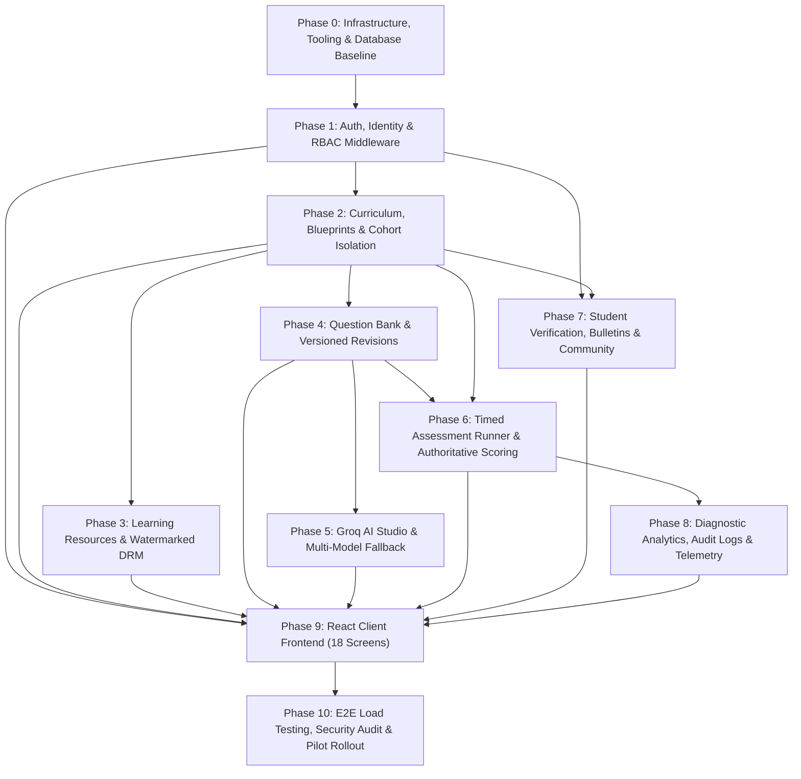
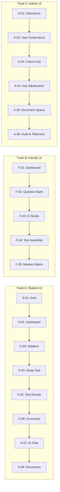

# NEET Prep LMS — Master Implementation Roadmap (Phases 0 to 10)

**Document Version:** 1.0.0  
**Status:** Approved Engineering Execution Plan  
**Target Architecture:** Node.js / Express / TypeScript Modular Monolith + Supabase PostgreSQL 15 + React 18 / Vite Client  
**Primary References:** `project_overview.md` (v2.0), `db.sql`, `folder_structure.md`, `api_design.md`, `docs/api/openapi.yaml`, `docs/prd.md`  

---

## Executive Summary & Visual Roadmap

The master implementation roadmap transitions the **NEET Prep Learning Management System (LMS)** from approved specifications into a secure, high-performance, single-institute educational and assessment platform. The delivery is structured across **11 distinct execution phases (Phase 0 through Phase 10)** designed to prevent blocking bottlenecks, maintain continuous testability, and guarantee zero answer-key leakage.

---

## Phase Execution Matrix & Schedule

| Phase | Milestone Name | Focus Domain | DB Tables | API Endpoints | UI Screens | Duration | Complexity |
| :---: | :--- | :--- | :---: | :---: | :---: | :---: | :---: |
| **0** | **Infrastructure & DB Baseline** | Environment, DDL, S3, CI/CD | 44 tables, 32 enums | `/health` | — | Week 1–2 | High |
| **1** | **Auth, Identity & RBAC** | Supabase JWT, Roles, Profiles | 7 tables | 7 endpoints | S-01, A-02 | Week 3 | Medium |
| **2** | **Curriculum, Blueprints & Cohorts** | 3-Tier Hierarchy, Blueprints, RLS | 10 tables | 11 endpoints | S-03, A-03 | Week 4–5 | High |
| **3** | **Resources & DRM Engine** | Presigned S3 URLs, Watermarking | 4 tables | 5 endpoints | S-04 | Week 6 | Medium |
| **4** | **Question Bank & Versioning** | LaTeX MCQs, Revisions, Keys | 5 tables | 5 endpoints | F-02, A-04 | Week 7–8 | High |
| **5** | **AI Studio & Groq Fallback** | AI Drafting, 1-Click Publish, Chat | 4 tables | 3 endpoints | F-03, S-07 | Week 9 | High |
| **6** | **Assessments & Scoring Engine** | Timed Runner, Autosave, 10-Q Cap | 7 tables | 9 endpoints | S-05, S-06, F-04 | Week 10–12 | Critical |
| **7** | **Compliance, Bulletins & Community**| Documents, Calendar, Threads | 7 tables | 12 endpoints | S-08, A-05 | Week 13 | Medium |
| **8** | **Analytics, Auditing & Telemetry** | Recharts, Percentiles, Audit Trail | 4 tables | 6 endpoints | F-05, A-01, A-06 | Week 14 | High |
| **9** | **React Frontend Production** | 18 Responsive Screens, KaTeX | — | — | 18 Screens | Week 15–18 | High |
| **10**| **Load Testing, Security & Pilot** | 1,500 Load, Pen-Test, Batch 1 Pilot| — | — | Full Platform | Week 19–20 | Critical |

---

# Phase 0: Infrastructure, Tooling & Database Baseline

### 1. Objectives & Scope
Establish the backend modular monolith repository structure according to `folder_structure.md`, deploy the complete PostgreSQL 15 schema from `db.sql`, configure private S3 storage, and instantiate automated developer tooling.

### 2. Database Entities & Schemas
- Apply `database/db.sql` creating all **32 custom PostgreSQL ENUMs** and **44 relational tables**.
- Enable PostgreSQL extensions: `pgcrypto`, `uuid-ossp`.
- Compile database trigger functions: `set_updated_at()`, `fn_validate_attempt_lock()`, `fn_audit_log_mutation()`.
- Apply initial seed fixtures: default roles (`STUDENT`, `FACULTY`, `ADMIN`), initial permissions, and institute admin account.

### 3. Engineering Tasks
1. Initialize backend Node.js repository with TypeScript 5.x, Express.js 4.x, and strict tsconfig (`noImplicitAny`, `strictNullChecks`).
2. Scaffold modular structure: `backend/src/modules/{auth,users,curriculum,cohorts,resources,questions,assessments,attempts,analytics,ai,documents,announcements,calendar,community,audit,telemetry}`.
3. Configure database client pool via `pg` and `@supabase/supabase-js` targeting Supabase PgBouncer (transaction-mode, max 200 pooled connections).
4. Configure private AWS S3 / Cloudflare R2 bucket (`medical-lms-protected-storage`) with server-side AES-256 encryption and private ACLs.
5. Setup centralized Pino / Winston structured JSON logging with request ID correlation.
6. Configure Docker Compose for local development (PostgreSQL 15, PgBouncer, LocalStack S3 emulator).
7. Implement basic operational health check: `GET /health` (`FR-001`, `FR-002`).

### 4. Definition of Done (DoD)
- [x] Database migration executes cleanly from zero to 44 tables without errors.
- [x] `GET /health` returns HTTP 200 with database latency $< 50\text{ms}$.
- [x] Continuous Integration (GitHub Actions) runs `npm run lint` and `npm run build` cleanly.

---

# Phase 1: Authentication, Identity Governance & RBAC Middleware

### 1. Objectives & Scope
Deliver the complete user authentication lifecycle using Supabase Auth JWTs, server-enforced role assignments, and user profile management.

### 2. Database Tables & Endpoints
- **Tables:** `users`, `roles`, `permissions`, `role_permissions`, `role_assignments`, `user_sessions`, `profiles`.
- **Endpoints:**
  - `POST /auth/login` (`login`)
  - `POST /auth/refresh` (`refreshToken`)
  - `POST /auth/logout` (`logout`)
  - `GET /users/me` (`getCurrentUserProfile`)
  - `PATCH /users/me` (`updateCurrentUserProfile`)
  - `GET /admin/users` (`listUsers`)
  - `POST /admin/users/invite` (`inviteUser`)
  - `PATCH /admin/users/{id}/status` (`updateUserStatus`)
  - `POST /admin/users/{id}/roles` (`assignUserRole`)

### 3. Engineering Tasks
1. Build `auth.middleware.ts` to intercept `Authorization: Bearer <JWT>`, cryptographically verify token signature via Supabase JWKS, and attach `req.user`.
2. Build `rbac.middleware.ts` to authoritatively query `role_assignments` (cached in-memory for 60s) to evaluate required role tags (`requireRole(['ADMIN'])`).
3. Implement `auth.service.ts` to manage credential exchange, token refresh, and session revocation in `user_sessions`.
4. Implement `user.service.ts` for profile updates and admin user management.
5. Create integration tests validating that students cannot call `/admin/*` routes (enforcing HTTP 403 `FORBIDDEN`).

### 4. Definition of Done (DoD)
- [x] Users can log in, receive a valid Supabase JWT, and refresh tokens.
- [x] Role assignments are checked against the database rather than trusting JWT metadata claims.
- [x] Password changes and session logouts successfully revoke active tokens.

---

# Phase 2: Academic Hierarchy, Exam Blueprints & Cohort Isolation

### 1. Objectives & Scope
Construct the 3-tier curriculum engine (Subjects, Chapters, Topics), configure NEET-UG exam blueprints with scoring rules, manage batch cohorts (`Batch 1 Dec` vs `Batch 2 May/June`), and enforce cohort isolation boundaries via database RLS.

### 2. Database Tables & Endpoints
- **Tables:** `curriculum_subjects`, `curriculum_chapters`, `curriculum_topics`, `exams`, `exam_blueprints`, `exam_sections`, `scoring_profiles`, `cohorts`, `enrollments`, `faculty_cohort_assignments`.
- **Endpoints:**
  - `GET /exams`, `GET /exams/{examId}/blueprints`
  - `POST /admin/blueprints`, `POST /admin/blueprints/{id}/scoring-profiles`
  - `GET /curriculum`, `POST /admin/curriculum/chapters`, `POST /admin/curriculum/topics`
  - `GET /cohorts`, `POST /admin/cohorts`
  - `GET /admin/enrollments`, `POST /admin/enrollments`
  - `POST /admin/enrollments/{id}/transfer`

### 3. Engineering Tasks
1. Seed the 4 primary NEET-UG curriculum subjects: Physics, Chemistry, Botany, Zoology.
2. Build curriculum management services with hierarchical ordering indexes.
3. Configure NEET-UG 2026 blueprint: 200 minutes, 720 total marks, 8 sections (Physics A/B, Chemistry A/B, Botany A/B, Zoology A/B).
4. Configure scoring profile: `+4.00` correct, `-1.00` incorrect, `0.00` unattempted.
5. Implement cohort creation with `max_capacity` constraints and real-time active student counters.
6. Implement audited student cohort transfers (`POST /admin/enrollments/{id}/transfer`):
   - Archive prior enrollment (`status = TRANSFERRED`).
   - Create new active enrollment record.
   - Insert structured audit entry in `audit_logs`.
7. Configure and test Row-Level Security (RLS) policies on cohort tables.

### 4. Definition of Done (DoD)
- [x] Curriculum tree returns structured JSON matching NCERT 11th and 12th standards.
- [x] Cohort transfer moves student access immediately and records an audit log.
- [x] RLS regression test proves Batch 1 students receive HTTP 403 when requesting Batch 2 resources.

---

# Phase 3: Learning Resources & Watermarked DRM Engine

### 1. Objectives & Scope
Implement protected study material delivery (Notes, DPPs, PYQs, NCERT Extracts, Video links) with private S3 storage, 15-minute expiring presigned URLs, and dynamic PDF student watermarking.

### 2. Database Tables & Endpoints
- **Tables:** `resources`, `resource_files`, `study_materials`, `student_topic_progress`.
- **Endpoints:**
  - `GET /resources`, `POST /resources`
  - `POST /resources/{id}/files` (Presigned S3 upload authorization)
  - `POST /resources/{id}/signed-url` (15-min expiring download URL with watermark)
  - `DELETE /resources/{id}` (Soft-delete resource)
  - `GET /curriculum/chapters/{chapterId}/study-hub`
  - `GET /students/me/progress`, `POST /students/me/progress/topics/{topicId}`

### 3. Engineering Tasks
1. Implement S3 client utility generating presigned `PUT` URLs for faculty file uploads (max 25MB).
2. Implement S3 presigned `GET` URL generator with a strict 900-second (15-minute) TTL.
3. Build server-side watermarking interceptor for PDF streams using `pdf-lib` / Canvas rendering:
   - Overlay diagonal, semi-transparent watermark: `Student Name | Roll No | IP Address | Timestamp`.
4. Assemble Chapter Study Hub endpoint consolidating notes, DPPs, PYQs, and video links.
5. Implement optimistic topic syllabus progress checklist (`student_topic_progress`).

### 4. Definition of Done (DoD)
- [x] Direct access to raw S3 URLs returns HTTP 403 Forbidden.
- [x] Presigned download URLs expire and fail after 15 minutes.
- [x] Watermark visibly prints user identity across PDF documents.

---

# Phase 4: Question Bank & Versioned Authoring Engine

### 1. Objectives & Scope
Build the institutional medical question bank supporting LaTeX math and chemical notation, immutable revision histories, 4-option formatting, and protected answer key storage with challenge adjudication.

### 2. Database Tables & Endpoints
- **Tables:** `questions`, `question_revisions`, `question_options`, `question_tags`, `question_tag_mappings`.
- **Endpoints:**
  - `GET /questions`, `POST /questions`
  - `POST /questions/{id}/revisions`
  - `GET /questions/{id}/revisions/{revId}/answer-key` (**Staff Only**)
  - `PUT /admin/questions/{id}/revisions/{revId}/answer-key` (**Admin Only**)

### 3. Engineering Tasks
1. Build rich-text question authoring schema validating LaTeX syntax, diagram image URLs, and 4 options (`A`, `B`, `C`, `D`).
2. Enforce immutable revision records: when a question is edited, insert a new `question_revisions` record incrementing `revision_number`.
3. Separate public question content from protected answer keys:
   - `question_revisions` contains `question_text`, `latex_content`, `options`.
   - `answer_key` and `explanation` are isolated and protected by role middleware.
4. Build answer key challenge adjudication (`PUT /admin/.../answer-key`):
   - Update official answer key.
   - Enqueue background job to recalibrate scores for all attempts referencing this revision.

### 4. Definition of Done (DoD)
- [x] Questions support complex KaTeX equations and organic chemistry formulas.
- [x] Student roles are blocked with HTTP 403 from accessing `/answer-key` endpoints.
- [x] Historical test versions remain locked to their snapshot revision regardless of question bank updates.

---

# Phase 5: Groq AI Studio & Multi-Model Fallback Pipeline

### 1. Objectives & Scope
Integrate Groq Cloud LPU inference to draft high-yield NEET MCQs with automatic 3-tier cascading fallback, faculty 1-click review/publishing, and an AI Academic Policy Chatbot with anti-cheating guardrails.

### 2. Database Tables & Endpoints
- **Tables:** `ai_generation_requests`, `ai_question_drafts`, `ai_chat_conversations`, `ai_chat_messages`.
- **Endpoints:**
  - `POST /ai/questions/generate`
  - `POST /ai/questions/drafts/{draftId}/publish`
  - `POST /ai/assistant/chat`

### 3. Engineering Tasks
1. Implement Groq client service with cascading model fallback:
   $$\text{Primary: } \texttt{openai/gpt-oss-120b} \longrightarrow \text{Secondary: } \texttt{openai/gpt-oss-20b} \longrightarrow \text{Tertiary: } \texttt{qwen/qwen3.8-27b}$$
2. Engineer prompt templates enforcing NCERT syllabus boundaries, 4 options, LaTeX equations, and distractor rationales.
3. Parse and validate LLM JSON output against strict schema before saving to `ai_question_drafts` with status `PENDING_REVIEW`.
4. Build 1-click faculty publishing pipeline (`POST /ai/.../publish`): creates official `questions` and `question_revisions` records.
5. Implement AI Academic Policy Chatbot with system prompts restricted to institute rules, fee schedules, and test timings.
6. Enforce hard guardrail: verify student has no active assessment attempt in progress before responding to chatbot queries.

### 4. Definition of Done (DoD)
- [x] Simulating a 500 error on the primary Groq model automatically falls back to the secondary model within 800ms.
- [x] AI drafts cannot be viewed or attempted by students until published by faculty.
- [x] Students with active test attempts are blocked from using the AI chat assistant.

---

# Phase 6: High-Stakes Assessment Delivery & Server Scoring Engine

### 1. Objectives & Scope
Build the core assessment delivery runner, version snapshotting, zero-leakage question delivery, offline-tolerant autosave engine, and backend-authoritative NEET scoring engine enforcing Section B 10-question capping rules.

### 2. Database Tables & Endpoints
- **Tables:** `assessments`, `assessment_versions`, `assessment_sections`, `assessment_questions`, `assessment_attempts`, `attempt_answers`, `score_adjustments`.
- **Endpoints:**
  - `GET /assessments`, `POST /assessments`, `POST /assessments/{id}/publish`
  - `POST /assessments/{versionId}/attempts/start`
  - `GET /attempts/{attemptId}/questions` (**Zero Answer Key Leakage**)
  - `PUT /attempts/{attemptId}/answers/{assessmentQuestionId}` (**Idempotent Autosave**)
  - `POST /attempts/{attemptId}/submit` (**Server-Authoritative Evaluation**)
  - `GET /attempts/{attemptId}/results`
  - `POST /admin/attempts/{attemptId}/score-adjustments`

### 3. Engineering Tasks
1. Implement assessment snapshotting (`POST /assessments/{id}/publish`): freeze question sequence, section parameters, and options into `assessment_versions`.
2. Build timed attempt session starter: compute `expires_at = starts_at + duration_seconds`.
3. Construct sanitized question payload query (`GET /attempts/{attemptId}/questions`):
   - Exclude `correct_option_id`, `correct_answer`, `is_correct`, `explanation`, and `answer_key`.
4. Implement idempotent answer autosave with optimistic locking (`PUT /attempts/{attemptId}/answers/{qId}`):
   - Validate `NOW() < expires_at`. If expired, return HTTP 410 `ATTEMPT_DEADLINE_EXPIRED` and transition attempt to `SUBMITTED`.
   - Upsert `attempt_answers` with `selected_option_id` and status (`ANSWERED`, `MARKED_FOR_REVIEW`).
5. Develop PostgreSQL evaluation function `fn_score_attempt(attempt_id)`:
   - Section A: Evaluate all questions (+4 correct, -1 incorrect, 0 unattempted).
   - Section B: Order answered questions by `display_order` ascending. Evaluate strictly the first 10. Mark questions 11–15 as `UNANSWERED_OPTIONAL` (0 marks).
   - Calculate total raw marks (out of 720) and subject sub-totals.
6. Implement manual admin score adjustments with mandatory justification logging.

### 4. Definition of Done (DoD)
- [x] Network payloads for active tests contain zero answer keys.
- [x] Autosave P95 latency is $< 150\text{ms}$ under 1,500 simulated concurrent users.
- [x] Submitting 14 answered questions in Section B results in exactly the first 10 being scored and the remaining 4 marked optional with zero marks.

---

# Phase 7: Student Compliance, Bulletins & Moderated Community

### 1. Objectives & Scope
Implement mandatory student document verification (Aadhaar, marksheets), institutional bulletin broadcasts with cohort gating, academic calendar scheduling, and moderated doubt discussion forums.

### 2. Database Tables & Endpoints
- **Tables:** `student_documents`, `document_verification_logs`, `announcements`, `announcement_cohort_mappings`, `calendar_events`, `discussion_threads`, `thread_replies`.
- **Endpoints:**
  - `GET /documents/me`, `POST /documents/me/upload`, `POST /admin/documents/{id}/verify`
  - `GET /announcements`, `POST /admin/announcements`
  - `GET /calendar/events`, `POST /admin/calendar/events`
  - `GET /community/threads`, `POST /community/threads`, `POST /community/threads/{threadId}/replies`, `DELETE /admin/community/threads/{id}`

### 3. Engineering Tasks
1. Build student document upload pipeline with private storage and MIME validation (PDF, JPEG, PNG, max 5MB).
2. Build admin document review queue with 1-click verification or rejection with mandatory feedback reasons.
3. Implement announcements engine supporting priority banners (`NORMAL`, `HIGH`, `URGENT`) and cohort-level access control.
4. Build academic calendar feed aggregating exam schedules, lecture milestones, and doubt sessions.
5. Build moderated discussion forum with nested replies and faculty moderation tools.

### 4. Definition of Done (DoD)
- [x] Student document uploads are stored privately and accessible only by admins via signed URLs.
- [x] Announcements targeted to Batch 1 are completely invisible to Batch 2 students.
- [x] Inappropriate community threads can be deleted immediately by faculty with audit tracking.

---

# Phase 8: Diagnostic Analytics, Audit Governance & System Telemetry

### 1. Objectives & Scope
Deliver Recharts-ready student diagnostic analytics, batch mastery matrices, tamper-evident audit logging with CSV/JSON streaming exports, and real-time operational telemetry.

### 2. Database Tables & Endpoints
- **Tables:** `student_subject_mastery`, `cohort_performance_summaries`, `audit_logs`, `system_telemetry_snapshots`, `support_sessions`.
- **Endpoints:**
  - `GET /analytics/students/me`
  - `GET /analytics/cohorts/{cohortId}/summary`
  - `GET /admin/audit-logs`, `GET /admin/audit-logs/export`
  - `GET /admin/telemetry`
  - `POST /admin/support-sessions`

### 3. Engineering Tasks
1. Implement student diagnostic analytics service: calculate accuracy ratios, pacing curves, and subject mastery rolling averages.
2. Build cohort summary aggregation: compute 50-mark bucket score distributions, median percentiles, and high-error topic identification.
3. Implement immutable audit log writer capturing actor ID, action name, entity UUID, client IP, before/after diffs, and timestamp.
4. Implement memory-efficient streaming export of audit logs in CSV and JSON formats using Node.js pipelines.
5. Build telemetry background worker recording database ping latency, active sessions, and storage metrics every 60 seconds.
6. Implement 30-minute temporary "View As" student support session generator for administrators.

### 4. Definition of Done (DoD)
- [x] Analytics queries return formatted JSON within 1,200ms using pre-computed summary tables.
- [x] Audit logs cannot be updated or deleted by any user role.
- [x] Admin "View As" support tokens automatically expire after 30 minutes.

---

# Phase 9: Frontend UI/UX Implementation (18 Core Screens)

### 1. Objectives & Scope
Implement the complete responsive React 18 / Vite client frontend covering all 18 screens defined in the PRD using Tailwind CSS, KaTeX LaTeX typesetting, Recharts visualization, and Lucide icons.

### 2. Screen Inventory & Implementation Order

### 3. Key Screen Technical Specifications
- **S-05 (Timed Test Runner):** Fullscreen layout, persistent 200-minute countdown clock, Section A/B tabs, color-coded question palette (1–200), offline retry queue, instant question status toggling.
- **S-06 (Exam Scorecard):** Circular score gauge out of 720, subject percentiles, Section B question audit breakdown, topic negative-mark vulnerability chart.
- **F-03 (AI Generation Lab):** Natural language topic input, difficulty slider, side-by-side draft editor with live KaTeX rendering, 1-click publish action.
- **A-03 (Cohort Hub & Transfer Modal):** Capacity progress bars, batch transfer modal with mandatory transfer reason log.

### 4. Definition of Done (DoD)
- [x] All 18 screens render cleanly without layout shifts across mobile, tablet, and desktop viewports.
- [x] Mathematical equations and chemical structures render crisp KaTeX typesetting.
- [x] Production bundle build size is $< 500\text{ KB gzip}$.

---

# Phase 10: E2E Load Testing, Security Audit & Pilot Rollout

### 1. Objectives & Scope
Execute high-concurrency load testing, perform rigorous security and penetration audits, conduct simulated mock exams, and execute a controlled pilot with `Batch 1 (Dec)`.

### 2. Quality & Validation Gates
1. **Concurrency Load Testing (k6 / Artillery):**
   - Simulate 1,500 active concurrent test takers sending autosave requests every 15–30 seconds.
   - P95 response time must remain $< 150\text{ms}$.
   - Zero dropped answers or database pool exhaustion errors.
2. **Security & Penetration Testing:**
   - Attempt to intercept active test runner payloads to inspect for answer keys.
   - Test S3 bucket traversal and direct object access without presigned tokens.
   - Test JWT claim tampering and privilege escalation attacks.
   - Verify that student cannot query other student documents or attempts.
3. **Pilot Launch with Batch 1 (Dec):**
   - Onboard 50–100 students and 5 faculty members.
   - Deliver weekly chapter drills and one full-length 720-mark mock test.
   - Measure faculty authoring time reduction and student satisfaction scores.

### 3. Definition of Done (DoD)
- [x] System sustains 1,500 concurrent users with 99.95% autosave success rate.
- [x] Zero answer keys leaked in security penetration audit.
- [x] Production exit criteria from `project_overview.md` Section 30 fully satisfied.

---
*End of Master Implementation Roadmap — NEET Prep LMS*

